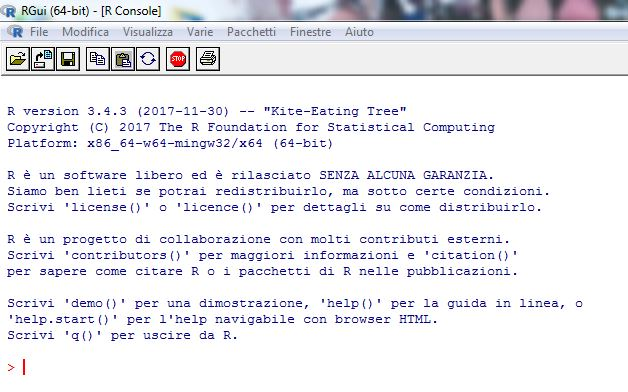

::: {.callout-note appearance="simple"}
## How to read the examples

Every example comes in three tabs: **R**, **Python** and **SAS**. Pick a language once and the choice is kept across every page of the site.

- The **R** and **Python** code is run each time the site is rebuilt, so the results shown are the real ones (R 4.x; Python 3.x with *numpy*, *pandas*, *matplotlib* and *statsmodels*).
- The **SAS** code is not run automatically, because SAS requires a licence. You can try it for free with [SAS OnDemand for Academics](https://www.sas.com/en_us/software/on-demand-for-academics.html). Vector and matrix operations use **PROC IML**, the SAS matrix language.
- The data files mentioned in the text are in the [`data/`](https://github.com/erasmovassallo/statistica-economica/tree/main/data) folder of the repository.
:::

## 1.1 R: an open-source statistical environment {#sec-r}

**R** is an open-source statistical computing environment released under the GNU-GPL licence. It is built on an object-oriented programming language and is by now well known well beyond specialist circles. It was created in 1996 by Ross Ihaka and Robert Gentleman at the University of Auckland as an offshoot of the S statistical language; indeed, at first most routines ran on either platform without any changes to the code. It is no coincidence that John M. Chambers, one of the creators of S, has been among the most active programmers supporting **R**.

More recent versions of **R**, however, have moved further away from S, emphasising the distinctive features of a language whose main strength is that it is entirely free. This is the real key to the success of **R**, which today offers a vast and ever-growing library of statistical routines, continually contributed by occasional programmers, experts and ordinary users alike: more than 10,000 packages at the beginning of 2018. It is therefore no surprise that on 7 January 2009 the prestigious *New York Times* ran an [article](http://www.nytimes.com/2009/01/07/technology/business-computing/07program.html) devoted to **R** and its growing popularity among statisticians.

For these reasons, this book pays specific attention to **R**, with reference to release 3.4.3 (64-bit Microsoft Windows version), the latest at the time of writing. The commands used, however, also work with other versions of the software without any significant changes.

Files, data, additional materials, updates and errata for the book are available at <http://www.unipa.it/persone/docenti/v/erasmo.vassallo/testo18a>.

To begin with, Figure 1.1 shows the **R** start-up window with the cursor at the command line. Note that there are additional programs (almost always free or open source) that make the software easier to use through a minimal graphical interface and/or help with managing packages and the online help files; [RStudio](https://posit.co/products/open-source/rstudio/) is one of the most popular. In any case, we keep to the command line, in keeping with the original philosophy of **R** and because it allows much greater flexibility with highly customisable scripts and commands.

{width=75%}

::: {.callout-tip collapse="true"}
## Python and SAS: the equivalent environments

- **Python** is a general-purpose, open-source language; for statistical analysis the main libraries are *numpy* (vectors and matrices), *pandas* (data tables), *matplotlib* (graphics) and *statsmodels* (statistical models). The most common environments are Jupyter, VS Code and RStudio/Positron itself.
- **SAS** is commercial software, widely used in business, banking and official statistics. You work with *programs* made of `DATA` steps (data management) and `PROC` procedures (analysis). The *SAS Studio* web interface is included in SAS OnDemand for Academics.
:::

In this book we will not dwell on a general introduction to **R** or on the generic use of its basic commands, unless they are useful for, or directly serve, the specific topics covered. The software is in fact familiar to the typical reader of this book, since many degree programmes in statistics, and certainly the Statistics programme at the University of Palermo, offer dedicated computer-literacy courses. Nevertheless, readers with less experience will still be able to follow the book by making use of the many excellent guides available online in several languages; in English, good starting points are [*An Introduction to R*](https://cran.r-project.org/doc/manuals/r-release/R-intro.html), the official manual, and the Italian-language guides by V. Muggeo and G. Ferrara ([*Nozioni di R*](https://cran.r-project.org/doc/contrib/nozioniR.pdf)) and by A.M. Mineo ([*Dispensa di R*](https://cran.r-project.org/doc/contrib/Mineo-dispensaR.pdf)).

Here, as a starting point for whatever further study readers find necessary, we present a few simple commands that illustrate how **R** works.

## 1.2 Assignment and workspace management {#sec-workspace}

Starting with value assignment, the command `x <- 4` assigns the value 4 to $x$. Remember that **R** is *case-sensitive*, that is, $x$ is different from $X$. In the same way, `y <- c(2,7,4,1)` assigns the values (2, 7, 4, 1) to the vector $y$.

::: {.panel-tabset group="language"}
### R

```{r}
x <- 4
y <- c(2, 7, 4, 1)
x
y
```

### Python

```{python}
import numpy as np

x = 4
y = np.array([2, 7, 4, 1])   # numeric vectors are built with numpy
print(x)
print(y)
```

### SAS

```sas
proc iml;                    /* the SAS matrix environment */
  x = 4;
  y = {2, 7, 4, 1};          /* column vector */
  print x, y;
quit;
```
:::

While `ls()` lists the contents of the workspace, `rm(PIL)` removes the variable *PIL* from memory, provided of course that an object with that name already exists. To remove every variable whose name contains PIL, we would write `rm(list=ls(pat="PIL"))`. Likewise, `save(list=ls(), file="save.rda")` saves the whole workspace to a file called *save.rda*. To delete all the data and variables in memory, clearing the entire workspace, we would write `rm(list=ls())`.

Once saved, for instance in *prova.rda*, the data can be loaded into a new **R** session simply with `load("prova.rda")`. After a series of computations, we may want to save only the objects $V1$ and $V2$, with `save(V1, V2, file="save2.rda")`. To store a complete snapshot of memory, including data and variables, we can use `save.image()`.

::: {.panel-tabset group="language"}
### R

```{r}
#| eval: false
ls()                               # workspace contents
rm(PIL)                            # remove the object PIL
rm(list = ls(pat = "PIL"))         # remove objects whose name contains "PIL"
save(list = ls(), file = "save.rda")   # save the whole workspace
rm(list = ls())                    # clear the workspace
load("prova.rda")                  # reload saved objects
save(V1, V2, file = "save2.rda")   # selective save
save.image()                       # full snapshot (.RData file)
```

### Python

```{python}
#| eval: false
import pickle

[n for n in dir() if not n.startswith("_")]   # defined objects (in Jupyter: %who)
del PIL                                       # remove the object PIL

# remove objects whose name contains "PIL"
for n in [n for n in list(globals()) if "PIL" in n]:
    del globals()[n]

# selective save and load with pickle
with open("save2.pkl", "wb") as f:
    pickle.dump({"V1": V1, "V2": V2}, f)
with open("save2.pkl", "rb") as f:
    objects = pickle.load(f)

# Python has no real "save.image()": to save a whole session
# you can use the dill library (dill.dump_session("session.pkl")).
```

### SAS

```sas
/* Matrix objects in PROC IML */
proc iml;
  show names;            /* list matrices in memory (≈ ls()) */
  free PIL;              /* remove the matrix PIL (≈ rm(PIL)) */
  store V1 V2;           /* selective save (≈ save(V1, V2, ...)) */
  store _all_;           /* save all matrices (≈ save.image()) */
  free _all_;            /* clear memory (≈ rm(list = ls())) */
  load _all_;            /* reload saved matrices (≈ load()) */
quit;

/* Datasets in the temporary WORK library */
proc datasets library=work;
  delete PIL;            /* delete the dataset PIL */
  delete PIL:;           /* delete datasets whose name STARTS with PIL */
quit;
```

In SAS the working "memory" is the temporary `WORK` library, which is emptied at the end of the session; to keep data you use a permanent library (`libname mylib "path";`).
:::

## 1.3 Vectors, matrices, functions and data frames {#sec-matrices}

Let us continue with more examples in **R**. Readers can type in the commands and check how they behave.

::: {.panel-tabset group="language"}
### R

```{r}
#| error: true
x <- 4
y <- c(2, 7, 4, 1)
x * Y
```

### Python

```{python}
#| error: true
x * Y
```

### SAS

```sas
proc iml;
  x = 4;
  y = {2, 7, 4, 1};
  z = x * Y;     /* no error: SAS is NOT case-sensitive */
  print z;
quit;
```
:::

The result is not what we expected, because $Y$ does not exist. Indeed, $y$ and $Y$ are not the same object. As mentioned, **R** is case-sensitive; users familiar with programming languages or Unix systems will not be surprised. Python is case-sensitive too, whereas SAS is not: in SAS, `y` and `Y` refer to the same object.

The correct product, a scalar times a vector, gives a vector. Conversely, $y$ times its transpose gives a scalar. Note the matrix product operator `%*%` and the transpose function `t()`. Whereas a row vector times a column vector gives a scalar, a column vector times a row vector gives a matrix.

::: {.panel-tabset group="language"}
### R

```{r}
x * y
t(y) %*% y
z <- y %*% t(y)
z
```

### Python

```{python}
print(x * y)
print(y @ y)            # inner product: @ is the matrix product
z = np.outer(y, y)      # column vector times row vector
print(z)
```

### SAS

```sas
proc iml;
  x = 4;
  y = {2, 7, 4, 1};
  a = x * y;
  b = t(y) * y;        /* in IML * is the matrix product; y` is the transpose */
  z = y * t(y);
  print a, b, z;
quit;
```
:::

Matrices can also be built by filling. The command `matrix(1:30,5,6)` defines a matrix containing the values 1 to 30 in 5 rows and 6 columns. Similarly, to fill a $2 \times 3$ matrix with zeros we would write `matrix(0,2,3)`, while a $3 \times 3$ unit diagonal matrix (the identity matrix) is `diag(1,3,3)`.

::: {.panel-tabset group="language"}
### R

```{r}
a <- matrix(1:30, 5, 6)
a
matrix(0, 2, 3)
diag(1, 3, 3)
```

### Python

```{python}
# R fills matrices by column: numpy needs order="F"
a = np.arange(1, 31).reshape(5, 6, order="F")
print(a)
print(np.zeros((2, 3)))
print(np.eye(3))
```

### SAS

```sas
proc iml;
  /* shape() fills by row: build a 6x5 matrix and transpose it */
  a = t(shape(1:30, 6, 5));
  zeros = j(2, 3, 0);      /* 2x3 matrix of zeros */
  id = I(3);               /* 3x3 identity matrix */
  print a, zeros, id;
quit;
```
:::

::: {.callout-warning}
## Mind the filling order
**R** fills matrices **by column**, whereas *numpy* and the SAS/IML `shape()` function fill them **by row**. To obtain the same matrix you need `order="F"` in Python and a transpose in SAS.
:::

One of the most interesting features of **R** is the ability to define new commands through functions. For example, `sm <- function(a,b) a+b` defines a function that adds the arguments $a$ and $b$; a function with more than one statement must be enclosed in curly braces. So `sm(6,8)` returns the sum 14.

::: {.panel-tabset group="language"}
### R

```{r}
sm <- function(a, b) a + b
sm(6, 8)
```

### Python

```{python}
def sm(a, b):
    return a + b

sm(6, 8)
```

### SAS

```sas
proc iml;
  start sm(a, b);          /* define an IML function (module) */
    return(a + b);
  finish;
  s = sm(6, 8);
  print s;
quit;
```
:::

Now let us build an object *dati* (data) as a `data.frame()`, entering the values directly at the command line, to fill a matrix with 5 rows and 2 columns, $X1$ and $X2$. The object $X1$ does not exist unless it is called from within *dati*, either by the variable name or by the position of the column vector. Note that `#` lets you add comments, which the software ignores.

::: {.panel-tabset group="language"}
### R

```{r}
#| error: true
dati <- data.frame(matrix(c(3, 6, 8, 9, 1, 4, 3, 6, 7, 8), 5, 2))
dati
X1        # the object X1 does not exist
dati$X1
dati[, 1]
```

### Python

```{python}
#| error: true
import pandas as pd

dati = pd.DataFrame(
    np.array([3, 6, 8, 9, 1, 4, 3, 6, 7, 8]).reshape(5, 2, order="F"),
    columns=["X1", "X2"],
)
print(dati)
X1        # the object X1 does not exist
```

```{python}
print(dati["X1"].to_numpy())       # by name
print(dati.iloc[:, 0].to_numpy())  # by position (Python counts from 0)
```

### SAS

```sas
data dati;                 /* in SAS, data tables are created with a DATA step */
  input X1 X2;
  datalines;
3 4
6 3
8 6
9 7
1 8
;
run;

proc print data=dati; run;
proc print data=dati; var X1; run;   /* column X1 only */
```
:::

The last command displays all the values in the first column, whatever the row. To display all the values in the first row we would write `dati[1,]`, while to display the single value in the second row and first column we would write `dati[2,1]`.

::: {.panel-tabset group="language"}
### R

```{r}
dati[1, ]
dati[2, 1]
```

### Python

```{python}
print(dati.iloc[[0], :])   # first row
print(dati.iloc[1, 0])     # second row, first column
```

### SAS

```sas
proc print data=dati(obs=1); run;                     /* first row */
proc print data=dati(firstobs=2 obs=2); var X1; run;  /* second row, first column */
```
:::

If, however, we want to work directly with the values in *dati* without referring to the data frame that contains them every time, we can use `attach()`. The reverse operation is `detach()`.

::: {.panel-tabset group="language"}
### R

```{r}
attach(dati)
X1
X2
detach(dati)
```

### Python

```{python}
# Python has no equivalent of attach(): extract the columns instead
X1, X2 = dati["X1"].to_numpy(), dati["X2"].to_numpy()
print(X1)
print(X2)
```

### SAS

```sas
/* Not needed in SAS: inside a DATA step, or a PROC with data=dati,
   variables are referred to directly by name */
data _null_;
  set dati;
  put X1= X2=;
run;
```
:::

Furthermore, if `matrix(1:6,2,3)` is a matrix with 2 rows and 3 unnamed columns, and `VX` and `VY` hold the column and row labels respectively, the `dimnames` argument lets us set the row and column names. (The labels mean *low*, *medium*, *high* and *short*, *long*.)

::: {.panel-tabset group="language"}
### R

```{r}
matrix(1:6, 2, 3)
VX <- c("basso", "medio", "alto")
VY <- c("corto", "lungo")
matrix(1:6, 2, 3, dimnames = list(VY, VX))
```

### Python

```{python}
VX = ["basso", "medio", "alto"]
VY = ["corto", "lungo"]
pd.DataFrame(np.arange(1, 7).reshape(2, 3, order="F"), index=VY, columns=VX)
```

### SAS

```sas
proc iml;
  m  = t(shape(1:6, 3, 2));
  VX = {"basso" "medio" "alto"};
  VY = {"corto" "lungo"};
  print m[rowname=VY colname=VX];
quit;
```
:::

Data are usually not typed in at the command line but read from external files. Two widely used commands are `read.table` and `write.table`, which read and write tabular data respectively. **R** can also read and write data in the formats of the best-known statistical packages, in most cases through dedicated packages. For instance, the file *pil.csv* (Italian GDP, used in later chapters) uses the semicolon as separator, following the Italian convention, and is read with `read.csv2()`.

::: {.panel-tabset group="language"}
### R

```{r}
pil <- read.csv2("data/pil.csv")
head(pil)
# write.csv2(pil, "pil_copy.csv", row.names = FALSE)   # writing
```

### Python

```{python}
pil = pd.read_csv("data/pil.csv", sep=";", decimal=",")
print(pil.head())
# pil.to_csv("pil_copy.csv", sep=";", decimal=",", index=False)   # writing
```

### SAS

```sas
proc import datafile="data/pil.csv" out=pil dbms=dlm replace;
  delimiter=";";
  getnames=yes;
run;
proc print data=pil(obs=6); run;

/* writing */
proc export data=pil outfile="pil_copy.csv" dbms=dlm replace;
  delimiter=";";
run;
```

In SAS OnDemand for Academics, files must first be uploaded to your personal space and the path adjusted accordingly (e.g. `"/home/u1234567/data/pil.csv"`).
:::

## 1.4 First statistical computations {#sec-statistics}

For our purposes, let us work through a few examples of statistical computation. Given a set of data $X$, we compute the absolute and relative frequencies. The syntax needs no explanation.

::: {.panel-tabset group="language"}
### R

```{r}
X <- c(4, 6, 8, 3, 3, 7, 9, 6, 3, 1, 2, 6, 8, 9, 5, 3)
table(X)
table(X) / length(X)
```

### Python

```{python}
X = pd.Series([4, 6, 8, 3, 3, 7, 9, 6, 3, 1, 2, 6, 8, 9, 5, 3], name="X")
print(X.value_counts().sort_index())
print(X.value_counts(normalize=True).sort_index())
```

### SAS

```sas
data es;
  input X @@;              /* @@ reads several values from the same line */
  datalines;
4 6 8 3 3 7 9 6 3 1 2 6 8 9 5 3
;
run;

proc freq data=es;
  tables X;                /* absolute, relative (%) and cumulative frequencies */
run;
```
:::

To display a histogram of the data in $X$, the command `hist(X)` produces the chart shown in Figure 1.2. **R** allows extensive customisation of its graphics. Readers can try standard commands such as `plot()`, `boxplot()` or `pie()`, to name just a few.

::: {.panel-tabset group="language"}
### R

```{r}
#| fig-cap: "Figure 1.2 – Example of a histogram"
hist(X)
```

### Python

```{python}
#| fig-cap: "Figure 1.2 – Example of a histogram"
import matplotlib.pyplot as plt

plt.figure(figsize=(5, 5))
plt.hist(X, bins=range(1, 10), edgecolor="black", color="lightgrey")
plt.title("Histogram of X")
plt.xlabel("X")
plt.ylabel("Frequency")
plt.show()
```

### SAS

```sas
proc sgplot data=es;
  histogram X / scale=count;
run;
```
:::

::: {.callout-note}
Each package chooses histogram classes in its own way: R closes them on the right, (a, b], whereas *matplotlib* and SAS close them on the left. With discrete data like these, bar heights may therefore differ slightly.
:::

A general description of the dataset $X$ is given by `summary()`, a very useful command for summarising and displaying the main results of any statistical analysis. In our example, it reports some descriptive statistics.

::: {.panel-tabset group="language"}
### R

```{r}
summary(X)
```

### Python

```{python}
print(X.describe())
```

### SAS

```sas
proc means data=es min q1 median mean q3 max maxdec=3;
  var X;
run;
```
:::

::: {.callout-warning}
## Quartiles: three packages, different definitions
By default R and *pandas* compute quartiles with the same method (linear interpolation, *type 7* in R): $Q_3 = 7.25$. SAS uses a different default definition (`QNTLDEF=5`) and returns $Q_3 = 7.5$, the same value R gives with `quantile(X, type = 2)`. This is not an error: there are several definitions of the sample quantile.

```{r}
quantile(X, type = 2)
```
:::

To show how useful `summary()` is, we will apply it to a regression model. For this purpose, we load the *cars* data from the *datasets* package, which ships with **R**. The command for estimating a linear regression is `lm()`; the tilde `~` separates the dependent variable from the explanatory ones.

::: {.panel-tabset group="language"}
### R

```{r}
data(cars)
modello <- lm(dist ~ speed, data = cars)
summary(modello)
```

### Python

```{python}
import statsmodels.formula.api as smf

cars = pd.read_csv("data/cars.csv")       # the same data as in R, saved in data/
modello = smf.ols("dist ~ speed", data=cars).fit()
print(modello.summary())
```

### SAS

```sas
/* Beware: SASHELP.CARS is a different dataset! Import the R data instead */
proc import datafile="data/cars.csv" out=cars dbms=csv replace;
  getnames=yes;
run;

proc reg data=cars;
  model dist = speed;
run;
quit;
```
:::

In this way, **R** displays the estimates and a first set of diagnostics on the goodness of fit of the linear model between *dist* (the distance needed to stop the car) and *speed* (the speed of the same car); we will return later to the statistics produced by `lm()`.

Finally, the commands `plot(cars, main="Regression line")` and `abline(modello)` draw the scatter plot of *dist* against *speed* and add the regression line estimated by OLS (Figure 1.3); note that `abline()` requires the graphics device to be already open.

::: {.panel-tabset group="language"}
### R

```{r}
#| fig-cap: "Figure 1.3 – Example of a regression line"
plot(cars, main = "Regression line")
abline(modello)
```

### Python

```{python}
#| fig-cap: "Figure 1.3 – Example of a regression line"
b0, b1 = modello.params
plt.figure(figsize=(5, 5))
plt.scatter(cars["speed"], cars["dist"], facecolors="none", edgecolors="black")
plt.axline((0, b0), slope=b1, color="black")   # equivalent of abline()
plt.title("Regression line")
plt.xlabel("speed")
plt.ylabel("dist")
plt.show()
```

### SAS

```sas
proc sgplot data=cars;
  title "Regression line";
  reg x=speed y=dist;      /* scatter plot + OLS line */
run;
```
:::

It is not our aim here to describe further features and functions of **R**; rather, this first chapter provides a general, admittedly incomplete overview that is nonetheless sufficient for the purposes of the book.
