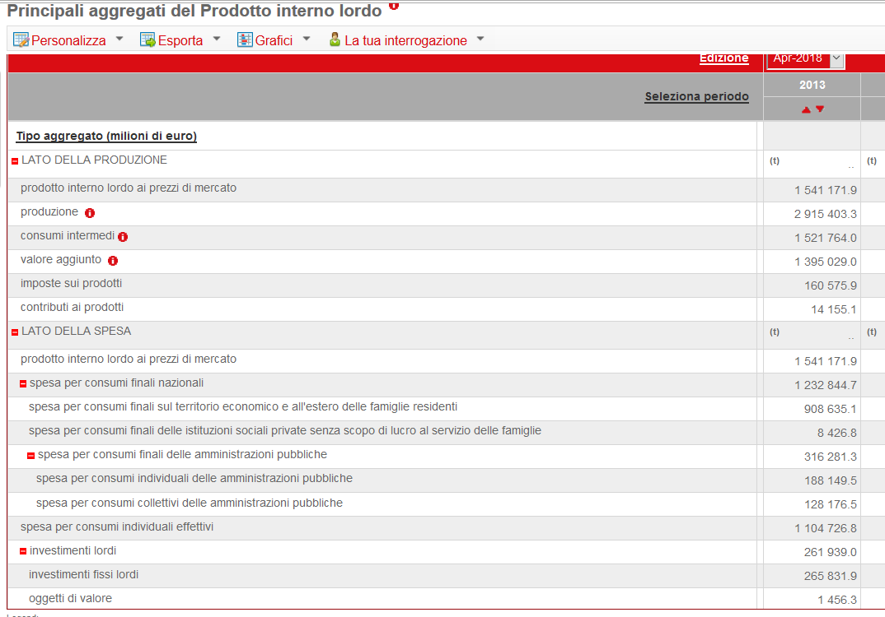

## 2.1 The System of National Accounts {#sec-esa2010}

The System of National Accounts sets out, in accounting terms, the economic and financial activities of an entire country or of parts of it; in the latter case the term Regional Accounts is preferred, although the reference framework is of course that of the National Accounts. The accounts may refer to a year or to a fraction of it (usually a quarter).

National Accounts are defined under the European rules of ESA 2010 (SEC2010 in Italian), which in September 2014 replaced the earlier ESA 95, in line with the international guidelines laid down in the United Nations System of National Accounts.

ESA 2010 therefore lays down, systematically and in detail, how the quantities describing the accounting workings of a country are defined and measured. It is, in essence, an integrated system of economic accounts, since it relies on accounting conventions that are uniform across European countries, with the aim of measuring the economic transactions that take place within each nation.

ESA follows the logic of double-entry bookkeeping: every item is recorded as an outflow for the unit that originates it and as an inflow for the unit that receives it. All accounts therefore record incoming and outgoing transactions that are balanced by an appropriate balancing item. Since the accounts are built in sequence, the balancing item of one account is carried over to the next. They record the production, distribution and redistribution transactions of the actors involved: essentially households, firms, general government and the rest of the world.

Compared with the previous 1995 version (in force from 1999), ESA 2010 introduces some important differences in both scope and concepts. In particular: research and development expenditure is capitalised; military expenditure by general government is reclassified from intermediate consumption to investment; a different technique is used to estimate trade with other countries in goods sent for processing (only the value of the processing service is recorded); and the units classified as general government are updated and checked. In addition, there is a series of small technical changes in the calculation of some aggregates, with limited practical effect, and a somewhat larger one related to the inclusion of all income-producing activities, illegal ones included (a principle already stated in ESA 95). Specifically, estimates of drug trafficking, prostitution and the smuggling of cigarettes and alcohol are introduced. Finally, compared with its predecessor, ESA 2010 makes greater use of different information sources and of administrative data, with a general improvement in all estimates, including those of the underground and irregular economy. Naturally, applying ESA 2010 retrospectively, that is, to data for earlier years released under ESA 95, led to some revisions of the time series, with a general upward revision of some macroeconomic aggregates.

In a simplified presentation that remains closely linked to the earlier version, ESA can be described as a structure of 6 main accounts, grouped into 3 categories, as listed below; the balancing item of each account is given in brackets.

**A) Current accounts**

1. Production account (value added)
2. Distribution and use of income account
   - 2.1 primary distribution (operating surplus)
   - 2.2 secondary distribution (disposable income)
   - 2.3 redistribution in kind (adjusted disposable income)
   - 2.4 use of income (saving)

**B) Accumulation accounts**

3. Capital account (net lending / borrowing with the rest of the world)
4. Financial account (net lending / borrowing)
5. Other changes in assets and liabilities (change in net worth)

**C) Balance sheets**

6. Balance sheet (net worth)
   - 6.1 opening balance sheet
   - 6.2 changes in the balance sheet
   - 6.3 closing balance sheet

For each account, we go through its component items in a deliberately non-detailed way, also omitting the formal and precise definitions of the aggregates; these would require a closer look at national accounting that would take us away from the aims of this book. In any case, the students for whom this book is intended should already have taken a basic course in accounting and economic statistics.

### 1. Production account

$$
Y + V = X + \mathit{Inn}
\tag{2.1}
$$

- $Y$ = GDP (gross domestic product) at market prices
- $V$ = intermediate consumption
- $X$ = total output (at basic prices)
- $\mathit{Inn}$ = net indirect taxes (taxes on production and imports less subsidies on products)

This account compares output with the costs needed to produce it. The difference between output and intermediate costs (by industry) gives value added (equal to the remuneration of the factors of production: capital, labour and enterprise). The sum of value added across industries gives GDP.

Recall that GDP (Gross Domestic Product) is the value of all final goods and services produced in a country over a given period, but it cannot be considered a measure of society's well-being. As Robert Kennedy famously put it in 1968, GDP counts air pollution, cigarette advertising and television programmes that glorify violence, yet it does not allow for the health of our families, the quality of their education or the joy of their leisure; it measures neither our wit nor our courage, neither our wisdom nor our learning nor our compassion: it measures everything, in short, except that which makes life worthwhile. Even so, GDP is still regarded today as the best statistical indicator of a nation's output and development.

### 2a. Primary distribution: generation of income account

$$
Y + \mathit{Cp} = \mathit{RLD} + \mathit{Ipi} + \mathit{RLG}
\tag{2.2}
$$

- $Y$ = GDP (Gross Domestic Product) at market prices
- $\mathit{Cp}$ = subsidies on production
- $\mathit{RLD}$ = compensation of employees (domestic)
- $\mathit{Ipi}$ = taxes on production and imports
- $\mathit{RLG}$ = gross operating surplus

This account records the functional (primary) distribution of income, that is, it shows how value added is shared among the factors of production (labour, capital, enterprise) in the form of wages and salaries, interest, rents and dividends, and profits. Subtracting compensation of employees from GDP gives, as the balancing item, the remuneration of the other factors, that is, the gross operating surplus.

Note that some aggregates can be, and sometimes are, also presented net of certain subsidies and/or taxes, by subtracting or adding the corresponding items among the resources and uses of the various accounts. For example, the "sequence of accounts" published by ISTAT (the Italian National Institute of Statistics) favours breaking down gross items so as to show, where possible, the net contribution of each aggregate to the account.

### 2b. Primary distribution: allocation of primary income account

$$
\mathit{RLD} + \mathit{RLG} + \mathit{Ipi} + \mathit{RLG}_{dn} + \mathit{RLG}_{drm} = Y_{nl} + \mathit{RLG}_{aN} + \mathit{RLG}_{arm} + \mathit{Cp}
\tag{2.3}
$$

- $Y_{nl}$ = gross national income
- $\mathit{Ipi}$ = indirect taxes
- $\mathit{RLG}_{drm}$ = property and entrepreneurial income from the rest of the world
- $\mathit{RLG}_{arm}$ = property and entrepreneurial income to the rest of the world
- $\mathit{RLG}_{dn}$ = property income from other domestic sectors
- $\mathit{RLG}_{aN}$ = property income to other domestic sectors

This account shows the income received by the owners of the factors of production. It concerns resident units, regardless of where they carried out their activity. The balancing item is gross national income.

### 2c. Secondary distribution of income account

$$
Y_{nld} + T_{drm} + T_{dn} = Y_{nl} + I_{red} + \mathit{Cs} + T_{an} + T_{arm}
\tag{2.4}
$$

- $Y_{nl}$ = gross national income
- $Y_{nld}$ = gross national disposable income
- $I_{red}$ = taxes on income and wealth
- $\mathit{Cs}$ = social contributions
- $T_{drm}$ = current transfers from the rest of the world
- $T_{arm}$ = current transfers to the rest of the world
- $T_{dn}$ = other current transfers from domestic sectors
- $T_{an}$ = other current transfers to domestic sectors

This account describes how disposable income is formed through current transfers. The balancing item is income available for consumption or saving.

### 2d. Redistribution of income in kind account

$$
Y_{nldc} = Y_{nld} + \mathit{Trnat}_{netti}
\tag{2.5}
$$

- $Y_{nldc}$ = adjusted gross national disposable income
- $Y_{nld}$ = gross national disposable income
- $\mathit{Trnat}_{netti}$ = net social transfers in kind

Transfers in kind are expenditures incurred by general government to provide the community with individual goods and services, either bought from third parties or produced directly.

### 2e. Use of income account

$$
Y_{nld} + \mathit{Rett} = C + S
\tag{2.6}
$$

- $Y_{nld}$ = adjusted gross national disposable income
- $S$ = gross national saving
- $C$ = actual final national consumption
- $\mathit{Rett}$ = adjustment for the change in households' net equity in pension funds

The balancing item is national saving, which enters the capital account.

### 3. Capital account

$$
S + T_{ke} = I_f + I_s + O_v + T_{ku} + A_n + B
\tag{2.7}
$$

- $T_{ke}$ = capital transfers from the rest of the world
- $T_{ku}$ = capital transfers to the rest of the world
- $A_n$ = net acquisitions of land and intangible assets
- $B$ = net lending (+) / net borrowing (−) of the country with the rest of the world
- $S$ = gross national saving
- $I_f$ = gross fixed capital formation
- $I_s$ = changes in inventories
- $O_v$ = acquisitions less disposals of valuables

The balancing item measures the country's ability to finance investment out of saving. A positive balance means that saving exceeds investment; this surplus flows abroad as lending to the rest of the world. Conversely, a negative balance means that investment has to be financed by borrowing abroad.

### 4. Financial account

$$
\mathit{Ofa} + B = \mathit{Ofp}
\tag{2.8}
$$

- $\mathit{Ofa}$ = financial transactions in assets
- $\mathit{Ofp}$ = financial transactions in liabilities

This account, compiled by the Bank of Italy, records changes in financial assets and liabilities. Note that the balance ($B$) of the financial account generally does not coincide with that of the capital account, because different statistical sources are used; to resolve this inconsistency, an adjustment item called "errors and omissions" is often added.

### 5. Other changes in assets and liabilities account

This account would record changes in volume due to the discovery or depletion of mineral deposits, land reclamation, archaeological finds, the registration of new patents or the expiry of others, and so on, as well as changes in value caused by price changes. Statistical limitations do not yet allow the account to be compiled in full.

### 6. Balance sheet

As in the previous case, the balance sheet (with its 3 sub-accounts) is also published only in part, owing to unresolved statistical difficulties.

There is also a set of rest-of-the-world accounts, which specifically analyse the transactions between the nation and the rest of the world. These transactions are often summarised in a single account called, precisely, "rest of the world" or "international transactions"; its balancing item is the nation's net lending or borrowing (subject to the usual differences due to balancing effects and to the different statistical sources used), which balances the two sides, essentially "Italy's receipts" and "Italy's payments".

## 2.2 The simplified national accounting system {#sec-simplified}

A more convenient way of presenting the main items and the relationships between them is the simplified system of National Accounts. In essence, the main aggregates are summarised in a specific balancing account known as the "resources and uses account" which, on one side (resources), includes GDP and imports of goods and services and, on the other (uses), final consumption expenditure, gross investment and exports of goods and services. The account balances supply with final demand, as shown by the input-output tables.

$$
\underbrace{Y + M}_{\text{resources}} = \underbrace{C + I + E}_{\text{uses}}
\tag{2.9}
$$

- $Y$ = GDP
- $M$ = imports (fob)
- $C$ = consumption expenditure
- $I$ = investment
- $E$ = exports (fob)

In the same way, a simplified income account, a capital account and a rest-of-the-world account are presented. The income account contains the following items

$$
C + S = Y + R
\tag{2.10}
$$

- $S$ = saving
- $Y$ = income (which we can take to coincide with GDP)
- $R$ = income and transfers from abroad

The sum $Y+R$ is the income available for consumption or saving. For the capital account we can write

$$
I + B = S
\tag{2.11}
$$

with $B$ = net lending / borrowing. Finally, the rest-of-the-world account

$$
E + R = M + B
\tag{2.12}
$$

balances exports plus income and transfers from abroad against imports plus the nation's net lending or borrowing.

## 2.3 ISTAT data and the analysis of aggregates {#sec-istat}

One of the easiest ways to consult ISTAT's main official data is the <http://dati.istat.it> sub-site. Under "national accounts" in the left-hand menu, accounting information is easily accessible both by territory and over time. In particular, the item "main aggregates of gross domestic product" provides an example table (accessed on 16 July 2018), partly shown in Figure 2.1.

::: {.callout-note appearance="simple"}
## Note to the online edition
The *dati.istat.it* site (I.Stat) has been gradually replaced by the **IstatData** platform, at <https://esploradati.istat.it>, which offers the same national accounts tables. From R, the data can also be downloaded with the *istat* package.
:::

{width=80%}

Figure 2.1 refers to data for Italy as a whole, with values at constant prices (chain-linked, reference year 2010), without any adjustment (in particular, quarterly data could also be adjusted for seasonal and calendar effects; more on this later).

Recall that, besides prices held constant at 2010, values can also be expressed at current prices and at previous-year prices. Constant prices are preferred when analysing aggregates over time, because their evolution can then be studied in volume terms, with the distorting effects of price changes removed.

Note also that the table reports GDP "at market prices", the most common valuation. Keep in mind that GDP is essentially a sum of "values added" (at the various stages of production) by the economic activities carried out "within" an economic territory, taken "gross" of depreciation (that is, without considering the wear and tear of the capital stock). Economic activities can therefore be valued "at factor cost" (which ISTAT no longer publishes), based on the remuneration of the factors of production; "at basic prices", that is, at production prices; and, indeed, "at market prices", based on the purchase prices of goods and services. Further considerations then come into play (gross or net of taxes and subsidies on products and production, an estimate of "financial intermediation services indirectly measured", other taxes and VAT) to arrive at GDP, but we will not go into them here.

Interested readers will find the data of Figure 2.1 in the file *aggregati.xls*, which can be read in **R** with the dedicated packages. Alternatively, the base commands `read.csv` or `read.csv2` can be used for CSV files (with English and Latin separators respectively), a format into which the XLS file can easily be converted; note that reading CSV files is preferred in everyday practice, as their plain-text format is easy to handle.

From that file we see that, at constant 2010 prices, Italian GDP in 2017 stood at about €1,594,580.9 million. Intermediate consumption is about 52% of total output, while total consumption expenditure is around 80% of GDP, the rest being covered by gross investment (between 17% and 18%) and by a residual share attributable to net exports. Overall, the economic aggregates for recent years point to an improvement in the national economy after the Great Recession. It is therefore interesting to analyse some accounting items before 2008; Table 2.1 reports some historical data for 2004-2008.

| Year | PIL | M | CF | CC | IA | IB | IC | SC | E |
|---:|---:|---:|---:|---:|---:|---:|---:|---:|---:|
| 2004 | 1,389,993 | 341,000 | 810,767 | 281,316 | 107,774 | 29,984 | 146,374 | 4,471 | 350,307 |
| 2005 | 1,429,879 | 372,222 | 838,650 | 296,159 | 112,322 | 29,927 | 154,436 | −747 | 371,354 |
| 2006 | 1,486,699 | 425,456 | 871,772 | 304,936 | 121,530 | 31,552 | 161,326 | 7,508 | 413,531 |
| 2007 | 1,544,777 | 451,226 | 901,799 | 310,229 | 127,004 | 32,188 | 168,283 | 8,972 | 447,528 |
| 2008 | 1,572,051 | 460,707 | 922,774 | 324,224 | 124,532 | 32,512 | 171,110 | 5,132 | 452,474 |

: Table 2.1 – Some National Accounts aggregates (2004-2008), € million at current prices {.striped}

*Key* (the variable names in the data file are in Italian): PIL = Gross Domestic Product (GDP); M = imports of goods and services fob; CF = household expenditure; CC = expenditure of general government and non-profit institutions; IA = investment in machinery and equipment; IB = investment in transport equipment; IC = investment in construction; SC = changes in inventories and valuables; E = exports of goods and services fob. CF plus CC gives national final consumption; IA plus IB plus IC gives total gross fixed capital formation.

This time the items are at current prices, since we are interested in comparing them with each other rather than in their evolution over time. The values are in the file *aggregati.csv*, which we import with `read.csv2()`.

::: {.panel-tabset group="language"}
### R

```{r}
tabella1 <- read.csv2("data/aggregati.csv")
attach(tabella1)
tabella1
```

### Python

```{python}
import pandas as pd

tabella1 = pd.read_csv("data/aggregati.csv", sep=";")
# equivalent of attach(): extract the columns as vectors
PIL, M, CF, CC = tabella1["PIL"], tabella1["M"], tabella1["CF"], tabella1["CC"]
IA, IB, IC, SC, E = tabella1["IA"], tabella1["IB"], tabella1["IC"], tabella1["SC"], tabella1["E"]
print(tabella1)
```

### SAS

```sas
proc import datafile="data/aggregati.csv" out=tabella1 dbms=dlm replace;
  delimiter=";";
  getnames=yes;
run;
proc print data=tabella1 noobs; run;
```
:::

It is worth noting that total resources (GDP + M) grew between 2004 and 2008 by €301,765 million at current prices, reaching 2,032,758 in the last year. But careful: these figures include price dynamics; we will come back to this later.

::: {.panel-tabset group="language"}
### R

```{r}
risorse <- PIL + M
risorse[5] - risorse[1]
risorse
```

### Python

```{python}
risorse = PIL + M
print(risorse.iloc[4] - risorse.iloc[0])   # Python counts from 0
print(risorse.to_numpy())
```

### SAS

```sas
data agg;
  set tabella1;
  risorse = PIL + M;
run;

/* difference between the last and the first year */
proc sql;
  select max(case when Anni=2008 then risorse end)
       - max(case when Anni=2004 then risorse end) as diff_risorse
  from agg;
quit;

proc print data=agg noobs; var Anni risorse; run;
```
:::

Most resources are of domestic origin: the share of GDP in the total (GDP + M) is high (around 80%), although it fell over those years, which may point to a weakening of the country in favour of imported goods and services

::: {.panel-tabset group="language"}
### R

```{r}
PIL / risorse
```

### Python

```{python}
print((PIL / risorse).to_numpy())
```

### SAS

```sas
data agg;
  set agg;
  quota_pil = PIL / risorse;
run;
proc print data=agg noobs; var Anni quota_pil; run;
```
:::

and, not by chance, imports regularly exceeded exports from 2005 onwards, by as much as 1.82% in 2008; as already mentioned, in more recent years the country has regained some competitiveness and now records positive net exports. Returning to the historical data:

::: {.panel-tabset group="language"}
### R

```{r}
M / E
round(((M / E) - 1) * 100, 2)
```

### Python

```{python}
print((M / E).to_numpy())
print((((M / E) - 1) * 100).round(2).to_numpy())
```

### SAS

```sas
data agg;
  set agg;
  rapp_ME = M / E;
  var_ME  = round((rapp_ME - 1) * 100, 0.01);   /* SAS rounds to a multiple */
run;
proc print data=agg noobs; var Anni rapp_ME var_ME; run;
```
:::

Note the use of the `round()` function to limit the number of decimals to 2.

On the demand side, aggregating consumption and investment highlights the greater driving role of the former, which is roughly three times as large as investment.

::: {.panel-tabset group="language"}
### R

```{r}
consumi <- CF + CC
investimenti <- IA + IB + IC
consumi / investimenti
```

### Python

```{python}
consumi = CF + CC
investimenti = IA + IB + IC
print((consumi / investimenti).to_numpy())
```

### SAS

```sas
data agg;
  set agg;
  consumi = CF + CC;
  investimenti = IA + IB + IC;
  rapp_ci = consumi / investimenti;
run;
proc print data=agg noobs; var Anni rapp_ci; run;
```
:::

It is of interest to explain the changes in GDP between 2004 and 2008 in terms of the corresponding changes on the demand side. To do so, we isolate GDP on the left-hand side and take differences between the start and end of the period; for simplicity, we add inventories to investment and subtract imports from exports to obtain net exports.

Under the standard economic assumption that aggregate demand drives aggregate supply, we see that the increase in GDP between 2004 and 2008, about €182,058 million in absolute terms, is explained by an increase in consumption of 154,915 million, an increase in investment and inventories of 44,683 million, and a reduction of 17,540 million due to the poor performance of exports relative to imports. Remember that price dynamics are included.

::: {.panel-tabset group="language"}
### R

```{r}
INV <- investimenti + SC
CON <- consumi
ESN <- E - M
PIL[5] - PIL[1]
CON[5] - CON[1]
INV[5] - INV[1]
ESN[5] - ESN[1]
```

### Python

```{python}
INV = investimenti + SC
CON = consumi
ESN = E - M
for nome, x in [("PIL", PIL), ("CON", CON), ("INV", INV), ("ESN", ESN)]:
    print(nome, x.iloc[4] - x.iloc[0])
```

### SAS

```sas
data agg;
  set agg;
  INV = investimenti + SC;
  CON = consumi;
  ESN = E - M;
run;

/* differences between 2008 (last row) and 2004 (first row) */
data diff;
  set agg end=ultimo;
  retain PIL0 CON0 INV0 ESN0;
  if _n_ = 1 then do; PIL0 = PIL; CON0 = CON; INV0 = INV; ESN0 = ESN; end;
  if ultimo then do;
    dPIL = PIL - PIL0; dCON = CON - CON0; dINV = INV - INV0; dESN = ESN - ESN0;
    output;
  end;
  keep dPIL dCON dINV dESN;
run;
proc print data=diff noobs; run;
```
:::

The next step is a short one: what, then, was the specific contribution of consumption, investment and net exports to GDP growth and hence to the country's economic development up to 2008? To answer, we simply divide the absolute differences by the initial level of GDP.

::: {.panel-tabset group="language"}
### R

```{r}
dPIL <- (PIL[5] - PIL[1]) / PIL[1] * 100
cCON <- (CON[5] - CON[1]) / PIL[1] * 100
cINV <- (INV[5] - INV[1]) / PIL[1] * 100
cESN <- (ESN[5] - ESN[1]) / PIL[1] * 100
risultati <- round(c(dPIL, cCON, cINV, cESN), 2)
risultati
```

### Python

```{python}
import numpy as np

contrib = lambda x: (x.iloc[4] - x.iloc[0]) / PIL.iloc[0] * 100
risultati = np.round([contrib(PIL), contrib(CON), contrib(INV), contrib(ESN)], 2)
print(risultati)
```

### SAS

```sas
data contributi;
  set agg end=ultimo;
  retain PIL0 CON0 INV0 ESN0;
  if _n_ = 1 then do; PIL0 = PIL; CON0 = CON; INV0 = INV; ESN0 = ESN; end;
  if ultimo then do;
    dPIL = round((PIL - PIL0) / PIL0 * 100, 0.01);
    cCON = round((CON - CON0) / PIL0 * 100, 0.01);
    cINV = round((INV - INV0) / PIL0 * 100, 0.01);
    cESN = round((ESN - ESN0) / PIL0 * 100, 0.01);
    output;
  end;
  keep dPIL cCON cINV cESN;
run;
proc print data=contributi noobs; run;
```
:::

Between 2004 and 2008 GDP grew by 13.10%: +11.15 percentage points came from the increase in consumption and +3.21 points from investment, while net exports subtracted 1.26 percentage points. Later on we will ask: how much of this result is due simply to price dynamics? As anticipated in the first numerical exercise, to avoid distortions, with the value of an aggregate largely reflecting prices (rather than quantities), items measured at constant prices must be used.

```{r}
#| include: false
detach(tabella1)
```

## 2.4 Four simplified accounts {#sec-four-accounts}

Let us now build four simplified National Accounts, once again using historical data taken from the ISTAT website. The file is *conti.csv*, and Table 2.2 reports its data, with the approximation made necessary by the simplified accounting framework; readers will notice a slight discrepancy with the data in Table 2.1.

| Item | Symbol | Value |
|:---|:---:|---:|
| Consumption | C | 1,210,281 |
| Investment and inventories | IS | 329,965 |
| Imports | M | 452,996 |
| Exports | E | 448,291 |
| Income and transfers from abroad | R | −19,408 |

: Table 2.2 – Some items for 2007, € million

Computing the missing items and building the four simplified accounts is quite straightforward. Recall that the `#` symbol lets us add useful comments, telling **R** to ignore whatever lies to its right.

::: {.panel-tabset group="language"}
### R

```{r}
C  <- 1210281
IS <- 329965
M  <- 452996
E  <- 448291
R  <- -19408
# Compute GDP (= income, Y),
# saving S and net lending B
Y <- C + IS + E - M
S <- Y + R - C
B <- S - IS
Y
S
B
```

### Python

```{python}
C, IS, M, E, R = 1210281, 329965, 452996, 448291, -19408
# Compute GDP (= income, Y),
# saving S and net lending B
Y = C + IS + E - M
S = Y + R - C
B = S - IS
print(Y, S, B)
```

### SAS

```sas
data conti;
  C = 1210281; IS = 329965; M = 452996; E = 448291; R = -19408;
  /* Compute GDP (= income, Y), saving S and net lending B */
  Y = C + IS + E - M;
  S = Y + R - C;
  B = S - IS;
run;
proc print data=conti noobs; var Y S B; run;
```
:::

We thus find that in 2007 Italy used resources ($Y+M$) of €1,988,537 million, of which 1,535,541 were of domestic origin ($Y$). Disposable income ($Y+R$) amounted to 1,516,133 million, of which 1,210,281 was consumed ($C$) and 305,852 saved ($S$). Saving only partly financed investment ($IS$, which also includes inventories and valuables), which amounted to 329,965 million, owing to net borrowing ($B$) of 24,113 million. Finally, in relations with the rest of the world, imports ($M$) plus net borrowing (428,883 million) are balanced by exports ($E$) plus income and transfers from abroad ($R$).

::: {.panel-tabset group="language"}
### R

```{r}
M + B
E + R
```

### Python

```{python}
print(M + B, E + R)
```

### SAS

```sas
data conti;
  set conti;
  MB = M + B;
  ER = E + R;
run;
proc print data=conti noobs; var MB ER; run;
```
:::

Shortly afterwards, the financial and economic crisis would hit Italy, with consequences that would last for several years.
