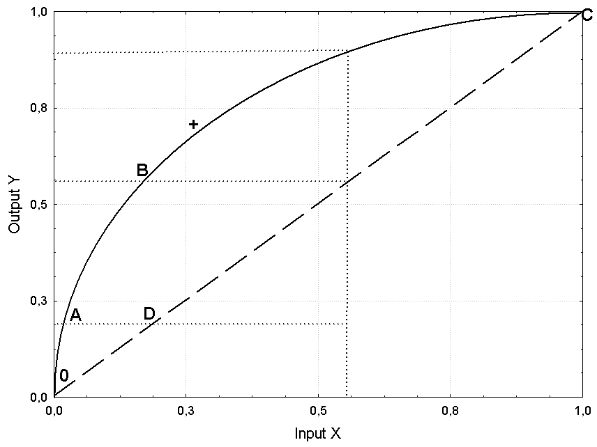
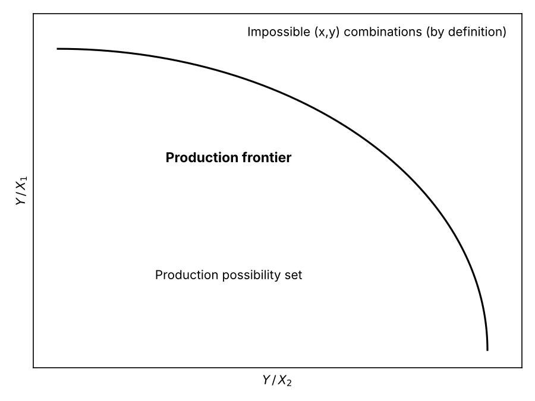
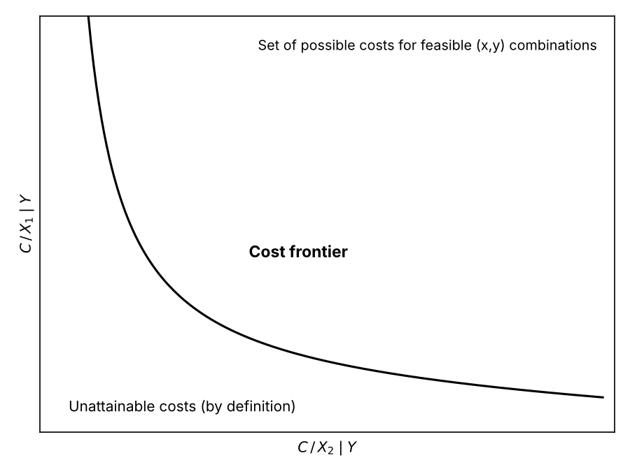
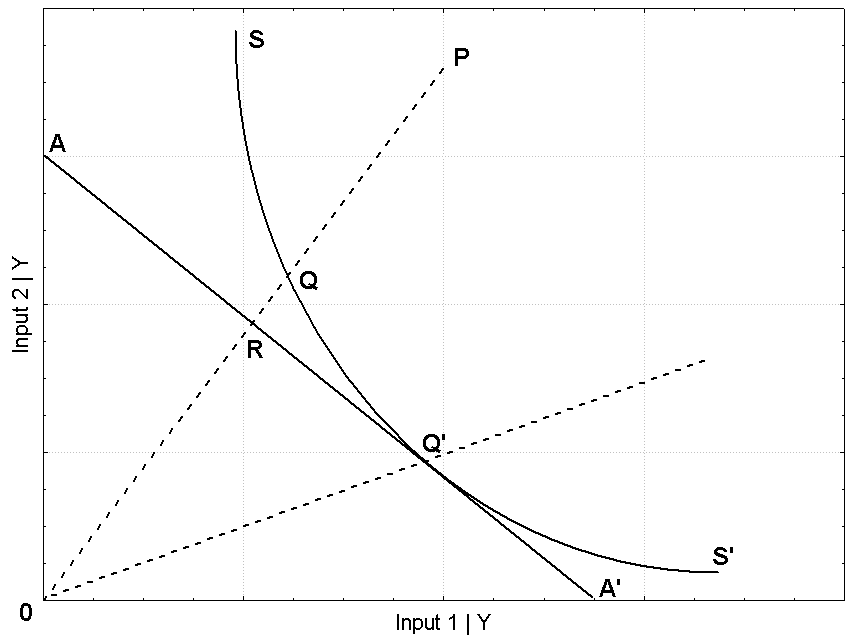
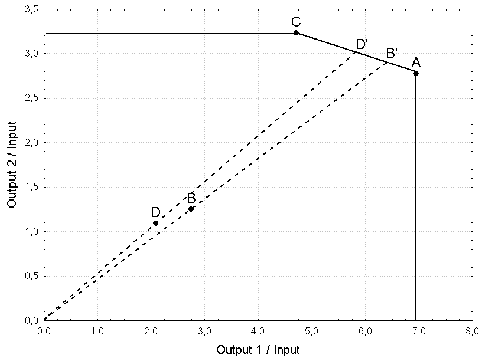

## 9.1 Productivity, efficiency and frontiers {#sec-frontiers}

The concept of productivity introduced in the previous chapter is linked to the definition and measurement of efficiency. In particular, if productivity is measured by a ratio of output to input, efficiency is measured by the ratio of observed output to the maximum output attainable by a production process for some level of technology.

Let us assume and draw two different shapes for two production functions $Y=f(X)$ for a simple process with one input and one output (Figure 9.1).

{width=65%}

Let $0C$ be, by construction, a straight line, precisely the bisector of the plane, i.e. such that its points all have the same output-to-input ratio ($Y/X=a$; in the special case where output equals input, $a=1$). $0C$ could represent a production function, however unrealistic, since it expresses a law transforming input into output for some process. Likewise, the curve $0ABC$ could also represent a (more realistic) production function. Let us assume, however, that the curve $0ABC$ is also the frontier of the production process: given a certain technology and some level $x$ of input $X$, a different level $y$ of output $Y$ can be obtained for each possible production function, but never above the value on the frontier, which by definition expresses the maximum the process can achieve given the inputs.

If $0ABC$ is the set of points $(x,y)$ such that the output levels reached are the highest possible, we say that the efficiency of the productions, or combinations $(x,y)$, lying on this frontier is maximal, and therefore certainly greater than that of the points lying on the line $0C$. We also say that the frontier $0ABC$ is the set of technically efficient points (in terms of the combination of $x$ and $y$) with output orientation, since it represents the maximum possible production given the input levels.

In Figure 9.1 points $A$ and $B$ have the same maximum efficiency but different productivity, since their output/input ratios differ; $C$ and $D$ have different efficiency ($C$ is on the frontier and $D$ is not) but the same productivity, since both lie on the line $0C$ and therefore have a constant output-to-input ratio (equal to 1 here). In particular, the line $0C$ represents a production process with constant returns to scale (CRS); indeed, at every point the tangent coincides with the line itself. The curve $0ABC$, instead, shows increasing returns to scale at $A$ and $B$ (tangents steeper than the line $0C$) and decreasing returns at $C$ (tangent flatter than $0C$). There is of course at least one point (in Figure 9.1, near the $+$ symbol) whose tangent is parallel to the line $0C$: here returns to scale are constant, and it is worth noting that if the production frontier is CRS, efficiency and productivity coincide (the CRS frontier is in fact a straight line).

So far the frontier has been defined with reference to production, meaning the maximum amount of output that can be produced for a given input level: this is an output-oriented approach. In exactly the same way, the production frontier can be seen as the minimum use of inputs for a given output level, with an input-oriented approach. Whatever the point of view, we refer to a concept of technical efficiency, since it concerns the levels, in quantity or value terms, of the inputs and outputs of the production process.

{width=65%}

{width=65%}

If, instead, the frontier is defined from the point of view of costs, an efficiency condition, in this case allocative efficiency, requires minimising production costs given input prices and a fixed level of output; the frontier then no longer bounds the production possibility set from above but, on the contrary, from below (Figures 9.2 and 9.3).

Following Farrell's well-known approach, and recalling that technical efficiency concerns the quantities (or values) of inputs and outputs while allocative efficiency concerns the costs of the process, one can also define overall efficiency as a combination of technical and allocative efficiency. To clarify the differences, consider Figure 9.4 in the input-oriented case; the transposition to the output-oriented case is straightforward.

{width=65%}

$SS'$ is the isoquant corresponding to a fixed production level $Y$, obtained by minimising the use of two inputs $X_{1}$ and $X_{2}$. At point $P$ the same quantity of output as at $Q$ is produced, but with greater use of inputs. We say that $P$ represents a case of technical inefficiency with respect to the optimal point $Q$, and hence that $P$ is relatively inefficient with respect to $Q$. This inefficiency can be measured by the ratio $0Q/0P$, if we use a radial measure of the distance between $Q$ and $P$. $AA'$ is instead an isocost line, along which the combination of inputs guarantees the same minimum cost for the fixed output $Y$. Point $Q$ is technically efficient but does not lie on the optimal isocost, so it shows allocative inefficiency with respect to point $R$. Allocative inefficiency is therefore measured by the ratio $0R/0Q$, which is again a radial measure. Overall inefficiency, interpretable as a combination of the two, can thus be measured by the product $(0Q/0P)\cdot (0R/0Q)=0R/0P$. Only at point $Q'$ are full technical and allocative efficiency achieved at the same time.

## 9.2 Parametric frontiers: the drifted-OLS method {#sec-drifted-ols}

Starting from the observed combinations $(x,y)$, frontier functions can be determined with some special devices. Classical statistical estimators (such as OLS) fit average functions to the data, whose points certainly cannot be regarded as estimates of the frontier unless some operations are performed to shift the function onto the frontier. More generally, frontier functions can be determined with either parametric or non-parametric methods. The non-statistical deterministic parametric method assumes a residual with no stochastic component; it is interpreted exclusively as inefficiency, since it represents the distance between the frontier and the function $f(X)$ obtained through mathematical linear-programming procedures. In the statistical deterministic parametric method, the model is estimated in the classical statistical way, giving an average function that is then suitably shifted to represent the frontier. There are several techniques for this shift; the simplest, but no less useful for that, is known as *drifted-OLS* and shifts the function by the largest residual (hence upwards) for production frontiers and by the smallest residual (hence downwards) for cost frontiers. The stochastic parametric method is less crude than the previous one, since it assumes that the residual is made up of inefficiency $u$, with its own specific distribution, and of white noise $\varepsilon$.

Let us give an example of drifted-OLS by computing the frontier function and the efficiency scores of 5 firms producing the levels $Y$ with inputs $X$ (Figure 9.5).

::: {.panel-tabset group="language"}
### R

```{r}
#| fig-cap: "Figure 9.5 – Frontier production function"
X <- c(2,4,6,8,10)
Y <- c(20,30,40,45,60)
ols <- lm(Y~X)
front <- fitted(ols)+max(resid(ols))
plot(X, Y, main="Frontier production function")
abline(ols)
abline(a=(ols$coeff[1]+max(resid(ols))), b=(ols$coeff[2]), lty=2)
```

### Python

```{python}
import numpy as np
import pandas as pd
import matplotlib.pyplot as plt
import statsmodels.formula.api as smf

X = np.array([2, 4, 6, 8, 10]); Y = np.array([20, 30, 40, 45, 60])
ols = smf.ols("Y ~ X", data=pd.DataFrame({"X": X, "Y": Y})).fit()
front = ols.fittedvalues.to_numpy() + ols.resid.max()
```

```{python}
#| fig-cap: "Figure 9.5 – Frontier production function"
#| results: hide
b0, b1 = ols.params
xx = np.array([0, 12])
plt.figure(figsize=(5, 5))
plt.scatter(X, Y, facecolors="none", edgecolors="black")
plt.plot(xx, b0 + b1 * xx, color="black")
plt.plot(xx, b0 + ols.resid.max() + b1 * xx, color="black", linestyle="--")
plt.xlim(1.5, 10.5); plt.ylim(18, 62)
plt.title("Frontier production function"); plt.xlabel("X"); plt.ylabel("Y")
plt.show()
```

### SAS

```sas
data dols;
  input X Y @@;
  datalines;
2 20 4 30 6 40 8 45 10 60
;
run;
proc reg data=dols noprint;
  model Y = X;
  output out=stima p=media r=residuo;
run;
quit;
proc sql noprint; select max(residuo) into :maxres from stima; quit;
data stima;
  set stima;
  front = media + &maxres;          /* frontier: shifted OLS line */
run;
proc sgplot data=stima;
  title "Frontier production function";
  scatter x=X y=Y;
  series x=X y=media;
  series x=X y=front / lineattrs=(pattern=dash);
run;
```
:::

Figure 9.5 shows the $(x,y)$ combinations, the corresponding average function estimated by OLS and the frontier function (dashed line), obtained by shifting the average function upwards in parallel until it touches the highest point. This gives an empirical frontier which, given the technology and the actually observed $(x,y)$ combinations, represents the maximum possible production $Y$ for the different levels of $X$.

Hence, for each input value, actual production $Y$ can be compared with the maximum attainable, given by the corresponding value on the frontier function $Y_{front}$, through the ratio $Y/Y_{front}$; this ratio always ranges between 0 (minimum efficiency) and 1 (maximum efficiency)

::: {.panel-tabset group="language"}
### R

```{r}
eff <- Y/front
round(eff,3)
order(eff)
```

### Python

```{python}
eff = Y / front
print(np.round(eff, 3))
print(np.argsort(eff) + 1)        # like R's order(), with indices from 1
```

### SAS

```sas
data stima;
  set stima;
  azienda = _n_;
  eff = round(Y/front, 0.001);
run;
proc sort data=stima out=graduatoria; by eff; run;
proc print data=graduatoria noobs; var azienda eff; run;
```
:::

Firm 4 is the least efficient, since it is the farthest from the frontier, on which by construction at least one firm lies (the frontier is obtained by shifting the OLS line by the largest residual). Other things being equal and with the same input levels, firm 4 could become efficient by increasing its output by about 10.9%

::: {.panel-tabset group="language"}
### R

```{r}
round(((1-eff[4])*100),1)
```

### Python

```{python}
print(round((1 - eff[3]) * 100, 1))    # the fourth firm has index 3
```

### SAS

```sas
data _null_;
  set stima(firstobs=4 obs=4);
  increase = round((1-Y/front)*100, 0.1);
  put increase=;
run;
```
:::

while firm 3, the second least inefficient, would need to increase production by about 2.4%

::: {.panel-tabset group="language"}
### R

```{r}
round(((1-eff[3])*100),1)
```

### Python

```{python}
print(round((1 - eff[2]) * 100, 1))
```

### SAS

```sas
data _null_;
  set stima(firstobs=3 obs=3);
  increase = round((1-Y/front)*100, 0.1);
  put increase=;
run;
```
:::

Firm 5 is the only fully efficient one, with a score of one.

We carry out a similar exercise for a simple cost function which, for 40 textile firms, relates total production cost in euro linearly to the prices of two inputs, given the output level. The data are in the file *frontcosto.csv*

::: {.panel-tabset group="language"}
### R

```{r}
fc <- read.csv2("data/frontcosto.csv")
attach(fc)
modello <- lm(costo~prezzo1+prezzo2)
frcost <- fitted(modello)+min(resid(modello))
```

### Python

```{python}
fc = pd.read_csv("data/frontcosto.csv", sep=";", decimal=",")
modello = smf.ols("costo ~ prezzo1 + prezzo2", data=fc).fit()
frcost = modello.fittedvalues + modello.resid.min()
```

### SAS

```sas
data fc;
  infile "data/frontcosto.csv" dlm=";" firstobs=2;
  input aziende costo :commax12. prezzo1 :commax12. prezzo2 :commax12.;
run;
proc reg data=fc noprint;
  model costo = prezzo1 prezzo2;
  output out=fcstima p=media r=residuo;
run;
quit;
proc sql noprint; select min(residuo) into :minres from fcstima; quit;
data fcstima;
  set fcstima;
  frcost = media + &minres;         /* cost frontier: downward shift */
run;
```
:::

Unlike the previous production case, to determine the cost frontier we add the smallest residual, which is certainly negative; the frontier therefore now lies below the observed values. So, to keep the efficiency score between 0 (minimum efficiency) and 1 (maximum efficiency), the frontier cost $C_{front}$ is divided by the observed cost $C$

::: {.panel-tabset group="language"}
### R

```{r}
effc <- frcost/costo
round(effc,3)
order(effc)
```

### Python

```{python}
effc = (frcost / fc["costo"]).to_numpy()
print(np.round(effc, 3))
print(np.argsort(effc) + 1)
```

### SAS

```sas
data fcstima;
  set fcstima;
  effc = round(frcost/costo, 0.001);
run;
proc sort data=fcstima out=graduatoria; by effc; run;
proc print data=graduatoria noobs; var aziende effc; run;
```
:::

Firm 17 is the least efficient, with costs that could still fall by 3.9%, while firms 30 and 12 reach maximum efficiency and therefore need no cost reduction

::: {.panel-tabset group="language"}
### R

```{r}
round(((1-effc[17])*100),1)
round(((1-effc[12])*100),1) # the same holds for firm 30
detach(fc)
```

### Python

```{python}
print(round((1 - effc[16]) * 100, 1))
print(round((1 - effc[11]) * 100, 1))   # the same holds for firm 30
```

### SAS

```sas
data _null_;
  set fcstima;
  where aziende in (17, 12, 30);
  reduction = round((1-frcost/costo)*100, 0.1);
  put aziende= reduction=;
run;
```
:::

Note that the first exercise refers to the concept of technical efficiency, whereas this second one refers to allocative efficiency. Moreover, the frontier is always built in relative terms using the observed data; it therefore indicates the best condition as a benchmark only for the units under examination, since one cannot rule out a priori the existence of even more efficient units, not included in the analysis, that could become a new benchmark.

Let us take another example with real data. We load the information in the file *nazioni.csv* on value added, labour units and gross capital of 21 of the most industrialised countries for 1966 and 2007, measured in billions of constant euro (at purchasing power parity) for value added and capital, and in millions of units for labour. We compute labour productivity, capital productivity and capital intensity

::: {.panel-tabset group="language"}
### R

```{r}
naz <- read.csv2("data/nazioni.csv")
attach(naz)
prodL66 <- y66/l66; prodL07 <- y07/l07
prodK66 <- y66/k66; prodK07 <- y07/k07
intKL66 <- k66/l66; intKL07 <- k07/l07
matr1 <- cbind(prodL66,prodL07,prodK66,prodK07,intKL66,intKL07)
rownames(matr1) <- sigle; matr1 <- cbind(c(1:21),matr1)
round(matr1,2)
```

### Python

```{python}
naz = pd.read_csv("data/nazioni.csv", sep=";", decimal=",", index_col="sigle")
matr1 = pd.DataFrame({
    "n": np.arange(1, 22),
    "prodL66": naz.y66 / naz.l66, "prodL07": naz.y07 / naz.l07,
    "prodK66": naz.y66 / naz.k66, "prodK07": naz.y07 / naz.k07,
    "intKL66": naz.k66 / naz.l66, "intKL07": naz.k07 / naz.l07})
print(matr1.round(2))
```

### SAS

```sas
data naz;
  infile "data/nazioni.csv" dlm=";" firstobs=2;
  input sigle $ (y66 y07 l66 l07 k66 k07) (:commax12.);
  n = _n_;
  prodL66 = y66/l66; prodL07 = y07/l07;
  prodK66 = y66/k66; prodK07 = y07/k07;
  intKL66 = k66/l66; intKL07 = k07/l07;
run;
proc print data=naz noobs;
  var sigle n prodL66 prodL07 prodK66 prodK07 intKL66 intKL07;
  format prodL66--intKL07 8.2;
run;
```
:::

Labour productivity in Italy rises from 23 thousand constant euro in 1966 to about 51 thousand in 2007; capital intensity also grows strongly (from about 67 to 158 thousand euro), while capital productivity falls only slightly (from 0.34 to 0.33).

Assuming that the Cobb-Douglas form is a good production function for these data, we compute the technical efficiency of the production processes of the 21 countries

::: {.panel-tabset group="language"}
### R

```{r}
modcd66 <- lm(log(y66)~log(l66)+log(k66))
modcd07 <- lm(log(y07)~log(l07)+log(k07))
front66 <- fitted(modcd66)+max(resid(modcd66))
front07 <- fitted(modcd07)+max(resid(modcd07))
eff66 <- log(y66)/front66; eff07 <- log(y07)/front07
order(eff66)
order(eff07)
detach(naz)
```

### Python

```{python}
modcd66 = smf.ols("np.log(y66) ~ np.log(l66) + np.log(k66)", data=naz).fit()
modcd07 = smf.ols("np.log(y07) ~ np.log(l07) + np.log(k07)", data=naz).fit()
front66 = modcd66.fittedvalues + modcd66.resid.max()
front07 = modcd07.fittedvalues + modcd07.resid.max()
eff66 = (np.log(naz.y66) / front66).to_numpy()
eff07 = (np.log(naz.y07) / front07).to_numpy()
print(np.argsort(eff66) + 1)
print(np.argsort(eff07) + 1)
```

### SAS

```sas
data naz;
  set naz;
  ly66 = log(y66); ll66 = log(l66); lk66 = log(k66);
  ly07 = log(y07); ll07 = log(l07); lk07 = log(k07);
run;
proc reg data=naz noprint;
  m66: model ly66 = ll66 lk66;
  output out=s66 p=p66 r=r66;
run;
quit;
proc reg data=s66 noprint;
  m07: model ly07 = ll07 lk07;
  output out=nazstima p=p07 r=r07;
run;
quit;
proc sql noprint;
  select max(r66), max(r07) into :max66, :max07 from nazstima;
quit;
data nazstima;
  set nazstima;
  eff66 = ly66/(p66 + &max66);
  eff07 = ly07/(p07 + &max07);
run;
proc sort data=nazstima out=g66; by eff66; run;
proc print data=g66 noobs; var n sigle eff66; run;
proc sort data=nazstima out=g07; by eff07; run;
proc print data=g07 noobs; var n sigle eff07; run;
```
:::

Italy, label 7, holds an intermediate position in both 1966 and 2007, with the frontier represented by Iceland (14) and by the United States (17), respectively.

## 9.3 Data Envelopment Analysis {#sec-dea}

Farrell's approach gave rise to the non-parametric approach known as *data envelopment analysis* (DEA) which, in its original and still most widespread formulation, yields measures of technical inefficiency for the units of analysis (*decision making units* or DMUs). There are many versions of DEA, but here we restrict ourselves to the simplest and most classical formulation.

DEA is a technique that envelops the data, i.e. it determines a frontier without reference to production functions with forms known a priori. DEA was born in 1978 and uses computational algorithms typical of operations research, since it essentially looks for solutions to constrained minimum and maximum problems.

A great advantage is the possibility of analysing processes with several outputs, a typical condition of many non-industrial processes that we could hardly study with parametric approaches; the latter are typically based on regression functions which, while allowing many inputs as regressors, do not allow several dependent variables (our outputs) except with unusual and more complex methods that we leave aside here.

The following example helps to understand the logic of DEA. Suppose we want to examine 4 DMUs, for instance 4 firms whose industrial transformation process has a single output and a single input, both measured in tonnes

::: {.panel-tabset group="language"}
### R

```{r}
out <- c(125,44,80,23)
inp <- c(18,16,17,11)
es1 <- cbind(out,inp)
rownames(es1) <- c("A","B","C","D")
es1
```

### Python

```{python}
es1 = pd.DataFrame({"out": [125, 44, 80, 23], "inp": [18, 16, 17, 11]},
                   index=["A", "B", "C", "D"])
print(es1)
```

### SAS

```sas
data es1;
  input dmu $ out inp;
  datalines;
A 125 18
B  44 16
C  80 17
D  23 11
;
run;
proc print data=es1 noobs; run;
```
:::

To obtain a measure of technical efficiency we must compare actual output with the maximum possible, given the different input levels. So, by computing the ratio $Y/X$ and dividing it by the largest observed value, it is easy to build the efficiency ranking

::: {.panel-tabset group="language"}
### R

```{r}
es1 <- cbind(es1,out/inp,(out/inp)/max(out/inp))
colnames(es1)[3:4] <- c("out/inp","(out/inp)/max")
es1
```

### Python

```{python}
es1["out/inp"] = es1["out"] / es1["inp"]
es1["(out/inp)/max"] = es1["out/inp"] / es1["out/inp"].max()
print(es1)
```

### SAS

```sas
proc sql;
  create table es1b as
  select *, out/inp as ratio, calculated ratio / max(calculated ratio) as efficiency
  from es1;
quit;
proc print data=es1b noobs; run;
```
:::

The first unit is on the efficiency frontier, with score 1, while the fourth firm is the least efficient (score 0.30).

Let us work through another example for processes with two outputs and a single input; the setting is entirely analogous to the more familiar one with one output and two inputs

::: {.panel-tabset group="language"}
### R

```{r}
es2 <- cbind(out1=out,out2=c(50,20,55,12),inp)
rownames(es2) <- rownames(es1)
es2
```

### Python

```{python}
es2 = pd.DataFrame({"out1": es1["out"], "out2": [50, 20, 55, 12], "inp": es1["inp"]})
print(es2)
```

### SAS

```sas
data es2;
  input dmu $ out1 out2 inp;
  datalines;
A 125 50 18
B  44 20 16
C  80 55 17
D  23 12 11
;
run;
proc print data=es2 noobs; run;
```
:::

and, as in the previous example,

::: {.panel-tabset group="language"}
### R

```{r}
es2 <- cbind(es2,oi1=es2[,1]/inp,oi2=es2[,2]/inp,
             maxo1=(es2[,1]/inp)/max(es2[,1]/inp),
             maxo2=(es2[,2]/inp)/max(es2[,2]/inp))
es2
```

### Python

```{python}
es2["oi1"] = es2["out1"] / es2["inp"]
es2["oi2"] = es2["out2"] / es2["inp"]
es2["maxo1"] = es2["oi1"] / es2["oi1"].max()
es2["maxo2"] = es2["oi2"] / es2["oi2"].max()
print(es2.round(4))
```

### SAS

```sas
proc sql;
  create table es2b as
  select *, out1/inp as oi1, out2/inp as oi2,
         calculated oi1 / max(calculated oi1) as maxo1,
         calculated oi2 / max(calculated oi2) as maxo2
  from es2;
quit;
proc print data=es2b noobs; run;
```
:::

So with several outputs (or several inputs) things get more complicated, since the results may disagree: considering the first output the most efficient firm is $A$, but considering the second output it becomes $C$. Even if the efficiency rankings were consistent and pointed to the same firms, we would probably not obtain the same distance from the frontier; clearly the problem becomes even more complicated if the process has many inputs and many outputs. DEA provides a solution.

{width=65%}

Figure 9.6 plots the four firms of the example. By definition, the frontier is given by the units with the highest output-to-input ratio, so it is built around units $A$ and $C$, in effect enveloping all the data. Firms $A$ and $C$ are therefore fully efficient: we say they dominate all the other units and by definition assign them a score of 1; the efficiency scores of the remaining firms $B$ and $D$, instead, are unknown.

We proceed as follows. We compute the ratio between the two outputs given the inputs, i.e. between $Y_{1}/X$ and $Y_{2}/X$, which amounts to comparing the two outputs directly

::: {.panel-tabset group="language"}
### R

```{r}
es2[,1]/es2[,2]
```

### Python

```{python}
print(es2["out1"] / es2["out2"])
```

### SAS

```sas
data _null_;
  set es2;
  ratio = out1/out2;
  put dmu= ratio=;
run;
```
:::

The slope of the line through $D$ and the origin (the process is assumed not to admit zero outputs or inputs unless jointly) is therefore known and equal to 1/1.92, and likewise for $B$ we have 1/2.20 (the lines are drawn as dashed lines in Figure 9.6). Projecting $D$ and $B$ onto the frontier built around $A$ and $C$ identifies two fictitious firms $D'$ and $B'$, which are efficient and have the same output ratio as $D$ and $B$. The efficiency score of $D$ is then computed with respect to its own virtual maximum $D'$ and, in the same way, $B$ is compared with $B'$, giving a radial measure of efficiency; thus the score of $D$ is $0D/0D'$, while that of $B$ is $0B/0B'$.

For simplicity, let $x=Y_{1}/X$ and $y=Y_{2}/X$ denote the horizontal and vertical axes of the plane in Figure 9.6. Since the equation

$$
(x-x_{1})/(x_{2}-x_{1})=(y-y_{1})/(y_{2}-y_{1})
\tag{9.1}
$$

defines the line through any two points, the segment joining $A$ and $C$ is given by $y=4.20-0.20x$. Point $D$ instead lies on the line $y=(1/1.92)x$; solving the two equations together easily gives the intersection point $D'(5.82;\,3.03)$; similarly we find $B'(6.42;\,2.92)$, which lies on the line $y=(1/2.20)x$. Since the distance of a point from the origin $(0,0)$ equals

$$
(x^{2}+y^{2})^{1/2}
\tag{9.2}
$$

we have $0D=2.36$ and $0D'=6.56$, and also $0B=3.02$ and $0B'=7.05$. We now have the information needed to compute the efficiency scores of firms $D$ and $B$

::: {.panel-tabset group="language"}
### R

```{r}
eff_D <- 2.36/6.56
eff_B <- 3.02/7.05
eff_D; eff_B
```

### Python

```{python}
eff_D = 2.36 / 6.56
eff_B = 3.02 / 7.05
print(eff_D, eff_B)
```

### SAS

```sas
data _null_;
  eff_D = 2.36/6.56;
  eff_B = 3.02/7.05;
  put eff_D= eff_B=;
run;
```
:::

Firm $D$ has an efficiency score of 0.36, lower than that of $B$, equal to 0.43, and of course lower than those of $A$ and $C$, which are the benchmark and by definition score 1. To increase their efficiency, firms $D$ and $B$ should move along their dashed lines towards their projections on the frontier (Figure 9.6), increasing the ratio $Y/X$ either by raising outputs for given inputs (*output-oriented*) or by reducing inputs for given outputs (*input-oriented*), or by both raising outputs and reducing inputs (this mixed approach is not allowed by traditional DEA techniques, but is available in more recent versions).

## 9.4 The mathematical formulation of DEA {#sec-dea-lp}

Efficiency can also be computed through a mathematical formulation, a generalisation that becomes necessary when the process has several inputs and outputs. For firm $B$ the problem to solve, with obvious meaning of the symbols (*peso* = weight), is $\max E_{B}$ subject to

$$
\begin{gathered}E_{A}=(125\,peso_{output1}+50\,peso_{output2})/(18\,peso_{input}) \\ E_{B}=(44\,peso_{output1}+20\,peso_{output2})/(16\,peso_{input}) \\ E_{C}=(80\,peso_{output1}+55\,peso_{output2})/(17\,peso_{input}) \\ E_{D}=(23\,peso_{output1}+12\,peso_{output2})/(11\,peso_{input}) \\ 0\le E_{i}\le 1,\quad peso_{k}\ge 0\end{gathered}
\tag{9.3}
$$

Since the problem is non-linear and hard to solve, a linear formulation is preferred, adding the condition $16\,peso_{input}=1$; the efficiency of $B$ to be maximised then becomes $E_{B}=44\,peso_{output1}+20\,peso_{output2}$. The procedure is repeated in the same way for the other three units.

In practice, the DEA problem is usually more complex, since even the standard model admits different assumptions about the production process. For example, we could rewrite the problem in compact form (*envelopment form*) assuming constant returns to scale (CRS) in the *output-oriented* case, i.e.

$$
\begin{gathered}\max_{\phi ,\lambda}\phi \\ -\phi y_{i}+Y\lambda \ge 0,\ x_{i}-X\lambda \ge 0,\ \lambda \ge 0\end{gathered}
\tag{9.4}
$$

or, for each of the $J$ units with $M$ outputs and $N$ inputs,

$$
\begin{gathered}1/efficiency_{i}=\max \phi_{i} \\ \sum_{j=1}^{J} \lambda_{j}y_{mj}-\phi_{i}y_{mi}\ge 0,\quad m=1,...,M \\ x_{ni}-\sum_{j=1}^{J} \lambda_{j}x_{nj}\ge 0,\quad n=1,...,N \\ \lambda_{j}\ge 0,\quad j=1,...,J\end{gathered}
\tag{9.5}
$$

where $\lambda$ is a $(J\times 1)$ vector of non-negative weights and $1\le \phi <\infty$. In this formulation the efficiency scores range from a minimum of 1, full efficiency, to a value that is larger the greater the inefficiency. Consequently, to obtain the usual range between 0 (minimum efficiency) and 1 (maximum efficiency), the reciprocal of the scores, $1/\phi$, is used.

In the *input-oriented* case, instead, we have

$$
\begin{gathered}\min_{\theta ,\lambda}\theta \\ -y_{i}+Y\lambda \ge 0,\ \theta x_{i}-X\lambda \ge 0,\ \lambda \ge 0\end{gathered}
\tag{9.6}
$$

or

$$
\begin{gathered}efficiency_{i}=\min \theta_{i} \\ \sum_{j=1}^{J} \lambda_{j}y_{mj}-y_{mi}\ge 0,\quad m=1,...,M \\ \theta_{i}x_{ni}-\sum_{j=1}^{J} \lambda_{j}x_{nj}\ge 0,\quad n=1,...,N \\ \lambda_{j}\ge 0,\quad j=1,...,J\end{gathered}
\tag{9.7}
$$

where $0\le \theta \le 1$.

To obtain efficiency scores under variable returns to scale (VRS) the following constraint must be added

$$
1'\lambda =1
\tag{9.8}
$$

where $1$ is a vector of ones with $J$ rows. If instead the additional constraint is

$$
1'\lambda \le 1
\tag{9.9}
$$

the scores are obtained under non-increasing returns to scale (NIRS); if the NIRS scores coincide with the VRS ones, decreasing returns to scale (DRS) are at work, while if they do not coincide but the CRS and VRS scores differ, increasing returns to scale (IRS) are at work.

If the technical efficiency score differs under constant returns to scale (CRS) and variable returns to scale (VRS), scale inefficiency is at work, which can be measured by the simple ratio of the efficiency scores obtained under the two assumptions; it is worth noting that, under constant returns to scale, the orientation does not affect the efficiency score.

Finally, we should mention that only the basic approach is presented here, but the family of DEA models is vast and today there is a very wide range of models and formulations, depending on the various working assumptions, such as the existence of slacks, discrete inputs and outputs, stochastic components, etc. We will not dwell further on this.

For an example we use the data in the file *esdea.csv*, on 2 outputs and 2 inputs of 10 firms

::: {.panel-tabset group="language"}
### R

```{r}
esdea <- read.csv2("data/esdea.csv")
attach(esdea)
X <- cbind(input1,input2)
Y <- cbind(output1,output2)
n <- dim(X)[1]
s <- dim(Y)[2]
m <- dim(X)[2]
```

### Python

```{python}
esdea = pd.read_csv("data/esdea.csv", sep=";", decimal=",")
X = esdea[["input1", "input2"]].to_numpy()
Y = esdea[["output1", "output2"]].to_numpy()
n, m = X.shape
s = Y.shape[1]
```

### SAS

```sas
data esdea;
  infile "data/esdea.csv" dlm=";" firstobs=2;
  input aziende (output1 output2 input1 input2) (:commax12.);
run;
```
:::

Solving the linear-programming problems in formulas (9.5) and (9.7) requires operations-research routines that are beyond the scope of this text. We therefore need to load a specific external package, since direct computation would require advanced knowledge; here we use *lpSolve*, distributed under the GNU licence and available on CRAN. In Python we use SciPy's `linprog` function, in SAS the `PROC OPTMODEL` procedure (SAS/OR)

::: {.panel-tabset group="language"}
### R

```{r}
# this is the only external package used
# in the whole book (install.packages("lpSolve"))
library(lpSolve)
```

### Python

```{python}
from scipy.optimize import linprog

def dea(X, Y, rts="crs", orient="io"):
    """DEA scores (between 0 and 1) for crs, vrs or nirs returns
    and input ("io") or output ("oo") orientation."""
    n, m = X.shape
    s = Y.shape[1]
    eff = np.zeros(n)
    for i in range(n):
        # variables: [theta (or phi), lambda_1, ..., lambda_n]
        if orient == "io":                       # min theta
            c = np.r_[1.0, np.zeros(n)]
            A = np.vstack([np.c_[np.zeros(s), -Y.T],     # Y'lambda >= y_i
                           np.c_[-X[i], X.T]])           # X'lambda <= theta x_i
            b = np.r_[-Y[i], np.zeros(m)]
        else:                                    # max phi
            c = np.r_[-1.0, np.zeros(n)]
            A = np.vstack([np.c_[Y[i], -Y.T],            # Y'lambda >= phi y_i
                           np.c_[np.zeros(m), X.T]])     # X'lambda <= x_i
            b = np.r_[np.zeros(s), X[i]]
        ones = np.r_[0.0, np.ones(n)][None, :]
        A_eq = b_eq = None
        if rts == "vrs":
            A_eq, b_eq = ones, [1.0]
        elif rts == "nirs":
            A, b = np.vstack([A, ones]), np.r_[b, 1.0]
        sol = linprog(c, A_ub=A, b_ub=b, A_eq=A_eq, b_eq=b_eq,
                      bounds=[(0, None)] * (n + 1), method="highs")
        eff[i] = sol.x[0] if orient == "io" else 1 / sol.x[0]
    return eff
```

### SAS

```sas
/* macro solving problems (9.5) and (9.7) for all units with PROC OPTMODEL */
%macro dea(rts=crs, orient=io, out=);
  %if &orient = io %then %let val = e.sol; %else %let val = 1/e.sol;
  proc optmodel printlevel=0;
    set <num> DMU;
    set <str> INP  = {'input1', 'input2'};
    set <str> OUTP = {'output1', 'output2'};
    num x{DMU, INP};
    num y{DMU, OUTP};
    read data esdea into DMU=[aziende]
         {i in INP} <x[aziende,i]=col(i)> {o in OUTP} <y[aziende,o]=col(o)>;
    num k;                            /* unit being evaluated */
    var e >= 0;                       /* theta (input) or phi (output) */
    var lambda{DMU} >= 0;
    %if &orient = io %then %do;
      min obj = e;
      con c_inp{i in INP}:  sum{j in DMU} lambda[j]*x[j,i] <= e*x[k,i];
      con c_out{o in OUTP}: sum{j in DMU} lambda[j]*y[j,o] >= y[k,o];
    %end;
    %else %do;
      max obj = e;
      con c_inp{i in INP}:  sum{j in DMU} lambda[j]*x[j,i] <= x[k,i];
      con c_out{o in OUTP}: sum{j in DMU} lambda[j]*y[j,o] >= e*y[k,o];
    %end;
    %if &rts = vrs  %then %do; con c_rts: sum{j in DMU} lambda[j] =  1; %end;
    %if &rts = nirs %then %do; con c_rts: sum{j in DMU} lambda[j] <= 1; %end;
    num eff{DMU};
    for {kk in DMU} do;
      k = kk;
      solve with lp / logfreq=0;
      eff[kk] = &val;
    end;
    create data &out from [aziende] &out=eff;
  quit;
%mend dea;
```
:::

For a production process with constant returns to scale and input orientation we obtain the following efficiency scores

::: {.panel-tabset group="language"}
### R

```{r}
risultato <- matrix(0, nrow=n, ncol=1)
colnames(risultato) <- "efficienza"
cond1 <- rbind(t(Y), -t(X))
f.dir <- rep(">=", s+m)
f.obj <- c(1, rep(0,n))
for(i in 1:n){
  cond2 <- matrix(c(rep(0, s), X[i,]), byrow=T)
  f.con <- cbind(cond2, cond1)
  f.rhs <- c(Y[i,], rep(0, m))
  risultato[i,'efficienza'] <- lp("min", f.obj, f.con, f.dir, f.rhs)$solution[1]
}
ris1 <- c(risultato); ris1
```

### Python

```{python}
ris1 = dea(X, Y, "crs", "io"); print(ris1)
```

### SAS

```sas
%dea(rts=crs, orient=io, out=crs_io);
proc print data=crs_io noobs; run;
```
:::

For variable returns to scale and input orientation we have

::: {.panel-tabset group="language"}
### R

```{r}
risultato <- matrix(0, nrow=n, ncol=1)
colnames(risultato) <- "efficienza"
cond1 <- rbind(t(Y), -t(X), matrix(rep(1, n), ncol=n))
f.dir <- c(rep(">=", s+m), "=")
f.obj <- c(1, rep(0, n))
for(i in 1:n){
  cond2 <- matrix(c(rep(0, s), X[i,], 0), byrow=T)
  f.con <- cbind(cond2, cond1)
  f.rhs <- c(Y[i,], rep(0, m), 1)
  risultato[i,'efficienza'] <- lp("min", f.obj, f.con, f.dir, f.rhs)$solution[1]
}
ris2 <- c(risultato); ris2
```

### Python

```{python}
ris2 = dea(X, Y, "vrs", "io"); print(ris2)
```

### SAS

```sas
%dea(rts=vrs, orient=io, out=vrs_io);
proc print data=vrs_io noobs; run;
```
:::

while for non-increasing returns to scale, again with input orientation,

::: {.panel-tabset group="language"}
### R

```{r}
risultato <- matrix(0, nrow=n, ncol=1)
colnames(risultato) <- "efficienza"
cond1 <- rbind(t(Y), -t(X), matrix(rep(1, n), ncol=n))
f.dir <- c(rep(">=", s+m), "<=")
f.obj <- c(1, rep(0, n))
for(i in 1:n){
  cond2 <- matrix(c(rep(0, s), X[i,], 0), byrow=T)
  f.con <- cbind(cond2, cond1)
  f.rhs <- c(Y[i,], rep(0, m), 1)
  risultato[i,'efficienza'] <- lp("min", f.obj, f.con, f.dir, f.rhs)$solution[1]
}
ris3 <- c(risultato); ris3
```

### Python

```{python}
ris3 = dea(X, Y, "nirs", "io"); print(ris3)
```

### SAS

```sas
%dea(rts=nirs, orient=io, out=nirs_io);
proc print data=nirs_io noobs; run;
```
:::

We can repeat the computations for the output orientation, obtaining the following results for constant, variable and non-increasing returns to scale respectively

::: {.panel-tabset group="language"}
### R

```{r}
risultato <- matrix(0, nrow=n, ncol=1)
colnames(risultato) <- "efficienza"
cond1 <- rbind(-t(Y), t(X))
f.dir <- rep("<=", s+m)
f.obj <- c(1, rep(0,n))
for(i in 1:n){
  cond2 <- matrix(c(Y[i,],rep(0, m)), byrow=T)
  f.con <- cbind(cond2, cond1)
  f.rhs <- c(rep(0,s),X[i,])
  risultato[i,'efficienza'] <- lp("max", f.obj, f.con, f.dir, f.rhs)$solution[1]
}
ris4 <- 1/c(risultato); ris4
risultato <- matrix(0, nrow=n, ncol=1)
colnames(risultato) <- "efficienza"
cond1 <- rbind(-t(Y), t(X), matrix(rep(1, n), ncol=n))
f.dir <- c(rep("<=", s+m), "=")
f.obj <- c(1, rep(0, n))
for(i in 1:n){
  cond2 <- matrix(c(Y[i,],rep(0, m), 0), byrow=T)
  f.con <- cbind(cond2, cond1)
  f.rhs <- c(rep(0,s),X[i,], 1)
  risultato[i,'efficienza'] <- lp("max", f.obj, f.con, f.dir, f.rhs)$solution[1]
}
ris5 <- 1/c(risultato); ris5
risultato <- matrix(0, nrow=n, ncol=1)
colnames(risultato) <- "efficienza"
cond1 <- rbind(-t(Y), t(X), matrix(rep(1, n), ncol=n))
f.dir <- c(rep("<=", s+m), "<=")
f.obj <- c(1, rep(0, n))
for(i in 1:n){
  cond2 <- matrix(c(Y[i,],rep(0, m), 0), byrow=T)
  f.con <- cbind(cond2, cond1)
  f.rhs <- c(rep(0,s),X[i,], 1)
  risultato[i,'efficienza'] <- lp("max", f.obj, f.con, f.dir, f.rhs)$solution[1]
}
ris6 <- 1/c(risultato); ris6
tabella <- cbind(ris1,ris2,ris3,ris4,ris5,ris6)
colnames(tabella) <- c("crs-io","vrs-io","nirs-io","crs-oo","vrs-oo","nirs-oo")
round(tabella,3)
```

### Python

```{python}
ris4 = dea(X, Y, "crs", "oo")
ris5 = dea(X, Y, "vrs", "oo")
ris6 = dea(X, Y, "nirs", "oo")
tabella = pd.DataFrame(np.c_[ris1, ris2, ris3, ris4, ris5, ris6],
                       columns=["crs-io", "vrs-io", "nirs-io", "crs-oo", "vrs-oo", "nirs-oo"],
                       index=np.arange(1, n + 1))
print(tabella.round(3))
```

### SAS

```sas
%dea(rts=crs,  orient=oo, out=crs_oo);
%dea(rts=vrs,  orient=oo, out=vrs_oo);
%dea(rts=nirs, orient=oo, out=nirs_oo);
data tabella;
  merge crs_io vrs_io nirs_io crs_oo vrs_oo nirs_oo;
  by aziende;
run;
proc print data=tabella noobs; format crs_io--nirs_oo 6.3; run;
```
:::

Note that the *input-oriented* and *output-oriented* scores are identical under constant returns to scale (CRS)

::: {.panel-tabset group="language"}
### R

```{r}
tabella[,1]/tabella[,4]
```

### Python

```{python}
print(np.round(tabella["crs-io"] / tabella["crs-oo"], 6).to_numpy())
```

### SAS

```sas
data _null_;
  set tabella;
  ratio = crs_io/crs_oo;
  put aziende= ratio=;
run;
```
:::

Any scale inefficiency is signalled by CRS and VRS scores that do not coincide

::: {.panel-tabset group="language"}
### R

```{r}
tabella[,1]/tabella[,2] # input-oriented
tabella[,4]/tabella[,5] # output-oriented
```

### Python

```{python}
print((tabella["crs-io"] / tabella["vrs-io"]).to_numpy())   # input-oriented
print((tabella["crs-oo"] / tabella["vrs-oo"]).to_numpy())   # output-oriented
```

### SAS

```sas
data scala;
  set tabella;
  sc_io = crs_io/vrs_io;     /* input-oriented */
  sc_oo = crs_oo/vrs_oo;     /* output-oriented */
run;
proc print data=scala noobs; var aziende sc_io sc_oo; run;
```
:::

Firms 2 and 10 show a scale inefficiency that is the same whether the input or the output orientation is considered, equal to 0.958 and 0.987 respectively; this is precisely their scale inefficiency, since if the incorrect CRS assumption is relaxed to the more general VRS they reach a score of 1; we do not know, however, whether increasing or decreasing returns are at work. The corresponding NIRS efficiency equals 1, which, CRS having been ruled out, implies decreasing returns to scale (DRS).

Firm 4 has an input-oriented efficiency score of 0.796 under CRS but 0.829 under VRS; its scale efficiency (SC) is therefore

::: {.panel-tabset group="language"}
### R

```{r}
(tabella[,1]/tabella[,2])[4]
```

### Python

```{python}
print(tabella.loc[4, "crs-io"] / tabella.loc[4, "vrs-io"])
```

### SAS

```sas
data _null_;
  set scala;
  where aziende = 4;
  put sc_io=;
run;
```
:::

with returns to scale now increasing (IRS), the only remaining alternative since NIRS and VRS do not coincide. Conversely, firms 7 and 9 show decreasing returns to scale, like firms 2 and 10, while the units not yet mentioned appear fully efficient, lying on the frontier.

As a consequence, the CRS efficiency score can be decomposed into the VRS score and the scale score SC, such that $eff_{CRS}=eff_{VRS}\cdot eff_{SC}$; indeed

::: {.panel-tabset group="language"}
### R

```{r}
crsio <- tabella[,1]; vrsio <- tabella[,2]
scio <- tabella[,1]/tabella[,2]
crsio-vrsio*scio
detach(esdea)
```

### Python

```{python}
crsio, vrsio = tabella["crs-io"], tabella["vrs-io"]
scio = crsio / vrsio
print((crsio - vrsio * scio).to_numpy())
```

### SAS

```sas
data _null_;
  set scala;
  difference = crs_io - vrs_io*sc_io;
  put aziende= difference=;
run;
```
:::

and this holds for both the input and the output orientation.
