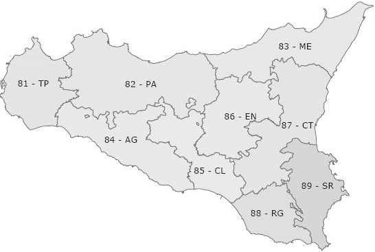

## 12.1 Spatial autocorrelation: Moran's and Geary's indices {#sec-spatial-autocorrelation}

The territory, with its specific characteristics, plays an essential role in correctly interpreting an aggregate. Aggregates often take similar values in neighbouring areas and dissimilar values in distant ones. For example, Lombardy and Sicily have very different levels of GDP per capita, while Sicily and Calabria record more similar values (the so-called first law of Tobler): just as values that are closer in time are generally more correlated, areas that are closer in space tend to be more correlated than distant ones.

The existence of strong spatial correlation, positive or negative, implies that the observations are not independent; it is therefore always advisable to check whether the data depend strongly on space.

To compute autocorrelation one can use traditional correlation indices, adjusted with a suitable matrix $W$ that indicates the spatial proximity of the areas. The simplest form is a contiguity matrix, which takes the value 0 when two areas have no common border and 1 otherwise. However, different definitions of contiguity could be used, or weights based on the inverse of the geographical distances between the centres of the areas. The choice of the type of contiguity or weight, and of the techniques for measuring distances and locating centres, is relatively arbitrary, which is an obvious limitation of these tools.

{width=65%}

Let us take as an example the 9 provinces of the Sicily Region, whose borders are shown in Figure 12.1 with their abbreviations and ISTAT codes. Setting 1 where two provinces share a border and 0 otherwise (0 also on the main diagonal), we obtain the following square matrix, built from the contiguity information in the file *confinanti.csv*, which also contains value added per capita for 2001 and 2006 (*vap01* and *vap06*)

::: {.panel-tabset group="language"}
### R

```{r}
matt <- read.csv2("data/confinanti.csv")
# matt is the name chosen for the full matrix
matw <- matt[,2:10]
matw
vap01 <- matt[,11]
vap06 <- matt[,12]
```

### Python

```{python}
import numpy as np
import pandas as pd
import matplotlib.pyplot as plt

matt = pd.read_csv("data/confinanti.csv", sep=";", index_col="province")
matw = matt.iloc[:, 0:9]
print(matw)
W = matw.to_numpy()
vap01 = matt["vap01"].to_numpy(float)
vap06 = matt["vap06"].to_numpy(float)
```

### SAS

```sas
proc import datafile="data/confinanti.csv" out=matt dbms=dlm replace;
  delimiter=";"; getnames=yes;
run;
proc print data=matt noobs; var province TP--SR; run;
```
:::

To obtain the spatial autocorrelation of GDP per capita for the 9 Sicilian provinces in 2001 and 2006, we use Moran's I index, defined as

$$
I=\left(n\Big/\sum_{i} \sum_{j} w_{ij}\right)\sum_{i} \sum_{j} (x_{i}-\bar{x})(x_{j}-\bar{x})w_{ij}\Big/\sum_{i} (x_{i}-\bar{x})^{2}
\tag{12.1}
$$

whose central value (no autocorrelation) is $-1/(n-1)$, which tends to 0 for sufficiently large $n$. In general, if the computed index is below the central value there is negative autocorrelation, if it is above there is positive autocorrelation.

Another well-known index of spatial autocorrelation is Geary's c

$$
c=\left((n-1)\Big/2\sum_{i} \sum_{j} w_{ij}\right)\sum_{i} \sum_{j} (x_{i}-x_{j})^{2}w_{ij}\Big/\sum_{i} (x_{i}-\bar{x})^{2}
\tag{12.2}
$$

When this index is greater than 1 there is evidence of negative autocorrelation, when it is below 1 we say there is positive autocorrelation, while autocorrelation is nil when the statistic is close to one.

We compute Moran's index for GDP per capita in 2001

::: {.panel-tabset group="language"}
### R

```{r}
num <- matrix(0,9,9)
for (i in 1:9) for (j in 1:9) num[i,j] <- (vap01[i]-mean(vap01))*(vap01[j]-mean(vap01))*matw[i,j]
num2 <- sum(num)
den <- 0
for (i in 1:9) den[i] <- (vap01[i]-mean(vap01))^2
den1 <- sum(den)
IMoran <- 9/sum(matw)*num2/den1
IMoran
centr <- -1/(9-1); centr
IMoran > centr
```

### Python

```{python}
def moran(x, W):
    z = x - x.mean()
    return len(x) / W.sum() * (z @ W @ z) / np.sum(z ** 2)

def geary(x, W):
    z = x - x.mean()
    diff2 = (x[:, None] - x[None, :]) ** 2
    return (len(x) - 1) / (2 * W.sum()) * np.sum(diff2 * W) / np.sum(z ** 2)

IMoran = moran(vap01, W)
centr = -1 / (9 - 1)
print(IMoran, centr, IMoran > centr)
```

### SAS

```sas
proc iml;
  use matt; read all var {TP PA ME AG CL EN CT RG SR} into W;
            read all var {vap01 vap06} into V; close matt;
  start moran(x, W);
    z = x - mean(x);
    return( nrow(x)/sum(W) * (z` * W * z) / ssq(z) );
  finish;
  start geary(x, W);
    n = nrow(x); z = x - mean(x);
    D = (repeat(x, 1, n) - repeat(x`, n, 1))##2;
    return( (n-1)/(2*sum(W)) * sum(D # W) / ssq(z) );
  finish;
  IMoran01 = moran(V[,1], W);  CGeary01 = geary(V[,1], W);
  IMoran06 = moran(V[,2], W);  CGeary06 = geary(V[,2], W);
  centr = -1/(9-1);
  print IMoran01 CGeary01 IMoran06 CGeary06 centr;
quit;
```
:::

and Geary's c index, again for 2001

::: {.panel-tabset group="language"}
### R

```{r}
numc <- matrix(0,9,9)
for (i in 1:9) for (j in 1:9) numc[i,j] <- ((vap01[i]-vap01[j])^2)*matw[i,j]
CGeary <- (8/(2*sum(matw)))*sum(numc)/sum(den)
CGeary
```

### Python

```{python}
print(geary(vap01, W))
```

### SAS

```sas
/* see the previous block: CGeary01 */
```
:::

Since Moran's index lies to the right of the central value, we can say that in 2001 there is weak positive autocorrelation of GDP per capita among the Sicilian provinces. Geary's index leads to the same conclusion, being below one. Likewise, for GDP per capita in 2006 we obtain

::: {.panel-tabset group="language"}
### R

```{r}
num <- matrix(0,9,9)
for (i in 1:9) for (j in 1:9) num[i,j] <- (vap06[i]-mean(vap06))*(vap06[j]-mean(vap06))*matw[i,j]
num2 <- sum(num)
den <- 0
for (i in 1:9) den[i] <- (vap06[i]-mean(vap06))^2
den1 <- sum(den)
IMoran <- 9/sum(matw)*num2/den1
IMoran
centr <- -1/(9-1); centr
IMoran > centr
```

### Python

```{python}
IMoran = moran(vap06, W)
print(IMoran, centr, IMoran > centr)
```

### SAS

```sas
/* see the previous block: IMoran06 */
```
:::

and

::: {.panel-tabset group="language"}
### R

```{r}
numc <- matrix(0,9,9)
for (i in 1:9) for (j in 1:9) numc[i,j] <- ((vap06[i]-vap06[j])^2)*matw[i,j]
CGeary <- (8/(2*sum(matw)))*sum(numc)/sum(den)
CGeary
```

### Python

```{python}
print(geary(vap06, W))
```

### SAS

```sas
/* see the previous block: CGeary06 */
```
:::

with stronger evidence of positive autocorrelation in 2006 than in 2001.

## 12.2 Cluster analysis {#sec-cluster}

Every territory has specific characteristics that can influence a phenomenon, whether economic or social. Moreover, many of these specific effects depend on the spatial location of the territory, since two neighbouring areas generally behave more similarly than distant ones. It is therefore reasonable to expect neighbouring territories to show similar macroeconomic patterns, in effect forming macro-areas that are fairly homogeneous internally; this is typically the case of the Centre-North and the South (Mezzogiorno) of Italy. *Cluster analysis* is therefore very useful for identifying areas that are similar with respect to certain characteristics.

Here we give an example with metric variables measured in the same unit. Suppose we examine the 9 Sicilian provinces with reference to hourly labour productivity, in euro, in the textile industry ($X$) and in the engineering industry ($Y$)

::: {.panel-tabset group="language"}
### R

```{r}
X <- c(12,25,16,81,55,70,18,48,51)
Y <- c(23,20,27,26,21,35,52,64,69)
```

### Python

```{python}
X = np.array([12, 25, 16, 81, 55, 70, 18, 48, 51])
Y = np.array([23, 20, 27, 26, 21, 35, 52, 64, 69])
```

### SAS

```sas
data prod;
  input provincia X Y @@;
  datalines;
1 12 23  2 25 20  3 16 27  4 81 26  5 55 21
6 70 35  7 18 52  8 48 64  9 51 69
;
run;
```
:::

We compute the matrix of Euclidean distances (other choices are of course possible, but this is one of the simplest and most widely used). Since the Euclidean distance between two points $z_{i}$ and $z_{j}$ is

$$
d(z_{i},z_{j})=\left(\sum_{k} (z_{i,k}-z_{j,k})^{2}\right)^{1/2}
\tag{12.3}
$$

the distance between the first and second province is 178 (omitting the square root for convenience)

::: {.panel-tabset group="language"}
### R

```{r}
d12 <- (X[1]-X[2])^2+(Y[1]-Y[2])^2; d12
```

### Python

```{python}
d12 = (X[0] - X[1]) ** 2 + (Y[0] - Y[1]) ** 2
print(d12)
```

### SAS

```sas
data _null_;
  set prod(obs=2);
  retain x1 y1;
  if _n_ = 1 then do; x1 = X; y1 = Y; end;
  else do; d12 = (x1-X)**2 + (y1-Y)**2; put d12=; end;
run;
```
:::

so, to obtain the full matrix, we write

::: {.panel-tabset group="language"}
### R

```{r}
d <- matrix(0,9,9)
for (i in 1:9) for (j in 1:9) d[i,j] <- (X[i]-X[j])^2+(Y[i]-Y[j])^2
```

### Python

```{python}
d = (X[:, None] - X[None, :]) ** 2 + (Y[:, None] - Y[None, :]) ** 2
```

### SAS

```sas
proc iml;
  use prod; read all var {X Y} into Z; close prod;
  d = distance(Z, "L2")##2;          /* squared Euclidean distances */
  print d;
  create dist from d; append from d; close dist;
quit;
```
:::

We now need a criterion for merging the areas, for example the minimum distance (or *single linkage*), according to which the two points with the smallest value are merged into a single point

::: {.panel-tabset group="language"}
### R

```{r}
d
```

### Python

```{python}
print(d)
```

### SAS

```sas
/* the matrix is printed by the previous block (print d) */
```
:::

There are other criteria, such as the maximum distance, the average distance and others, but the minimum distance is perhaps the most intuitive and simple choice. The minimum distance between the cluster formed by points $a$ and $b$ and the one formed by point $c$ is therefore $d(ab,c)=\min \left\{d(a,c),d(b,c)\right\}$

::: {.panel-tabset group="language"}
### R

```{r}
dn <- d; d0 <- d; ind <- dim(dn)[2]; aggr <- 0
dn[lower.tri(dn,TRUE)] <- NA
for (j in 1:(ind-2)) {
  coord <- which(dn==min(dn,na.rm=TRUE),arr.ind=TRUE)
  minimo <- min(dn,na.rm=TRUE)
  aggr[j] <- minimo; dd <- 0
  for (i in 1:ind) dd[i] <- min(d0[coord[1],i],d0[i,coord[2]])
  dn[coord[1],] <- dd
  dn[,coord[1]] <- dd
  dn <- dn[,-coord[2]]
  dn <- dn[-coord[2],]
  d0[coord[1],] <- dd
  d0[,coord[1]] <- dd
  d0 <- d0[,-coord[2]]
  d0 <- d0[-coord[2],]
  ind <- ind-1
  dn[lower.tri(dn,TRUE)] <- NA
}
aggr[j+1] <- dn[1,2]
gruppi <- matrix(0,(dim(d)[2]-1),2)
for (i in 1:(dim(d)[2]-1)) gruppi[i,1:2] <- which(d==aggr[i],arr.ind=TRUE)[1:2]
gruppi <- cbind(gruppi,aggr)
colnames(gruppi) <- c("cl1","cl2","dist")
```

### Python

```{python}
from scipy.cluster.hierarchy import linkage
from scipy.spatial.distance import squareform

# single linkage on the (squared, as in the text) distance matrix
Z = linkage(squareform(d), method="single")
members = {i: [i + 1] for i in range(9)}          # provinces numbered from 1
rows = []
for k, (a, b, dist, _) in enumerate(Z):
    members[9 + k] = sorted(members[int(a)] + members[int(b)])
    rows.append({"step": k + 1, "group": members[9 + k], "dist": dist})
gruppi = pd.DataFrame(rows).set_index("step")
```

### SAS

```sas
/* PROC CLUSTER directly accepts a distance matrix (TYPE=DISTANCE) */
data dist(type=distance);
  set dist;
  provincia = _n_;
run;
proc cluster data=dist method=single nonorm outtree=albero;
  id provincia;
run;
```
:::

In this way we obtain the groups formed by progressive merging and the distance at which each merge occurs

::: {.panel-tabset group="language"}
### R

```{r}
gruppi
```

### Python

```{python}
print(gruppi)
```

### SAS

```sas
/* the "Cluster History" table of PROC CLUSTER reports, step by step,
   the clusters joined and the minimum distance ("Minimum Distance") */
```
:::

At the first step points 3 and 1 are merged and at the second points 9 and 8. At the third step point 3, which already includes point 1, is merged with point 2; the group is therefore formed by points 1, 2 and 3. At the fourth step points 6 and 4 are merged and at the fifth 6 and 5, so the cluster at the fifth step consists of points 4, 5 and 6. Proceeding in this way, the sixth group contains points 1, 2, 3 and 7, the seventh points 1, 2, 3, 4, 5, 6 and 7, and the eighth all the previous ones, thus including all nine points.

Going back to the example of the 9 Sicilian provinces, we can say that provinces 1 (Trapani) and 3 (Messina) are the first to show a strong similarity in terms of hourly labour productivity in the textile and engineering industries, followed by provinces 8 (Ragusa) and 9 (Syracuse), and so on.

If the clustering procedure is carried out to the last step, all units end up in a single group; instead, the procedure must be stopped at the most appropriate point to identify a limited number of groups. For this purpose a similarity index can be used, choosing the merge corresponding to the most significant step-by-step change (Figure 12.2)

::: {.panel-tabset group="language"}
### R

```{r}
#| fig-cap: "Figure 12.2 – Similarity index"
simil <- (1-gruppi[,3]/max(d))*100; round(simil,2)
plot(round(simil,2), type="l", main="Similarity", xlab="Steps", ylab="Values")
abline(v=4, lty=2)
```

### Python

```{python}
simil = (1 - gruppi["dist"] / d.max()) * 100
print(simil.round(2).to_numpy())
```

```{python}
#| fig-cap: "Figure 12.2 – Similarity index"
#| results: hide
plt.figure(figsize=(5, 5))
plt.plot(gruppi.index, simil.round(2), color="black")
plt.axvline(4, color="black", linestyle="--", linewidth=0.8)
plt.title("Similarity"); plt.xlabel("Steps"); plt.ylabel("Values")
plt.show()
```

### SAS

```sas
/* similarity index from the merging distances of PROC CLUSTER */
proc iml;
  use dist; read all var ("COL1":"COL9") into D; close dist;
  call symputx("dmax", max(D));
quit;
data simil;
  set albero;
  where _ncl_ < 9;
  passo = 9 - _ncl_;
  simil = round((1 - _height_/&dmax)*100, 0.01);
run;
proc sort data=simil; by passo; run;
proc sgplot data=simil noautolegend;
  title "Similarity";
  series x=passo y=simil;
  refline 4 / axis=x lineattrs=(pattern=dash);
  xaxis label="Steps"; yaxis label="Values";
run;
```
:::

Figure 12.2 shows the pattern of the similarity index, indicating step 4 as the candidate for defining the clusters; specifically, this implies a partition into 5 groups: {1,2,3}, {8,9}, {4,6}, {5} and {7}.

## 12.3 Factor analysis and principal components {#sec-principal-components}

*Factor analysis* is another technique that can usefully be applied to the analysis of territorial units. Suppose we know the current surplus ($X1$) and the net lending ($X2$) of 12 municipal administrations. We are interested in summarising the data so as to better represent the accounting position of the units under study. Factor analysis can help, since it summarises the information in a smaller number of new variables (the factors) than the original ones. In general, for each variable $x$ we define

$$
x_{i}=\sum_{j} A_{ij}F_{j}+U_{i} \quad \text{with} \quad F_{j}=\sum_{i} W_{ij}x_{i}
\tag{12.4}
$$

where $F_{j}$ is the $j$-th factor common to all the $x_{i}$, while $U_{i}$ is the $i$-th unique factor. The main method for extracting the factors is based on *principal components*, which are simply linear combinations of the variables; in particular, the first component captures the largest share of the variance, the second (uncorrelated with the first) the largest share of the remaining variance, and so on. To choose the number of factors at which to stop the extraction, one refers precisely to the percentage of variance explained by each factor.

Suppose that the accounting position of our 12 municipal administrations is described by the following two variables

::: {.panel-tabset group="language"}
### R

```{r}
X1 <- c(16,12,13,11,10,9,8,7,5,3,2,0)
X2 <- c(8,10,6,2,8,-1,4,6,-3,-1,-3,0)
```

### Python

```{python}
X1 = np.array([16, 12, 13, 11, 10, 9, 8, 7, 5, 3, 2, 0], dtype=float)
X2 = np.array([8, 10, 6, 2, 8, -1, 4, 6, -3, -1, -3, 0], dtype=float)
```

### SAS

```sas
data comuni;
  input X1 X2 @@;
  comune = _n_;
  datalines;
16 8  12 10  13 6  11 2  10 8  9 -1
8 4  7 6  5 -3  3 -1  2 -3  0 0
;
run;
```
:::

We extract the factors, noting that some statistics do not differ between the original variables and the mean-centred ones

::: {.panel-tabset group="language"}
### R

```{r}
X1m <- X1-mean(X1)
X2m <- X2-mean(X2)
mean(X1); mean(X2); mean(X1m); mean(X2m)
var(X1); var(X2); var(X1m); var(X2m)
cov(X1,X2); cov(X1m,X2m)
cor(X1,X2); cor(X1m,X2m)
```

### Python

```{python}
X1m, X2m = X1 - X1.mean(), X2 - X2.mean()
print(X1.mean(), X2.mean(), X1m.mean(), X2m.mean())
print(X1.var(ddof=1), X2.var(ddof=1), X1m.var(ddof=1), X2m.var(ddof=1))
print(np.cov(X1, X2)[0, 1], np.cov(X1m, X2m)[0, 1])
print(np.corrcoef(X1, X2)[0, 1], np.corrcoef(X1m, X2m)[0, 1])
```

### SAS

```sas
proc standard data=comuni mean=0 out=centrate; var X1 X2; run;
data entrambe;
  merge comuni centrate(rename=(X1=X1m X2=X2m));
run;
proc corr data=entrambe cov; var X1 X2 X1m X2m; run;
```
:::

hence

::: {.panel-tabset group="language"}
### R

```{r}
S <- matrix(c(var(X1),cov(X1,X2),cov(X2,X1),var(X2)),2,2)
S
```

### Python

```{python}
S = np.cov(X1, X2)          # variance-covariance matrix
print(S)
```

### SAS

```sas
proc iml;
  use comuni; read all var {X1 X2} into X; close comuni;
  S = cov(X);
  print S;
quit;
```
:::

whose eigenvalues and eigenvectors are easily obtained

::: {.panel-tabset group="language"}
### R

```{r}
eigen(S)
```

### Python

```{python}
values, vectors = np.linalg.eigh(S)            # eigenvalues in increasing order
order = np.argsort(values)[::-1]
print(values[order]); print(vectors[:, order])
```

### SAS

```sas
proc iml;
  use comuni; read all var {X1 X2} into X; close comuni;
  S = cov(X);
  call eigen(values, vectors, S);
  print valori vettori;
quit;
```
:::

The same result can be obtained by a step-by-step computation. The general equation is

$$
(S-\lambda I)w=0
\tag{12.5}
$$

where $\lambda$ is the eigenvalue and $w$ the eigenvector. Excluding the trivial solution $w=0$, we have the characteristic equation $|S-\lambda I|=0$, i.e.

$$
\left|\begin{matrix}23.09-\lambda & 16.45 \\ 16.45 & 21.09-\lambda \end{matrix}\right|=0
$$

which is equivalent to

$$
\lambda^{2}-44.18\lambda +216.36=0
$$

from which, by the well-known formula $\lambda_{i}=(-b\pm (b^{2}-4ac)^{1/2})/2a$,

::: {.panel-tabset group="language"}
### R

```{r}
lambda1 <- -((-44.18)-(44.18^2-4*1*216.36)^0.5)/(2*1)
lambda2 <- -((-44.18)+(44.18^2-4*1*216.36)^0.5)/(2*1)
lambda <- c(lambda1,lambda2)
lambda
```

### Python

```{python}
lambda1 = -((-44.18) - (44.18 ** 2 - 4 * 1 * 216.36) ** 0.5) / (2 * 1)
lambda2 = -((-44.18) + (44.18 ** 2 - 4 * 1 * 216.36) ** 0.5) / (2 * 1)
print(lambda1, lambda2)
```

### SAS

```sas
data _null_;
  lambda1 = -((-44.18) - (44.18**2 - 4*1*216.36)**0.5)/(2*1);
  lambda2 = -((-44.18) + (44.18**2 - 4*1*216.36)**0.5)/(2*1);
  put lambda1= lambda2=;
run;
```
:::

or, more conveniently,

::: {.panel-tabset group="language"}
### R

```{r}
polyroot(c(216.36,-44.18,1))
```

### Python

```{python}
print(np.roots([1, -44.18, 216.36]))     # coefficients from the highest degree
```

### SAS

```sas
proc iml;
  roots = polyroot({1 -44.18 216.36});   /* real and imaginary parts */
  print roots;
quit;
```
:::

Compared with `eigen()`, the results are of course approximate, since they are derived with fewer decimal places.

To obtain the two eigenvectors $w$, we substitute the computed values of $\lambda$ into $(S-\lambda I)$ and solve $(S-\lambda_{1}I)w_{1}=0$

::: {.panel-tabset group="language"}
### R

```{r}
id <- diag(2)
S-lambda1*id
```

### Python

```{python}
I2 = np.eye(2)
print(S - lambda1 * I2)
```

### SAS

```sas
proc iml;
  use comuni; read all var {X1 X2} into X; close comuni;
  S = cov(X);
  lambda1 = -((-44.18) - (44.18**2 - 4*216.36)**0.5)/2;
  lambda2 = -((-44.18) + (44.18**2 - 4*216.36)**0.5)/2;
  M1 = S - lambda1*I(2);
  M2 = S - lambda2*I(2);
  w1 = (-M1[2,1]/M1[1,1]) // 1;   w1norm = w1/sqrt(ssq(w1));
  w2 = (-M2[2,1]/M2[1,1]) // 1;   w2norm = w2/sqrt(ssq(w2));
  print M1, w1 w1norm, M2, w2 w2norm;
quit;
```
:::

$$
\left[\begin{matrix}-15.48 & 16.45 \\ 16.45 & -17.48\end{matrix}\right]\left[\begin{matrix}w_{11} \\ w_{12}\end{matrix}\right]=\left[\begin{matrix}0 \\ 0\end{matrix}\right]
$$

from which the first condition is $-15.48w_{11}+16.45w_{12}=0$; setting $w_{12}=1$ we obtain

::: {.panel-tabset group="language"}
### R

```{r}
w11 <- -(S-lambda1*id)[2,1]/(S-lambda1*id)[1,1]
w11
```

### Python

```{python}
M1 = S - lambda1 * I2
w11 = -M1[1, 0] / M1[0, 0]
print(w11)
```

### SAS

```sas
/* see the previous block (w1) */
```
:::

therefore

::: {.panel-tabset group="language"}
### R

```{r}
w1 <- c(w11,1)
w1
```

### Python

```{python}
w1 = np.array([w11, 1.0])
print(w1)
```

### SAS

```sas
/* see the previous block (w1) */
```
:::

At this point $w_{1}$ must be normalised, since $w_{11}^{2}+w_{12}^{2}=1$ must hold

::: {.panel-tabset group="language"}
### R

```{r}
w1norm <- w1*(1/sqrt(sum(w1^2))); w1norm
sum(w1norm^2)
```

### Python

```{python}
w1norm = w1 / np.sqrt(np.sum(w1 ** 2))
print(w1norm, np.sum(w1norm ** 2))
```

### SAS

```sas
/* see the previous block (w1norm) */
```
:::

Once the first eigenvector is obtained, the equation of the first component follows immediately

$$
c_{1}=0.728x_{1}+0.685x_{2}
$$

Similarly, for $(S-\lambda_{2}I)w_{2}=0$ we obtain

::: {.panel-tabset group="language"}
### R

```{r}
S-lambda2*id
```

### Python

```{python}
M2 = S - lambda2 * I2
print(M2)
```

### SAS

```sas
/* see the previous block (M2) */
```
:::

with first condition $17.48w_{21}+16.45w_{22}=0$; setting $w_{22}=1$ we have

::: {.panel-tabset group="language"}
### R

```{r}
w21 <- -(S-lambda2*id)[2,1]/(S-lambda2*id)[1,1]
w21
w2 <- c(w21,1); w2
w2norm <- w2*(1/sqrt(sum(w2^2))); w2norm
sum(w2norm^2)
```

### Python

```{python}
w21 = -M2[1, 0] / M2[0, 0]
w2 = np.array([w21, 1.0])
w2norm = w2 / np.sqrt(np.sum(w2 ** 2))
print(w21, w2, w2norm, np.sum(w2norm ** 2))
```

### SAS

```sas
/* see the previous block (w2 e w2norm) */
```
:::

and so the second component has equation

$$
c_{2}=-0.685x_{1}+0.728x_{2}
$$

Hence, using the mean-centred variables, we obtain

::: {.panel-tabset group="language"}
### R

```{r}
c1 <- w1norm[1]*X1m+w1norm[2]*X2m
c2 <- w2norm[1]*X1m+w2norm[2]*X2m
```

### Python

```{python}
c1 = w1norm[0] * X1m + w1norm[1] * X2m
c2 = w2norm[0] * X1m + w2norm[1] * X2m
```

### SAS

```sas
/* PROC PRINCOMP on the covariance matrix (COV option) computes
   eigenvalues, eigenvectors and component scores (Prin1, Prin2) */
proc princomp data=comuni cov out=punteggi;
  var X1 X2;
run;
```
:::

with the obvious result for the corresponding means and variances

::: {.panel-tabset group="language"}
### R

```{r}
cbind(c1,c2)
round(mean(c1),2); round(mean(c2),2)
round(var(c1),2); round(var(c2),2)
round(var(c1),2)+round(var(c2),2)
round(var(X1m),2)+round(var(X2m),2)
```

### Python

```{python}
print(np.c_[c1, c2])
print(round(c1.mean(), 2), round(c2.mean(), 2))
print(round(c1.var(ddof=1), 2), round(c2.var(ddof=1), 2))
print(round(c1.var(ddof=1), 2) + round(c2.var(ddof=1), 2))
print(round(X1m.var(ddof=1), 2) + round(X2m.var(ddof=1), 2))
```

### SAS

```sas
proc print data=punteggi noobs; var comune Prin1 Prin2; run;
proc means data=punteggi mean var maxdec=2; var Prin1 Prin2; run;
```
:::

It is interesting to note that the covariance and, of course, the correlation between the components are zero

::: {.panel-tabset group="language"}
### R

```{r}
round(cov(c1,c2),2)
round(cor(c1,c2),2)
```

### Python

```{python}
print(round(np.cov(c1, c2)[0, 1], 2) + 0, round(np.corrcoef(c1, c2)[0, 1], 2) + 0)
```

### SAS

```sas
proc corr data=punteggi cov; var Prin1 Prin2; run;
```
:::

The best way to interpret the components is to understand how they relate to the original variables

::: {.panel-tabset group="language"}
### R

```{r}
cormat <- matrix(c(cor(c1,X1),cor(c1,X2),cor(c2,X1),cor(c2,X2)),2,2)
rownames(cormat) <- c("X1","X2")
colnames(cormat) <- c("c1","c2")
cormat
```

### Python

```{python}
cormat = pd.DataFrame([[np.corrcoef(c1, X1)[0, 1], np.corrcoef(c2, X1)[0, 1]],
                       [np.corrcoef(c1, X2)[0, 1], np.corrcoef(c2, X2)[0, 1]]],
                      index=["X1", "X2"], columns=["c1", "c2"])
print(cormat)
```

### SAS

```sas
proc corr data=punteggi noprob nosimple;
  var Prin1 Prin2;
  with X1 X2;
run;
```
:::

The components are independent of each other and the first is strongly and positively correlated with both original variables; the second component appears negatively correlated with the first variable and positively with the second, but weakly. It is therefore harder to attach a meaning to the latter, while the first can effectively represent the degree of sound accounting position of the territorial units, with higher scores for the more virtuous administrations. On the other hand, with only two original variables it would make little sense to use both components; indeed, the variance explained by the first is sufficiently high

::: {.panel-tabset group="language"}
### R

```{r}
(var(c1)/(var(c1)+var(c2)))*100
(var(c2)/(var(c1)+var(c2)))*100
cbind(1:12,c1)[order(c1),]
```

### Python

```{python}
v1, v2 = c1.var(ddof=1), c2.var(ddof=1)
print(v1 / (v1 + v2) * 100, v2 / (v1 + v2) * 100)
ranking = pd.DataFrame({"municipality": np.arange(1, 13), "c1": c1}).sort_values("c1")
print(ranking.to_string(index=False))
```

### SAS

```sas
/* the share of explained variance is in the "Eigenvalues" table of PROC PRINCOMP */
proc sort data=punteggi; by Prin1; run;
proc print data=punteggi noobs; var comune Prin1; run;
```
:::

In conclusion, the best accounting position is that of the administration numbered 1 in the example, while the worst is that of administration 11.

Methodological details on the topics of this chapter are beyond the scope of this book.
