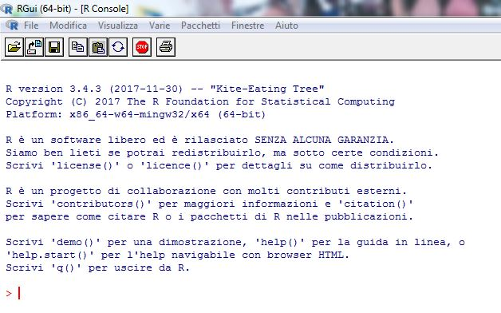

::: {.callout-note appearance="simple"}
## Come leggere gli esempi

Ogni esempio è proposto in tre schede: **R**, **Python** e **SAS**. Basta scegliere il linguaggio una volta: la scelta resta valida in tutte le pagine del sito.

- Il codice **R** e **Python** viene eseguito a ogni aggiornamento del sito: i risultati mostrati sono quelli reali (R 4.x, Python 3.x con *numpy*, *pandas*, *matplotlib* e *statsmodels*).
- Il codice **SAS** non viene eseguito automaticamente, perché richiede una licenza. Si può provare gratuitamente con [SAS OnDemand for Academics](https://www.sas.com/it_it/software/on-demand-for-academics.html). Le operazioni su vettori e matrici usano **PROC IML**, l'ambiente matriciale di SAS.
- I file di dati citati si trovano nella cartella [`data/`](https://github.com/erasmovassallo/statistica-economica/tree/main/data) del repository.
:::

## 1.1 R: un ambiente statistico open source {#sec-r}

**R** è un ambiente di sviluppo statistico open source con licenza GNU-GPL, basato su un linguaggio di programmazione orientato agli oggetti e ormai ben noto non soltanto agli addetti ai lavori. Nasce nel 1996 da un progetto di Ross Ihaka e Robert Gentleman presso l'Università di Auckland come derivazione del linguaggio statistico S, tant'è che all'inizio gran parte delle routine giravano sull'una e sull'altra piattaforma di calcolo senza la necessità di modificare il codice; non è un caso che John M. Chambers, uno dei fondatori del linguaggio S, sia stato tra i programmatori più attivi nel sostegno di **R**.

Tuttavia, le versioni più recenti di **R** si sono maggiormente differenziate da S, enfatizzando le specificità di un linguaggio che ha come suo principale punto di forza la totale gratuità. È questa la vera chiave del successo di **R** che, oggi, può vantare una vasta e sempre crescente libreria di routine statistiche aggiunte continuamente da programmatori occasionali, esperti o semplici utenti: oltre 10.000 librerie a inizio 2018. Non è dunque un caso che l'edizione del 7 gennaio 2009 del prestigioso *New York Times* abbia dedicato un [articolo](http://www.nytimes.com/2009/01/07/technology/business-computing/07program.html) proprio a **R** e alla sua crescente diffusione negli ambienti statistici.

Per tali ragioni, questo testo dedica specifica attenzione a **R** con riferimento alla release 3.4.3 (nella versione Microsoft Windows a 64 bit), ultima al momento in cui si scrive. Tuttavia, i comandi utilizzati funzionano anche con altre versioni del software senza modifiche degne di nota.

All'indirizzo <http://www.unipa.it/persone/docenti/v/erasmo.vassallo/testo18a> è possibile trovare file, dati, materiali aggiuntivi, eventuali aggiornamenti ed errata corrige del volume.

Per iniziare, la Figura 1.1 riporta la finestra di avvio di **R** con il cursore in riga di comando. Va notato che esistono programmi aggiuntivi (quasi sempre gratuiti od open source) che forniscono un maggiore supporto grafico all'uso del software tramite una GUI minimale e/o nella gestione delle librerie o dei file di help in linea; [RStudio](https://posit.co/products/open-source/rstudio/) è una delle più diffuse. In ogni caso, la programmazione si mantiene in riga di comando per rispettare la filosofia originaria di **R** e consentire una maggiore flessibilità di esecuzione a script e comandi altamente personalizzabili.

{width=75%}

::: {.callout-tip collapse="true"}
## Python e SAS: gli ambienti equivalenti

- **Python** è un linguaggio generalista, anch'esso open source; per l'analisi statistica si usano soprattutto le librerie *numpy* (vettori e matrici), *pandas* (tabelle di dati), *matplotlib* (grafici) e *statsmodels* (modelli statistici). Gli ambienti più comuni sono Jupyter, VS Code e la stessa RStudio/Positron.
- **SAS** è un software commerciale, molto diffuso in ambito aziendale, bancario e nella statistica ufficiale. Si lavora con *programmi* composti da passi `DATA` (gestione dei dati) e procedure `PROC` (analisi). L'interfaccia web *SAS Studio* è inclusa in SAS OnDemand for Academics.
:::

In questo volume non ci soffermeremo su un'introduzione a **R** e sull'uso generico dei comandi di base, a meno che non siano utili o finalizzati ai contenuti specifici che verranno trattati. Infatti, il software è noto al tipico utilizzatore di questo testo, poiché molti dei corsi di studio delle classi statistiche, e certamente il corso in Statistica presso l'Università degli Studi di Palermo, offrono specifici percorsi di alfabetizzazione informatica. Tuttavia, anche il lettore con minori competenze potrà affrontare utilmente la lettura del testo sfruttando le molte ottime guide presenti sul web in varie lingue; tra queste, in italiano, si consigliano [*Nozioni di R*](https://cran.r-project.org/doc/contrib/nozioniR.pdf) di V. Muggeo e G. Ferrara e la [*Dispensa di R*](https://cran.r-project.org/doc/contrib/Mineo-dispensaR.pdf) di A.M. Mineo.

Qui, come stimolo per gli approfondimenti che il lettore riterrà necessari, riportiamo alcuni semplici comandi utili a rappresentare il funzionamento di **R**.

## 1.2 Assegnazioni e gestione del workspace {#sec-workspace}

Iniziando dalle assegnazioni di valore, il comando `x <- 4` attribuisce il valore 4 a $x$. Va ricordato che **R** è *case-sensitive*, cioè $x$ è diverso da $X$. Allo stesso modo, `y <- c(2,7,4,1)` assegna i valori (2, 7, 4, 1) al vettore $y$.

::: {.panel-tabset group="language"}
### R

```{r}
x <- 4
y <- c(2, 7, 4, 1)
x
y
```

### Python

```{python}
import numpy as np

x = 4
y = np.array([2, 7, 4, 1])   # i vettori numerici si costruiscono con numpy
print(x)
print(y)
```

### SAS

```sas
proc iml;                    /* ambiente matriciale di SAS */
  x = 4;
  y = {2, 7, 4, 1};          /* vettore colonna */
  print x, y;
quit;
```
:::

Se il comando `ls()` presenta a video il contenuto del workspace, il comando `rm(PIL)` elimina la variabile *PIL* dalla memoria del computer, ovviamente nell'ipotesi che esista già un oggetto con questa denominazione. Ma se volessimo eliminare tutte le variabili che contengono PIL nel nome, scriveremo `rm(list=ls(pat="PIL"))`. Ed ancora, `save(list=ls(), file="save.rda")` salva l'intero workspace in un file chiamato *save.rda*. Se volessimo eliminare tutti i dati e le variabili presenti in memoria, cancellando l'intero workspace, scriveremo `rm(list=ls())`.

Una volta salvati, per esempio in *prova.rda*, il caricamento dei dati in una nuova sessione di **R** avviene semplicemente con `load("prova.rda")`. Dopo una serie di elaborazioni, può interessare un salvataggio selettivo dei soli oggetti $V1$ e $V2$, con `save(V1, V2, file="save2.rda")`. Ma se volessimo memorizzare uno snapshot completo della memoria, includendo dati e variabili, si potrà utilizzare `save.image()`.

::: {.panel-tabset group="language"}
### R

```{r}
#| eval: false
ls()                               # contenuto del workspace
rm(PIL)                            # elimina l'oggetto PIL
rm(list = ls(pat = "PIL"))         # elimina gli oggetti che contengono "PIL" nel nome
save(list = ls(), file = "save.rda")   # salva l'intero workspace
rm(list = ls())                    # svuota il workspace
load("prova.rda")                  # ricarica oggetti salvati
save(V1, V2, file = "save2.rda")   # salvataggio selettivo
save.image()                       # snapshot completo (file .RData)
```

### Python

```{python}
#| eval: false
import pickle

[n for n in dir() if not n.startswith("_")]   # oggetti definiti (in Jupyter: %who)
del PIL                                       # elimina l'oggetto PIL

# elimina gli oggetti che contengono "PIL" nel nome
for n in [n for n in list(globals()) if "PIL" in n]:
    del globals()[n]

# salvataggio selettivo e caricamento con pickle
with open("save2.pkl", "wb") as f:
    pickle.dump({"V1": V1, "V2": V2}, f)
with open("save2.pkl", "rb") as f:
    oggetti = pickle.load(f)

# Python non ha un vero "save.image()": per salvare tutta la sessione
# si può usare la libreria dill (dill.dump_session("sessione.pkl")).
```

### SAS

```sas
/* Oggetti matriciali in PROC IML */
proc iml;
  show names;            /* elenca le matrici in memoria (≈ ls()) */
  free PIL;              /* elimina la matrice PIL (≈ rm(PIL)) */
  store V1 V2;           /* salvataggio selettivo (≈ save(V1, V2, ...)) */
  store _all_;           /* salva tutte le matrici (≈ save.image()) */
  free _all_;            /* svuota la memoria (≈ rm(list = ls())) */
  load _all_;            /* ricarica le matrici salvate (≈ load()) */
quit;

/* Dataset della libreria temporanea WORK */
proc datasets library=work;
  delete PIL;            /* elimina il dataset PIL */
  delete PIL:;           /* elimina i dataset il cui nome INIZIA per PIL */
quit;
```

In SAS la "memoria" di lavoro è la libreria temporanea `WORK`, che si svuota a fine sessione; per conservare i dati si usa una libreria permanente (`libname mialib "percorso";`).
:::

## 1.3 Vettori, matrici, funzioni e data frame {#sec-matrici}

Continuiamo con altri esempi su **R**. Il lettore potrà trascrivere le istruzioni e verificarne il comportamento.

::: {.panel-tabset group="language"}
### R

```{r}
#| error: true
x <- 4
y <- c(2, 7, 4, 1)
x * Y
```

### Python

```{python}
#| error: true
x * Y
```

### SAS

```sas
proc iml;
  x = 4;
  y = {2, 7, 4, 1};
  z = x * Y;     /* nessun errore: SAS NON distingue maiuscole e minuscole */
  print z;
quit;
```
:::

Il risultato non è quello atteso poiché $Y$ non esiste. Infatti, $y$ e $Y$ non rappresentano gli stessi oggetti. **R**, come si diceva, è case-sensitive; gli utenti abituati ai linguaggi di programmazione o ai sistemi Unix non si stupiranno. Anche Python è case-sensitive, mentre SAS non lo è: in SAS `y` e `Y` indicano lo stesso oggetto.

Il prodotto corretto, cioè uno scalare per un vettore, fornirà un vettore. Al contrario, $y$ per la sua trasposta ci fornirà uno scalare. Da notare il comando del prodotto matriciale `%*%` e di trasposta `t()`. Se un vettore riga per un vettore colonna fornisce uno scalare, un vettore colonna per un vettore riga darà una matrice.

::: {.panel-tabset group="language"}
### R

```{r}
x * y
t(y) %*% y
z <- y %*% t(y)
z
```

### Python

```{python}
print(x * y)
print(y @ y)            # prodotto scalare: @ è il prodotto matriciale
z = np.outer(y, y)      # vettore colonna per vettore riga
print(z)
```

### SAS

```sas
proc iml;
  x = 4;
  y = {2, 7, 4, 1};
  a = x * y;
  b = t(y) * y;        /* in IML * è il prodotto matriciale; y` è la trasposta */
  z = y * t(y);
  print a, b, z;
quit;
```
:::

Le matrici possono essere costruite anche per riempimento. Il comando `matrix(1:30,5,6)` definisce una matrice con valori da 1 a 30 in 5 righe e 6 colonne. Se, allo stesso modo, volessimo popolare la matrice $2 \times 3$ di zeri, scriveremo `matrix(0,2,3)`, mentre una matrice diagonale unitaria $3 \times 3$ (matrice identità) sarà `diag(1,3,3)`.

::: {.panel-tabset group="language"}
### R

```{r}
a <- matrix(1:30, 5, 6)
a
matrix(0, 2, 3)
diag(1, 3, 3)
```

### Python

```{python}
# R riempie le matrici per colonna: in numpy serve order="F"
a = np.arange(1, 31).reshape(5, 6, order="F")
print(a)
print(np.zeros((2, 3)))
print(np.eye(3))
```

### SAS

```sas
proc iml;
  /* shape() riempie per riga: si costruisce 6x5 e si traspone */
  a = t(shape(1:30, 6, 5));
  zeri = j(2, 3, 0);       /* matrice 2x3 di zeri */
  id = I(3);               /* matrice identità 3x3 */
  print a, zeri, id;
quit;
```
:::

::: {.callout-warning}
## Attenzione all'ordine di riempimento
**R** riempie le matrici **per colonna**; *numpy* e la funzione `shape()` di SAS/IML le riempiono invece **per riga**. Per ottenere la stessa matrice occorre `order="F"` in Python e una trasposizione in SAS.
:::

Una delle caratteristiche più interessanti di **R** è la possibilità di definire nuovi comandi tramite funzioni; ad esempio, `sm <- function(a,b) a+b` definisce la funzione di somma tra gli argomenti $a$ e $b$, mentre un numero maggiore di istruzioni deve essere racchiuso tra parentesi graffe. Pertanto, `sm(6,8)` fornirà la somma 14.

::: {.panel-tabset group="language"}
### R

```{r}
sm <- function(a, b) a + b
sm(6, 8)
```

### Python

```{python}
def sm(a, b):
    return a + b

sm(6, 8)
```

### SAS

```sas
proc iml;
  start sm(a, b);          /* definizione di una funzione (modulo) IML */
    return(a + b);
  finish;
  s = sm(6, 8);
  print s;
quit;
```
:::

Costruiamo adesso un oggetto *dati* come `data.frame()`, con valori inseriti direttamente in riga di comando, per popolare una matrice di 5 righe e 2 colonne $X1$ e $X2$. L'oggetto $X1$ non esiste se non richiamato all'interno di *dati* tramite la denominazione della variabile, ovvero con la posizione dello specifico vettore colonna. Notiamo che `#` consente di aggiungere commenti ignorati dal software.

::: {.panel-tabset group="language"}
### R

```{r}
#| error: true
dati <- data.frame(matrix(c(3, 6, 8, 9, 1, 4, 3, 6, 7, 8), 5, 2))
dati
X1        # l'oggetto X1 non esiste
dati$X1
dati[, 1]
```

### Python

```{python}
#| error: true
import pandas as pd

dati = pd.DataFrame(
    np.array([3, 6, 8, 9, 1, 4, 3, 6, 7, 8]).reshape(5, 2, order="F"),
    columns=["X1", "X2"],
)
print(dati)
X1        # l'oggetto X1 non esiste
```

```{python}
print(dati["X1"].to_numpy())     # per nome
print(dati.iloc[:, 0].to_numpy())  # per posizione (in Python si conta da 0)
```

### SAS

```sas
data dati;                 /* in SAS le tabelle di dati si creano con un passo DATA */
  input X1 X2;
  datalines;
3 4
6 3
8 6
9 7
1 8
;
run;

proc print data=dati; run;
proc print data=dati; var X1; run;   /* la sola colonna X1 */
```
:::

L'ultimo comando visualizza tutti i valori posti in una qualsiasi riga della prima colonna. Se volessimo visualizzare tutti i valori della prima riga scriveremo `dati[1,]` oppure, per visualizzare il singolo valore che corrisponde alla posizione della seconda riga e prima colonna, `dati[2,1]`.

::: {.panel-tabset group="language"}
### R

```{r}
dati[1, ]
dati[2, 1]
```

### Python

```{python}
print(dati.iloc[[0], :])   # prima riga
print(dati.iloc[1, 0])     # seconda riga, prima colonna
```

### SAS

```sas
proc print data=dati(obs=1); run;                     /* prima riga */
proc print data=dati(firstobs=2 obs=2); var X1; run;  /* seconda riga, prima colonna */
```
:::

Ma se volessimo operare direttamente con i valori in *dati* senza richiamare di volta in volta la matrice che li contiene, potremmo usare il comando `attach()`. L'operazione inversa è consentita da `detach()`.

::: {.panel-tabset group="language"}
### R

```{r}
attach(dati)
X1
X2
detach(dati)
```

### Python

```{python}
# Python non ha un equivalente di attach(): si estraggono le colonne
X1, X2 = dati["X1"].to_numpy(), dati["X2"].to_numpy()
print(X1)
print(X2)
```

### SAS

```sas
/* In SAS non serve: dentro un passo DATA o una PROC con data=dati
   le variabili si richiamano direttamente per nome */
data _null_;
  set dati;
  put X1= X2=;
run;
```
:::

Inoltre, se `matrix(1:6,2,3)` è una matrice con 2 righe e 3 colonne non denominate, e se `VX` e `VY` contengono rispettivamente le etichette di colonna e di riga, tramite l'argomento `dimnames` specificheremo i nomi di riga e di colonna.

::: {.panel-tabset group="language"}
### R

```{r}
matrix(1:6, 2, 3)
VX <- c("basso", "medio", "alto")
VY <- c("corto", "lungo")
matrix(1:6, 2, 3, dimnames = list(VY, VX))
```

### Python

```{python}
VX = ["basso", "medio", "alto"]
VY = ["corto", "lungo"]
pd.DataFrame(np.arange(1, 7).reshape(2, 3, order="F"), index=VY, columns=VX)
```

### SAS

```sas
proc iml;
  m  = t(shape(1:6, 3, 2));
  VX = {"basso" "medio" "alto"};
  VY = {"corto" "lungo"};
  print m[rowname=VY colname=VX];
quit;
```
:::

In genere, l'inserimento di dati non avviene da riga di comando ma leggendo file esterni. In particolare, due istruzioni molto utilizzate sono `read.table` e `write.table`, che consentono rispettivamente di leggere e scrivere valori posti in forma tabellare. **R**, comunque, consente lettura e scrittura di dati anche nei formati tipici dei software statistici più noti tramite uso, in gran parte dei casi, di specifiche librerie. Ad esempio, il file *pil.csv* usato nei capitoli successivi ha il punto e virgola come separatore, secondo la convenzione italiana, e si legge con `read.csv2()`.

::: {.panel-tabset group="language"}
### R

```{r}
pil <- read.csv2("data/pil.csv")
head(pil)
# write.csv2(pil, "pil_copia.csv", row.names = FALSE)   # scrittura
```

### Python

```{python}
pil = pd.read_csv("data/pil.csv", sep=";", decimal=",")
print(pil.head())
# pil.to_csv("pil_copia.csv", sep=";", decimal=",", index=False)   # scrittura
```

### SAS

```sas
proc import datafile="data/pil.csv" out=pil dbms=dlm replace;
  delimiter=";";
  getnames=yes;
run;
proc print data=pil(obs=6); run;

/* scrittura */
proc export data=pil outfile="pil_copia.csv" dbms=dlm replace;
  delimiter=";";
run;
```

In SAS OnDemand for Academics i file vanno prima caricati nello spazio personale e il percorso va adattato (ad es. `"/home/u1234567/data/pil.csv"`).
:::

## 1.4 Primi calcoli statistici {#sec-statistica}

Utile ai nostri scopi, facciamo alcuni esempi di calcolo statistico. Definito un insieme di dati $X$, calcoliamo le frequenze assolute e quelle relative. La sintassi non richiede spiegazione.

::: {.panel-tabset group="language"}
### R

```{r}
X <- c(4, 6, 8, 3, 3, 7, 9, 6, 3, 1, 2, 6, 8, 9, 5, 3)
table(X)
table(X) / length(X)
```

### Python

```{python}
X = pd.Series([4, 6, 8, 3, 3, 7, 9, 6, 3, 1, 2, 6, 8, 9, 5, 3], name="X")
print(X.value_counts().sort_index())
print(X.value_counts(normalize=True).sort_index())
```

### SAS

```sas
data es;
  input X @@;              /* @@ legge più valori sulla stessa riga */
  datalines;
4 6 8 3 3 7 9 6 3 1 2 6 8 9 5 3
;
run;

proc freq data=es;
  tables X;                /* frequenze assolute, relative (%) e cumulate */
run;
```
:::

Se volessimo visualizzare un istogramma costruito sui dati contenuti in $X$, il comando `hist(X)` fornirebbe il grafico riportato nella Figura 1.2. Le caratteristiche di **R** consentono un'ampia personalizzazione della rappresentazione grafica. Il lettore può provare l'esito di comandi standard quali `plot()`, `boxplot()` o `pie()`, per citarne solo alcuni.

::: {.panel-tabset group="language"}
### R

```{r}
#| fig-cap: "Figura 1.2 – Esempio di istogramma"
hist(X)
```

### Python

```{python}
#| fig-cap: "Figura 1.2 – Esempio di istogramma"
import matplotlib.pyplot as plt

plt.figure(figsize=(5, 5))
plt.hist(X, bins=range(1, 10), edgecolor="black", color="lightgrey")
plt.title("Histogram of X")
plt.xlabel("X")
plt.ylabel("Frequency")
plt.show()
```

### SAS

```sas
proc sgplot data=es;
  histogram X / scale=count;
run;
```
:::

::: {.callout-note}
Ogni software sceglie a modo suo le classi dell'istogramma: R le chiude a destra, (a, b], mentre *matplotlib* e SAS le chiudono a sinistra. Con dati discreti come questi le altezze delle barre possono quindi differire leggermente.
:::

Una generica descrizione del dataset $X$ si può ottenere con il comando `summary()`, invero molto utile per sintetizzare e presentare a video i risultati principali di tutte le analisi statistiche. Nel nostro esempio, il comando riporta alcune statistiche descrittive.

::: {.panel-tabset group="language"}
### R

```{r}
summary(X)
```

### Python

```{python}
print(X.describe())
```

### SAS

```sas
proc means data=es min q1 median mean q3 max maxdec=3;
  var X;
run;
```
:::

::: {.callout-warning}
## Quartili: tre software, definizioni diverse
R e *pandas* calcolano per default i quartili con lo stesso metodo (interpolazione lineare, *type 7* in R): $Q_3 = 7.25$. SAS usa per default un'altra definizione (`QNTLDEF=5`) e restituisce $Q_3 = 7.5$, lo stesso valore che in R si ottiene con `quantile(X, type = 2)`. Non è un errore: esistono diverse definizioni di quantile campionario.

```{r}
quantile(X, type = 2)
```
:::

Per evidenziarne l'utilità, applicheremo `summary()` a un modello di regressione. A tale scopo, carichiamo in memoria i dati *cars* del package *datasets*, presente di default in **R**. Il comando per la stima della regressione lineare è `lm()`; la tilde `~` separa la variabile dipendente dalle esplicative.

::: {.panel-tabset group="language"}
### R

```{r}
data(cars)
modello <- lm(dist ~ speed, data = cars)
summary(modello)
```

### Python

```{python}
import statsmodels.formula.api as smf

cars = pd.read_csv("data/cars.csv")       # gli stessi dati di R, salvati in data/
modello = smf.ols("dist ~ speed", data=cars).fit()
print(modello.summary())
```

### SAS

```sas
/* Attenzione: SASHELP.CARS è un dataset diverso! Si importano i dati di R */
proc import datafile="data/cars.csv" out=cars dbms=csv replace;
  getnames=yes;
run;

proc reg data=cars;
  model dist = speed;
run;
quit;
```
:::

In questo modo, **R** visualizza le stime ottenute e una prima diagnostica circa la bontà del modello lineare tra gli oggetti *dist* (distanza necessaria all'arresto dell'autovettura) e *speed* (velocità della stessa autovettura); torneremo più avanti sulla descrizione delle statistiche prodotte da `lm()`.

Infine, i comandi `plot(cars, main="Retta di regressione")` e `abline(modello)` visualizzano il grafico di dispersione tra *dist* e *speed* e disegnano la retta di regressione ottenuta tramite OLS (Figura 1.3); va notato che l'uso di `abline()` richiede che il dispositivo grafico sia già aperto.

::: {.panel-tabset group="language"}
### R

```{r}
#| fig-cap: "Figura 1.3 – Esempio di retta di regressione"
plot(cars, main = "Retta di regressione")
abline(modello)
```

### Python

```{python}
#| fig-cap: "Figura 1.3 – Esempio di retta di regressione"
b0, b1 = modello.params
plt.figure(figsize=(5, 5))
plt.scatter(cars["speed"], cars["dist"], facecolors="none", edgecolors="black")
plt.axline((0, b0), slope=b1, color="black")   # equivalente di abline()
plt.title("Retta di regressione")
plt.xlabel("speed")
plt.ylabel("dist")
plt.show()
```

### SAS

```sas
proc sgplot data=cars;
  title "Retta di regressione";
  reg x=speed y=dist;      /* dispersione + retta OLS */
run;
```
:::

Non è nostro obiettivo qui descrivere altre caratteristiche e funzioni di **R**; semmai, questo primo capitolo fornisce un quadro generale, certo incompleto, ma sufficiente agli scopi del volume.
