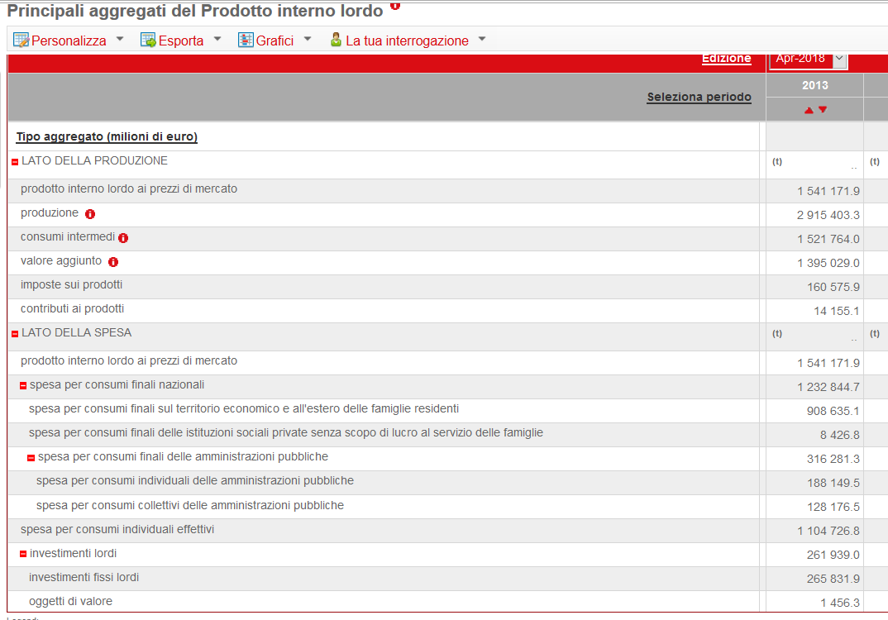

## 2.1 Il Sistema dei Conti Nazionali {#sec-sec2010}

Il Sistema dei Conti Nazionali presenta in termini contabili le attività economiche e finanziarie che caratterizzano un intero Paese o porzioni di esso; in quest'ultimo caso si preferisce il termine di Conti Territoriali, anche se lo schema di riferimento è naturalmente quello della Contabilità Nazionale. I conti possono riferirsi all'anno o a frazioni di esso (usualmente il trimestre).

La Contabilità Nazionale viene definita nell'ambito delle regole europee del SEC2010 che, a partire da settembre 2014, sostituisce il precedente SEC95 in accordo con le linee guida internazionali stabilite nel Sistema dei conti nazionali delle Nazioni Unite.

Il SEC2010, dunque, stabilisce in modo sistematico e dettagliato come si definiscono e si misurano le grandezze che descrivono il funzionamento contabile di un Paese. Esso, in sostanza, è un sistema integrato dei conti economici, poiché fa ricorso a convenzioni contabili omogenee tra i Paesi europei con l'obiettivo di misurare contabilmente le operazioni economiche che avvengono all'interno delle nazioni.

La logica del SEC è quella della partita doppia, in cui ogni posta è registrata in uscita per l'operatore che la origina e in entrata per quello che la riceve. Pertanto, tutti i conti registrano operazioni in entrata e in uscita che si bilanciano per mezzo di un opportuno saldo contabile. Poiché sono costruiti a cascata, il saldo di un conto sarà riportato nel conto successivo. Essi registrano operazioni di produzione, di distribuzione e di redistribuzione degli attori coinvolti, fondamentalmente famiglie, imprese, pubbliche amministrazioni e resto del mondo.

Rispetto alla precedente versione del 1995 (in vigore dal 1999), il SEC2010 presenta alcune importanti differenze riguardo sia l'ambito di applicazione sia i concetti. In particolare: la capitalizzazione delle spese in ricerca e sviluppo; la riclassificazione da consumi intermedi a investimenti della spesa per armamenti sostenuta dalle amministrazioni pubbliche; una differente tecnica di stima degli scambi con l'estero di merci da sottoporre a lavorazione (si registra il valore del solo servizio di trasformazione); un aggiornamento e una verifica delle unità classificabili come amministrazioni pubbliche. In aggiunta, una serie di piccole modifiche tecniche sul calcolo di alcuni aggregati con limitate ricadute pratiche, e una un po' più consistente legata all'inclusione di tutte le attività che producono reddito, incluse quelle illegali (principio già enunciato nel SEC95). Nello specifico, si introduce una stima del traffico di sostanze stupefacenti, della prostituzione e del contrabbando di sigarette o alcol. Infine, il SEC2010, rispetto al suo predecessore, ha accresciuto l'integrazione di differenti fonti informative e l'uso di dati amministrativi, con un generale miglioramento di tutte le stime e delle attività sommerse e irregolari. Naturalmente, l'applicazione del nuovo SEC2010 in chiave storica, cioè ai dati degli anni precedenti diffusi con il SEC95, ha determinato alcune revisioni delle informazioni in serie storica, con una generale rivalutazione di alcuni aggregati macroeconomici.

In una rappresentazione semplificata che mantiene una forte connessione con la versione precedente, possiamo presentare il SEC in base a una struttura su 6 conti principali, a loro volta divisi in 3 categorie, come di seguito elencato; tra parentesi è riportato il corrispondente saldo del conto.

**A) Conti delle operazioni correnti**

1. Conto della produzione (valore aggiunto)
2. Conto della distribuzione e utilizzazione del reddito
   - 2.1 distribuzione primaria (risultato di gestione)
   - 2.2 distribuzione secondaria (reddito disponibile)
   - 2.3 redistribuzione in natura (reddito disponibile corretto)
   - 2.4 utilizzazione del reddito (risparmio)

**B) Conti dell'accumulazione**

3. Formazione di capitale (accreditamento / indebitamento sull'estero)
4. Finanziario (accreditamento / indebitamento)
5. Variazioni delle attività e passività (variazione netta del patrimonio)

**C) Conti patrimoniali**

6. Patrimoniale (patrimonio netto)
   - 6.1 patrimoniale di apertura
   - 6.2 variazioni del patrimonio
   - 6.3 patrimoniale di chiusura

Per i diversi conti, proseguiamo con le poste costituenti in una rappresentazione volutamente non dettagliata, omettendo anche le formali e puntuali definizioni degli aggregati, per le quali occorrerebbe un ulteriore approfondimento sui temi di contabilità nazionale che ci porterebbe fuori strada rispetto agli obiettivi del testo. D'altronde, gli studenti ai quali è indirizzato questo volume dovrebbero già avere nel proprio bagaglio di conoscenze un corso base di contabilità e statistica economica.

### 1. Conto della produzione

$$
Y + V = X + \mathit{Inn}
\tag{2.1}
$$

- $Y$ = PIL (prodotto interno lordo) ai prezzi di mercato
- $V$ = consumi intermedi
- $X$ = produzione totale (ai prezzi base)
- $\mathit{Inn}$ = imposte indirette nette (imposte sulla produzione e importazioni al netto dei contributi ai prodotti)

Questo conto confronta la produzione con l'ammontare dei costi necessari per ottenerla. La differenza tra produzione e costi intermedi (per branca) fornisce il valore aggiunto (pari alla remunerazione dei fattori produttivi capitale, lavoro e impresa). La somma del valore aggiunto per branca fornisce il PIL.

Ricordiamo che il PIL (o Prodotto Interno Lordo) è il valore di tutti i beni e servizi finali prodotti in un Paese in un determinato periodo di tempo, ma non può essere considerato una misura del benessere della società. Per dirla alla Robert Kennedy (1968): «... il PIL comprende l'inquinamento dell'aria, la pubblicità delle sigarette, [...] programmi televisivi che valorizzano la violenza [...]. Il PIL non tiene conto della salute delle nostre famiglie, della qualità della loro educazione e della gioia dei loro momenti di svago [...]. Non misura né la nostra arguzia né il nostro coraggio né la nostra saggezza né la nostra conoscenza né la nostra compassione. Misura tutto, eccetto ciò che rende la vita degna di essere vissuta...». Ciò nonostante, il PIL è considerato ancora oggi il migliore indicatore statistico della produzione e dello sviluppo di una nazione.

### 2a. Distribuzione primaria: conto della generazione dei redditi primari

$$
Y + \mathit{Cp} = \mathit{RLD} + \mathit{Ipi} + \mathit{RLG}
\tag{2.2}
$$

- $Y$ = PIL (Prodotto Interno Lordo) ai prezzi di mercato
- $\mathit{Cp}$ = contributi alla produzione
- $\mathit{RLD}$ = redditi interni da lavoro dipendente
- $\mathit{Ipi}$ = imposte sulla produzione e importazioni
- $\mathit{RLG}$ = risultato lordo di gestione

Questo conto registra la distribuzione funzionale (primaria) del reddito, cioè mostra come il valore aggiunto viene ripartito tra i fattori di produzione (lavoro, capitale, impresa) sotto forma di salari e stipendi, interessi, rendite e dividendi, profitti. Se dal PIL si sottraggono i redditi da lavoro dipendente, si ottiene quale saldo la remunerazione degli altri fattori, cioè il risultato lordo di gestione.

Va notato che alcuni aggregati possono essere, e talvolta vengono, rappresentati anche al netto di certi contributi e/o imposte, sottraendo o aggiungendo le poste corrispondenti tra le risorse e gli impieghi dei diversi conti. Per esempio, la "sequenza dei conti" pubblicata dall'ISTAT predilige la scomposizione delle poste lorde in modo da evidenziare, ove possibile, il contributo netto degli aggregati al conto.

### 2b. Distribuzione primaria: conto dell'attribuzione dei redditi primari

$$
\mathit{RLD} + \mathit{RLG} + \mathit{Ipi} + \mathit{RLG}_{dn} + \mathit{RLG}_{drm} = Y_{nl} + \mathit{RLG}_{aN} + \mathit{RLG}_{arm} + \mathit{Cp}
\tag{2.3}
$$

- $Y_{nl}$ = reddito nazionale lordo
- $\mathit{Ipi}$ = imposte indirette
- $\mathit{RLG}_{drm}$ = redditi da capitale e impresa dal resto del mondo
- $\mathit{RLG}_{arm}$ = redditi da capitale e impresa al resto del mondo
- $\mathit{RLG}_{dn}$ = redditi da capitale da altri settori nazionali
- $\mathit{RLG}_{aN}$ = redditi da capitale ad altri settori nazionali

Questo conto presenta l'acquisizione del reddito dei soggetti proprietari dei fattori di produzione. È un conto che interessa gli operatori residenti, indipendentemente da dove hanno prestato la loro opera. Il saldo è il reddito nazionale lordo.

### 2c. Conto della distribuzione secondaria del reddito

$$
Y_{nld} + T_{drm} + T_{dn} = Y_{nl} + I_{red} + \mathit{Cs} + T_{an} + T_{arm}
\tag{2.4}
$$

- $Y_{nl}$ = reddito nazionale lordo
- $Y_{nld}$ = reddito nazionale lordo disponibile
- $I_{red}$ = imposte sul reddito e sul patrimonio
- $\mathit{Cs}$ = contributi sociali
- $T_{drm}$ = trasferimenti correnti dal resto del mondo
- $T_{arm}$ = trasferimenti correnti al resto del mondo
- $T_{dn}$ = altri trasferimenti correnti da settori nazionali
- $T_{an}$ = altri trasferimenti correnti a settori nazionali

Questo conto descrive la formazione del reddito disponibile per via dei trasferimenti correnti. Il saldo è il reddito disponibile per consumo o risparmio.

### 2d. Conto della redistribuzione del reddito in natura

$$
Y_{nldc} = Y_{nld} + \mathit{Trnat}_{netti}
\tag{2.5}
$$

- $Y_{nldc}$ = reddito nazionale lordo disponibile corretto
- $Y_{nld}$ = reddito nazionale lordo disponibile
- $\mathit{Trnat}_{netti}$ = saldo dei trasferimenti sociali in natura

I trasferimenti in natura sono oneri sostenuti dalla Pubblica Amministrazione per offrire alla collettività beni e servizi individuali acquistati da terzi o prodotti direttamente.

### 2e. Conto della utilizzazione del reddito

$$
Y_{nld} + \mathit{Rett} = C + S
\tag{2.6}
$$

- $Y_{nld}$ = reddito nazionale lordo disponibile corretto
- $S$ = risparmio nazionale lordo
- $C$ = consumi finali nazionali effettivi
- $\mathit{Rett}$ = rettifica per variazione dei diritti netti delle famiglie sui fondi pensione

Il saldo è il risparmio nazionale; entra nel conto della formazione del capitale.

### 3. Conto della formazione del capitale

$$
S + T_{ke} = I_f + I_s + O_v + T_{ku} + A_n + B
\tag{2.7}
$$

- $T_{ke}$ = trasferimenti in conto capitale dal resto del mondo
- $T_{ku}$ = trasferimenti in conto capitale al resto del mondo
- $A_n$ = acquisti netti di terreni o di beni immateriali
- $B$ = accreditamento (+) / indebitamento (−) del Paese con il resto del mondo
- $S$ = risparmio nazionale lordo
- $I_f$ = investimenti fissi lordi
- $I_s$ = variazione delle scorte
- $O_v$ = variazione degli oggetti di valore

Il saldo del conto misura la capacità del Paese di finanziare gli investimenti con il risparmio. Un saldo positivo indica un risparmio superiore agli investimenti; questo valore positivo si riversa all'estero sotto forma di impieghi nel resto del mondo. Viceversa, un saldo negativo indica una necessità di finanziamento degli investimenti con debiti contratti all'estero.

### 4. Conto finanziario

$$
\mathit{Ofa} + B = \mathit{Ofp}
\tag{2.8}
$$

- $\mathit{Ofa}$ = operazioni finanziarie attive
- $\mathit{Ofp}$ = operazioni finanziarie passive

Questo conto, redatto dalla Banca d'Italia, registra le modificazioni delle attività e passività finanziarie. Dobbiamo notare che generalmente il saldo ($B$) delle attività finanziarie non coincide con quello presente nel conto della formazione del capitale, in ragione delle diverse fonti statistiche utilizzate; spesso, per risolvere questa incongruenza, si aggiunge una posta di rettifica "errori ed omissioni".

### 5. Conto delle variazioni delle attività e passività

Il conto registrerebbe variazioni di volume legate a scoperta o esaurimento di miniere, bonifica di terreni, rinvenimento di reperti archeologici, registrazione di nuovi brevetti o scadenza di altri, ecc., ma anche le variazioni di valore causate da variazioni di prezzo. Limiti statistici non consentono ancora una redazione completa del conto.

### 6. Conto patrimoniale

Come nel caso precedente, anche il conto patrimoniale (con i suoi 3 sottoconti) viene pubblicato solo parzialmente, in ragione di irrisolte difficoltà statistiche.

Esisterebbero anche una serie di conti con il resto del mondo, in base ai quali vengono analizzate specificamente le operazioni in essere tra la nazione e il resto del mondo. Spesso le operazioni vengono sintetizzate in un unico conto detto per l'appunto "resto del mondo" o delle "transazioni internazionali"; il saldo è l'accreditamento o indebitamento della nazione, fermo restando le solite differenze dovute a effetti di bilanciamento e alle diverse fonti statistiche utilizzate, saldo che consente il bilanciamento delle due sezioni, sostanzialmente sintetizzabili in "entrate dell'Italia" e "uscite dell'Italia".

## 2.2 Il sistema semplificato di Contabilità Nazionale {#sec-semplificato}

Un modo più agevole di presentare le principali poste e i rapporti tra esse è rappresentato dal sistema semplificato di Contabilità Nazionale. In buona sostanza, gli aggregati principali vengono riassunti all'interno di uno specifico conto di equilibrio noto come "conto delle risorse e degli impieghi" che, da un lato (le risorse), include il PIL e le importazioni di beni e servizi e, dall'altro (gli impieghi), la spesa per consumi finali, gli investimenti lordi e le esportazioni di beni e servizi. Il conto pone in equilibrio le componenti dell'offerta con quelle della domanda finale, come da risultanze delle tavole input-output.

$$
\underbrace{Y + M}_{\text{risorse}} = \underbrace{C + I + E}_{\text{impieghi}}
\tag{2.9}
$$

- $Y$ = PIL
- $M$ = importazioni (fob)
- $C$ = spesa per consumi
- $I$ = investimenti
- $E$ = esportazioni (fob)

In modo analogo vengono presentati un conto semplificato del reddito, uno della formazione del capitale e un conto del resto del mondo. Nel conto del reddito troviamo le poste seguenti

$$
C + S = Y + R
\tag{2.10}
$$

- $S$ = risparmio
- $Y$ = reddito (che possiamo far coincidere con il PIL)
- $R$ = redditi e trasferimenti dall'estero

La somma $Y+R$ costituisce il reddito disponibile per consumo o risparmio. Per il conto della formazione del capitale possiamo scrivere

$$
I + B = S
\tag{2.11}
$$

con $B$ = accreditamento / indebitamento. Infine, il conto del resto del mondo

$$
E + R = M + B
\tag{2.12}
$$

bilancia esportazioni e redditi più trasferimenti dall'estero con importazioni e accreditamento o indebitamento della nazione.

## 2.3 I dati ISTAT e l'analisi degli aggregati {#sec-istat}

Uno dei modi più agevoli per consultare i principali dati ufficiali dell'ISTAT è ricorrere al sottosito <http://dati.istat.it>. Sotto "conti nazionali" del menu posto a sinistra è facilmente accessibile l'informazione contabile, sia nel dettaglio territoriale sia in quello storico. In particolare, la voce "principali aggregati del prodotto interno lordo" fornisce un esempio di tabella (consultazione del 16.07.2018) parzialmente rappresentata in Figura 2.1.

::: {.callout-note appearance="simple"}
## Nota all'edizione online
Il sito *dati.istat.it* (I.Stat) è stato progressivamente sostituito dalla piattaforma **IstatData**, all'indirizzo <https://esploradati.istat.it>, dove si trovano le stesse tavole dei conti nazionali. Da R i dati si possono scaricare anche con il pacchetto *istat*.
:::

{width=80%}

La Figura 2.1 si riferisce a dati per l'Italia nel complesso, con valori a prezzi costanti (concatenati all'anno base 2010), senza alcuna correzione (in particolare, i dati trimestrali potrebbero anche essere corretti per effetti di stagionalità e di calendario; sul punto diremo più avanti).

Ricordiamo che, oltre ai prezzi tenuti costanti all'anno 2010, esiste anche la possibilità di esprimere le valutazioni a prezzi correnti e a prezzi dell'anno precedente. La modalità a prezzi costanti è quella preferita nell'analisi temporale degli aggregati, poiché in tal modo se ne può studiare l'evoluzione in termini di volume, avendo eliminato gli effetti distorcenti della variazione dei prezzi.

Notiamo, ancora, che in tabella il PIL è riportato ai "prezzi di mercato", la valutazione più comune. Teniamo a mente che il PIL è sostanzialmente una somma di "valori aggiunti" (nei vari stadi della produzione) delle attività economiche svolte "all'interno" di un territorio economico, considerate al "lordo" degli ammortamenti (ossia senza considerare il deprezzamento subito dallo stock di capitale). La valutazione delle attività economiche può, dunque, essere eseguita al "costo dei fattori" (che l'ISTAT non pubblica più), basata sulla remunerazione dei fattori produttivi; ai "prezzi base", cioè in base ai prezzi della produzione; e, appunto, ai "prezzi di mercato", basata sui prezzi di acquisto di beni e servizi. Intervengono, poi, altre considerazioni sul lordo o netto di imposte e contributi su prodotti e produzioni, una stima dei "servizi di intermediazione finanziaria indirettamente misurati", altre imposte e l'IVA per giungere al PIL, ma qui non ci dilunghiamo oltre.

Il lettore interessato troverà nel file *aggregati.xls* i dati di cui alla Figura 2.1, che si possono leggere in **R** tramite le librerie allo scopo dedicate. In alternativa, è possibile utilizzare il comando base `read.csv` o `read.csv2` nel caso di formato CSV (rispettivamente con separatore anglosassone e latino), nel quale può essere facilmente convertito il formato XLS; va notato che la lettura del CSV è preferita nella pratica quotidiana, in virtù della facile trattabilità del suo formato testo.

Dal file citato si desume che, a prezzi costanti 2010, il PIL italiano si attesta nell'anno 2017 a circa 1.594.580,9 milioni di euro. Sulla produzione totale, i consumi intermedi si attestano attorno al 52%, mentre la spesa totale per consumi si aggira attorno all'80% del PIL, il resto essendo coperto da investimenti lordi per una quota tra il 17% e il 18% e da una quota residua imputabile alle esportazioni nette. In termini generali, gli aggregati economici rilevati negli ultimi anni segnalano il miglioramento dell'economia nazionale dopo la grande crisi. È, dunque, interessante analizzare alcune poste contabili prima del 2008; a tal proposito, la Tabella 2.1 riporta alcuni dati storici riferibili all'intervallo 2004-2008.

| Anni | PIL | M | CF | CC | IA | IB | IC | SC | E |
|---:|---:|---:|---:|---:|---:|---:|---:|---:|---:|
| 2004 | 1.389.993 | 341.000 | 810.767 | 281.316 | 107.774 | 29.984 | 146.374 | 4.471 | 350.307 |
| 2005 | 1.429.879 | 372.222 | 838.650 | 296.159 | 112.322 | 29.927 | 154.436 | −747 | 371.354 |
| 2006 | 1.486.699 | 425.456 | 871.772 | 304.936 | 121.530 | 31.552 | 161.326 | 7.508 | 413.531 |
| 2007 | 1.544.777 | 451.226 | 901.799 | 310.229 | 127.004 | 32.188 | 168.283 | 8.972 | 447.528 |
| 2008 | 1.572.051 | 460.707 | 922.774 | 324.224 | 124.532 | 32.512 | 171.110 | 5.132 | 452.474 |

: Tabella 2.1 – Alcuni aggregati di Contabilità Nazionale (2004-2008), milioni di euro correnti {.striped}

*Legenda*: PIL = Prodotto Interno Lordo; M = importazioni di beni e servizi fob; CF = spesa delle famiglie; CC = spesa della PA e ISP; IA = investimenti in macchinari e attrezzature; IB = investimenti in mezzi di trasporto; IC = investimenti in costruzioni; SC = variazione delle scorte e degli oggetti di valore; E = esportazioni di beni e servizi fob. La somma di CF e CC costituisce i consumi finali nazionali; la somma di IA, IB e IC fornisce il totale degli investimenti fissi lordi.

Le poste sono presentate questa volta a prezzi correnti, poiché siamo interessati a un confronto tra le stesse più che alla loro specifica evoluzione storica. I valori corrispondenti sono contenuti nel file *aggregati.csv*, che importiamo con `read.csv2()`.

::: {.panel-tabset group="language"}
### R

```{r}
tabella1 <- read.csv2("data/aggregati.csv")
attach(tabella1)
tabella1
```

### Python

```{python}
import pandas as pd

tabella1 = pd.read_csv("data/aggregati.csv", sep=";")
# equivalente di attach(): estraiamo le colonne come vettori
PIL, M, CF, CC = tabella1["PIL"], tabella1["M"], tabella1["CF"], tabella1["CC"]
IA, IB, IC, SC, E = tabella1["IA"], tabella1["IB"], tabella1["IC"], tabella1["SC"], tabella1["E"]
print(tabella1)
```

### SAS

```sas
proc import datafile="data/aggregati.csv" out=tabella1 dbms=dlm replace;
  delimiter=";";
  getnames=yes;
run;
proc print data=tabella1 noobs; run;
```
:::

È interessante evidenziare che il totale delle risorse (PIL+M) cresce tra il 2004 e il 2008 di 301.765 milioni di euro correnti, attestandosi nell'ultimo anno a 2.032.758: ma, facciamo attenzione, in queste cifre sono incluse le dinamiche dei prezzi; sul punto torneremo più avanti.

::: {.panel-tabset group="language"}
### R

```{r}
risorse <- PIL + M
risorse[5] - risorse[1]
risorse
```

### Python

```{python}
risorse = PIL + M
print(risorse.iloc[4] - risorse.iloc[0])   # in Python si conta da 0
print(risorse.to_numpy())
```

### SAS

```sas
data agg;
  set tabella1;
  risorse = PIL + M;
run;

/* differenza tra l'ultimo e il primo anno */
proc sql;
  select max(case when Anni=2008 then risorse end)
       - max(case when Anni=2004 then risorse end) as diff_risorse
  from agg;
quit;

proc print data=agg noobs; var Anni risorse; run;
```
:::

Gran parte delle risorse è di origine interna; infatti, l'incidenza del PIL sul totale (PIL+M) è alta (attorno all'80%), anche se decrescente in quegli anni, ciò potendo segnalare un indebolimento del sistema Paese a favore di beni e servizi importati

::: {.panel-tabset group="language"}
### R

```{r}
PIL / risorse
```

### Python

```{python}
print((PIL / risorse).to_numpy())
```

### SAS

```sas
data agg;
  set agg;
  quota_pil = PIL / risorse;
run;
proc print data=agg noobs; var Anni quota_pil; run;
```
:::

e non a caso le importazioni superano regolarmente le esportazioni a partire dal 2005, fino a un +1,82% nel 2008, mentre, come abbiamo già detto, negli anni a noi più recenti il Paese ha recuperato un po' di competitività e riesce a esportare con un saldo positivo delle esportazioni nette. Tornando ai dati storici:

::: {.panel-tabset group="language"}
### R

```{r}
M / E
round(((M / E) - 1) * 100, 2)
```

### Python

```{python}
print((M / E).to_numpy())
print((((M / E) - 1) * 100).round(2).to_numpy())
```

### SAS

```sas
data agg;
  set agg;
  rapp_ME = M / E;
  var_ME  = round((rapp_ME - 1) * 100, 0.01);   /* in SAS si arrotonda a un multiplo */
run;
proc print data=agg noobs; var Anni rapp_ME var_ME; run;
```
:::

Notiamo l'utilizzo della funzione `round()` per limitare a 2 il numero dei decimali.

Sul fronte della domanda, l'aggregazione dei consumi e degli investimenti permette di evidenziare meglio il maggiore ruolo trainante dei primi, con un ammontare circa triplo rispetto agli investimenti.

::: {.panel-tabset group="language"}
### R

```{r}
consumi <- CF + CC
investimenti <- IA + IB + IC
consumi / investimenti
```

### Python

```{python}
consumi = CF + CC
investimenti = IA + IB + IC
print((consumi / investimenti).to_numpy())
```

### SAS

```sas
data agg;
  set agg;
  consumi = CF + CC;
  investimenti = IA + IB + IC;
  rapp_ci = consumi / investimenti;
run;
proc print data=agg noobs; var Anni rapp_ci; run;
```
:::

Appare di interesse spiegare le variazioni esibite dal PIL tra il 2004 e il 2008 con le analoghe variazioni dal lato della domanda. Per far ciò, isoliamo il PIL a primo membro e differenziamo tra inizio e fine periodo; per semplicità aggreghiamo le scorte agli investimenti e sottraiamo le importazioni dalle esportazioni per ottenere le esportazioni nette.

Nell'ipotesi economica standard che sia la domanda aggregata a generare l'offerta aggregata, si può osservare che l'incremento di PIL tra il 2004 e il 2008, attestato in termini assoluti a circa 182.058 milioni di euro, è spiegato da un incremento dei consumi per 154.915 milioni, da un incremento di investimenti e scorte per 44.683 milioni e da una riduzione di 17.540 milioni a causa della sfavorevole performance delle esportazioni rispetto alle importazioni: ricordiamoci che è inclusa la dinamica dei prezzi.

::: {.panel-tabset group="language"}
### R

```{r}
INV <- investimenti + SC
CON <- consumi
ESN <- E - M
PIL[5] - PIL[1]
CON[5] - CON[1]
INV[5] - INV[1]
ESN[5] - ESN[1]
```

### Python

```{python}
INV = investimenti + SC
CON = consumi
ESN = E - M
for nome, x in [("PIL", PIL), ("CON", CON), ("INV", INV), ("ESN", ESN)]:
    print(nome, x.iloc[4] - x.iloc[0])
```

### SAS

```sas
data agg;
  set agg;
  INV = investimenti + SC;
  CON = consumi;
  ESN = E - M;
run;

/* differenze tra il 2008 (ultima riga) e il 2004 (prima riga) */
data diff;
  set agg end=ultimo;
  retain PIL0 CON0 INV0 ESN0;
  if _n_ = 1 then do; PIL0 = PIL; CON0 = CON; INV0 = INV; ESN0 = ESN; end;
  if ultimo then do;
    dPIL = PIL - PIL0; dCON = CON - CON0; dINV = INV - INV0; dESN = ESN - ESN0;
    output;
  end;
  keep dPIL dCON dINV dESN;
run;
proc print data=diff noobs; run;
```
:::

Il passo successivo è breve: qual è stato allora il contributo specifico che consumi, investimenti ed esportazioni nette hanno dato alla crescita del PIL e, quindi, allo sviluppo economico della nazione sino al 2008? Per rispondere alla domanda basta rapportare le differenze assolute al livello iniziale del PIL.

::: {.panel-tabset group="language"}
### R

```{r}
dPIL <- (PIL[5] - PIL[1]) / PIL[1] * 100
cCON <- (CON[5] - CON[1]) / PIL[1] * 100
cINV <- (INV[5] - INV[1]) / PIL[1] * 100
cESN <- (ESN[5] - ESN[1]) / PIL[1] * 100
risultati <- round(c(dPIL, cCON, cINV, cESN), 2)
risultati
```

### Python

```{python}
import numpy as np

contrib = lambda x: (x.iloc[4] - x.iloc[0]) / PIL.iloc[0] * 100
risultati = np.round([contrib(PIL), contrib(CON), contrib(INV), contrib(ESN)], 2)
print(risultati)
```

### SAS

```sas
data contributi;
  set agg end=ultimo;
  retain PIL0 CON0 INV0 ESN0;
  if _n_ = 1 then do; PIL0 = PIL; CON0 = CON; INV0 = INV; ESN0 = ESN; end;
  if ultimo then do;
    dPIL = round((PIL - PIL0) / PIL0 * 100, 0.01);
    cCON = round((CON - CON0) / PIL0 * 100, 0.01);
    cINV = round((INV - INV0) / PIL0 * 100, 0.01);
    cESN = round((ESN - ESN0) / PIL0 * 100, 0.01);
    output;
  end;
  keep dPIL cCON cINV cESN;
run;
proc print data=contributi noobs; run;
```
:::

Il PIL tra il 2004 e il 2008 esibisce un incremento del 13,10%, dovuto per +11,15 punti percentuali all'incremento dei consumi, per +3,21 punti agli investimenti, ma per −1,26 punti percentuali alle esportazioni nette. Più avanti ci porremo la domanda: quanto dipende questo risultato dalla semplice dinamica dei prezzi? Come abbiamo anticipato nel primo esercizio numerico, per evitare effetti distorcenti e valutazioni attribuite al valore di un aggregato dovute in larga parte ai prezzi (e non alle quantità), è necessario utilizzare poste misurate a prezzi costanti.

```{r}
#| include: false
detach(tabella1)
```

## 2.4 Quattro conti semplificati {#sec-quattro-conti}

Costruiamo, adesso, quattro conti semplificati di Contabilità Nazionale utilizzando, ancora una volta, i dati storici desunti dal sito dell'ISTAT. Il file in questione è *conti.csv* e la Tabella 2.2 ne riporta i dati, con la necessaria approssimazione dovuta alla semplificazione dello schema contabile richiamato; il lettore noterà una leggera discrepanza con i dati della Tabella 2.1.

| Posta | Simbolo | Valore |
|:---|:---:|---:|
| Consumi | C | 1.210.281 |
| Investimenti e scorte | IS | 329.965 |
| Importazioni | M | 452.996 |
| Esportazioni | E | 448.291 |
| Redditi e trasferimenti dall'estero | R | −19.408 |

: Tabella 2.2 – Alcune poste per l'anno 2007 in milioni di euro

Il calcolo delle poste mancanti e la costruzione dei quattro conti semplificati è piuttosto agevole. Ricordiamo che il simbolo `#` consente di aggiungere utili commenti, indicando a **R** di ignorare quanto è posto alla destra del simbolo stesso.

::: {.panel-tabset group="language"}
### R

```{r}
C  <- 1210281
IS <- 329965
M  <- 452996
E  <- 448291
R  <- -19408
# Calcoliamo il PIL (=reddito, Y),
# il risparmio S e l'accreditamento B
Y <- C + IS + E - M
S <- Y + R - C
B <- S - IS
Y
S
B
```

### Python

```{python}
C, IS, M, E, R = 1210281, 329965, 452996, 448291, -19408
# Calcoliamo il PIL (=reddito, Y),
# il risparmio S e l'accreditamento B
Y = C + IS + E - M
S = Y + R - C
B = S - IS
print(Y, S, B)
```

### SAS

```sas
data conti;
  C = 1210281; IS = 329965; M = 452996; E = 448291; R = -19408;
  /* Calcoliamo il PIL (=reddito, Y), il risparmio S e l'accreditamento B */
  Y = C + IS + E - M;
  S = Y + R - C;
  B = S - IS;
run;
proc print data=conti noobs; var Y S B; run;
```
:::

Scopriamo, così, che nel corso del 2007 l'Italia ha impiegato risorse ($Y+M$) per 1.988.537 milioni di euro, di cui 1.535.541 di origine interna ($Y$). Il reddito disponibile ($Y+R$) ammontava a 1.516.133 milioni, di cui 1.210.281 consumati ($C$) e 305.852 risparmiati ($S$). Il risparmio ha finanziato solo parzialmente l'investimento ($IS$) (sono incluse anche le scorte e gli oggetti di valore), risultato pari a 329.965 milioni, in ragione di un indebitamento ($B$) di 24.113 milioni. Infine, nei rapporti con il resto del mondo, la somma tra importazioni ($M$) e indebitamento (428.883 milioni) trova un suo bilanciamento con le esportazioni ($E$) e i redditi e trasferimenti dall'estero ($R$).

::: {.panel-tabset group="language"}
### R

```{r}
M + B
E + R
```

### Python

```{python}
print(M + B, E + R)
```

### SAS

```sas
data conti;
  set conti;
  MB = M + B;
  ER = E + R;
run;
proc print data=conti noobs; var MB ER; run;
```
:::

Da lì a poco sarebbe arrivata in Italia la crisi finanziaria ed economica, le cui conseguenze si sarebbero protratte per diversi anni.
