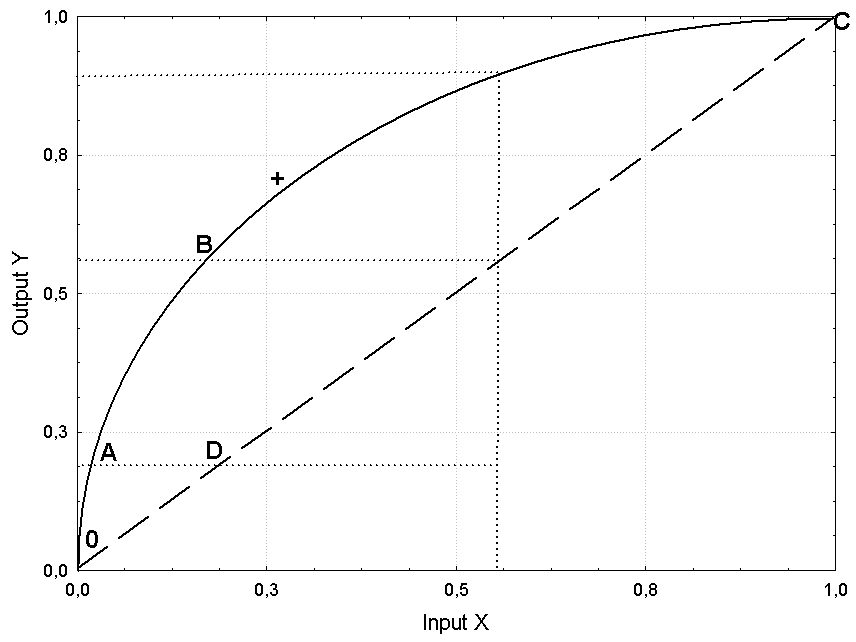
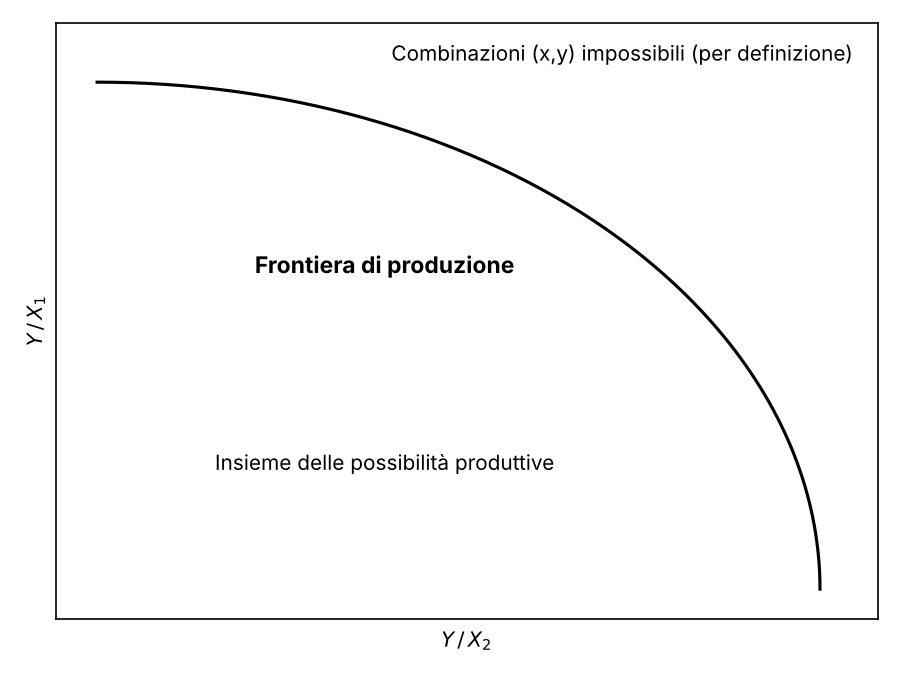
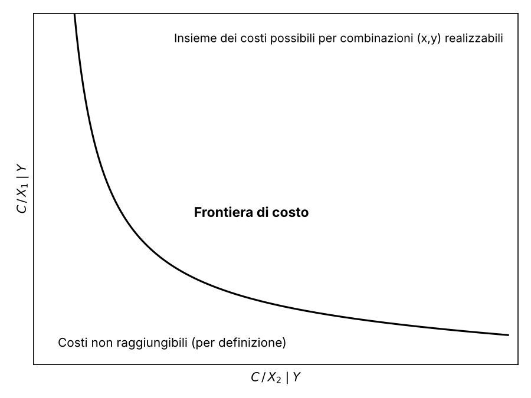
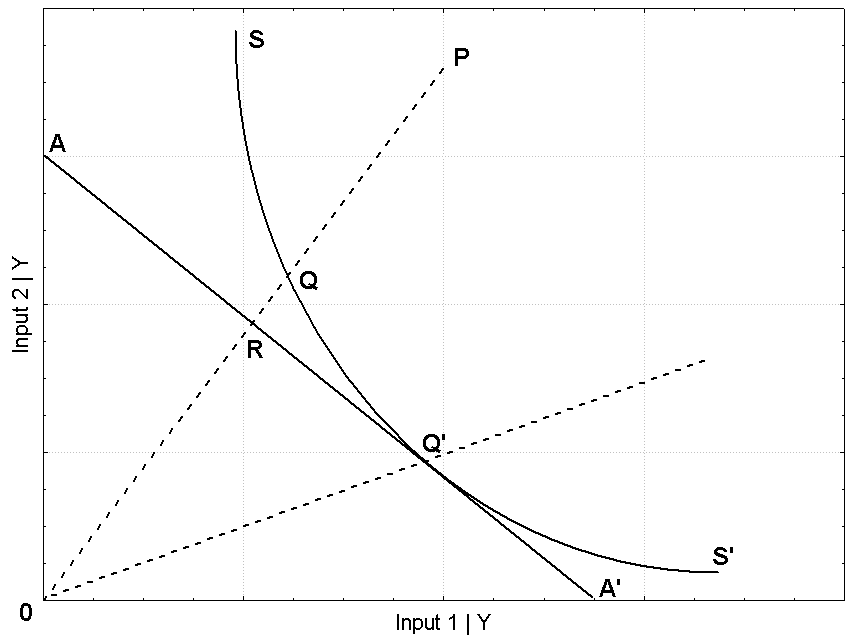
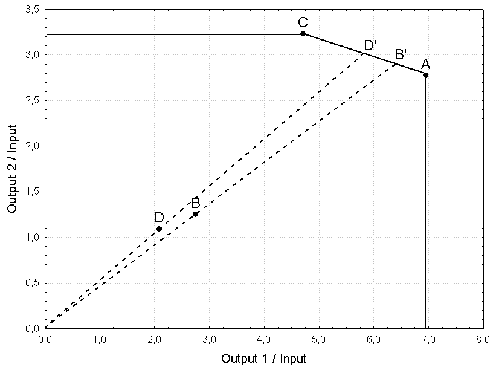

## 9.1 Produttività, efficienza e frontiere {#sec-frontiere}

Il concetto di produttività introdotto nel capitolo precedente è legato alla definizione e alla misura dell'efficienza. In particolare, se la misura della produttività è rappresentata da un rapporto tra output e input, la misura dell'efficienza è data dal rapporto tra l'output osservato e l'output massimo ottenibile da un processo di produzione per un qualche livello della tecnologia.

Ipotizziamo e disegniamo due forme diverse per due funzioni di produzione $Y=f(X)$ per un semplice processo con un solo input e un solo output (Figura 9.1).

{width=65%}

Sia $0C$ per costruzione una retta, e precisamente la bisettrice del piano individuato, cioè tale che i suoi punti siano caratterizzati dal medesimo rapporto tra output e input ($Y/X=a$; nel caso particolare di uguaglianza tra output e input sarà $a=1$). $0C$ potrebbe rappresentare, per quanto poco realistica, una funzione di produzione, poiché esprime una legge di trasformazione di input in output di un qualche processo. Allo stesso modo, anche la curva $0ABC$ potrebbe rappresentare una (più realistica) funzione di produzione. Ipotizziamo, però, che la curva $0ABC$ corrisponda anche alla frontiera del processo produttivo: data una certa tecnologia e noto un qualche livello $x$ dell'input $X$, si può ottenere un diverso livello $y$ dell'output $Y$ per ogni diversa funzione di produzione ipotizzabile, ma comunque non superiore al valore posto sulla frontiera, che esprime per definizione il massimo ottenibile dal processo dati gli input.

Se dunque $0ABC$ è l'insieme dei punti $(x,y)$ tali che i livelli di output raggiunti sono il massimo possibile, diremo che l'efficienza delle produzioni o delle combinazioni $(x,y)$ che stanno su tale frontiera è massima, e quindi certamente maggiore di quella dei punti che giacciono sulla retta $0C$. Diremo anche che la frontiera $0ABC$ è l'insieme dei punti tecnicamente efficienti (nel senso della combinazione tra $x$ e $y$) con orientamento all'output, poiché rappresenta la massima produzione possibile dati i livelli degli input.

Nella Figura 9.1 i punti $A$ e $B$ hanno la stessa massima efficienza ma livelli diversi di produttività, poiché diverso è il rapporto output/input; $C$ e $D$ hanno livelli diversi di efficienza ($C$ è sulla frontiera e $D$ no) ma uguale produttività, poiché stanno entrambi sulla retta $0C$ e quindi hanno un rapporto costante tra output e input (in questo caso uguale a 1). In particolare, la retta $0C$ rappresenta un processo produttivo con rendimenti di scala costanti (CRS); infatti, in ogni punto, la tangente coincide con la retta stessa. La curva $0ABC$ mostra invece rendimenti di scala crescenti in $A$ e $B$ (tangenti più inclinate della retta $0C$) e decrescenti in $C$ (tangente meno inclinata di $0C$). Esiste naturalmente almeno un punto (nella Figura 9.1 in prossimità del simbolo $+$) la cui tangente è parallela alla retta $0C$: qui i rendimenti di scala sono costanti, ed è utile osservare che, se la frontiera di produzione è CRS, efficienza e produttività coincidono (la frontiera CRS è infatti una retta).

Finora la frontiera è stata definita con riferimento alla produzione, intendendo la massima quantità di output producibile per un dato livello di input: si tratta di un approccio orientato all'output. In maniera del tutto analoga è possibile riferirsi alla frontiera di produzione quale espressione del minimo impiego di input per un fissato livello di output, con un approccio orientato all'input. Quale che sia il punto di vista, si farà riferimento a un concetto di efficienza tecnica, poiché esso riguarda i livelli, in termini di quantità o di valore, di input e output del processo di produzione.

{width=65%}

{width=65%}

Se, diversamente, la frontiera viene definita dal punto di vista dei costi, diremo che una condizione di efficienza, in questo caso di efficienza allocativa, richiede la minimizzazione dei costi di produzione dati i prezzi degli input e fissato un certo livello di output; dunque la frontiera non delimita più l'insieme delle possibilità produttive avvolgendolo dall'alto ma, al contrario, avvolgendolo dal basso (Figure 9.2 e 9.3).

Seguendo la nota impostazione di Farrell e ricordando che il concetto di efficienza tecnica attiene alle quantità (o ai valori) di input e output e quello di efficienza allocativa ai costi del processo, è possibile definire anche un concetto di efficienza totale, quale combinazione di efficienza tecnica ed efficienza allocativa. Per chiarire le differenze, consideriamo la Figura 9.4 nel caso di orientamento all'input; la trasposizione al caso di orientamento all'output è immediata.

{width=65%}

$SS'$ è l'isoquanto corrispondente a un fissato livello di produzione $Y$, ottenuta minimizzando l'uso di due input $X_{1}$ e $X_{2}$. Nel punto $P$ si produce la stessa quantità di output di $Q$, ma con un utilizzo maggiore di input. Diremo che $P$ rappresenta un caso di inefficienza tecnica rispetto al punto ottimale $Q$ e quindi che $P$ è relativamente inefficiente rispetto a $Q$. Tale inefficienza è misurabile con il rapporto $0Q/0P$, se facciamo ricorso a una misura radiale della distanza tra $Q$ e $P$. $AA'$ è invece una retta di isocosto, tale che la combinazione di input garantisce, per l'output $Y$ fissato, il medesimo costo minimo. Il punto $Q$ è efficiente dal punto di vista tecnico ma non si trova sull'isocosto ottimale, quindi presenta un'inefficienza allocativa rispetto al punto $R$. L'inefficienza allocativa è dunque misurata dal rapporto $0R/0Q$, che è ancora una misura radiale. Pertanto l'inefficienza totale, interpretabile come una combinazione di entrambe, è misurabile con il prodotto $(0Q/0P)\cdot (0R/0Q)=0R/0P$. Soltanto nel punto $Q'$ si ottiene, contemporaneamente, una piena efficienza tecnica e allocativa.

## 9.2 Frontiere parametriche: il metodo drifted-OLS {#sec-drifted-ols}

A partire dalle combinazioni osservate $(x,y)$, le funzioni di frontiera possono determinarsi con particolari accorgimenti. I classici stimatori statistici (come l'OLS) adattano ai dati funzioni medie, i cui punti non possono certo considerarsi stime della frontiera, a meno di compiere alcune operazioni per spostare la funzione stessa sulla frontiera. Più in generale, per determinare le funzioni di frontiera si può ricorrere sia a metodi parametrici sia a metodi non parametrici. Il metodo parametrico deterministico non statistico ipotizza la presenza di un residuo senza alcuna componente stocastica; esso viene interpretato esclusivamente in termini di inefficienza, poiché rappresenta la distanza tra la frontiera e la funzione $f(X)$ ottenuta tramite procedure matematiche di programmazione lineare. Nel metodo parametrico deterministico statistico si ricorre alla classica stima statistica del modello, ottenendo così una funzione media che viene opportunamente traslata per rappresentare la frontiera. Per compiere questo spostamento esistono diverse tecniche; la più semplice, ma non per questo meno utile, è nota come *drifted-OLS* e prevede uno spostamento pari al massimo residuo (e quindi verso l'alto) per le frontiere di produzione e pari al minimo residuo (e quindi verso il basso) per le frontiere di costo. Il metodo parametrico stocastico è meno grossolano del precedente, poiché ipotizza che il residuo sia composto dall'inefficienza $u$, con una sua specifica distribuzione, ma anche da un rumore bianco $\varepsilon$.

Facciamo un esempio di drifted-OLS calcolando la funzione di frontiera e i punteggi di efficienza di 5 aziende che producono i livelli $Y$ con i fattori produttivi $X$ (Figura 9.5).

::: {.panel-tabset group="language"}
### R

```{r}
#| fig-cap: "Figura 9.5 – Funzione di produzione di frontiera"
X <- c(2,4,6,8,10)
Y <- c(20,30,40,45,60)
ols <- lm(Y~X)
front <- fitted(ols)+max(resid(ols))
plot(X, Y, main="Funzione di produzione di frontiera")
abline(ols)
abline(a=(ols$coeff[1]+max(resid(ols))), b=(ols$coeff[2]), lty=2)
```

### Python

```{python}
import numpy as np
import pandas as pd
import matplotlib.pyplot as plt
import statsmodels.formula.api as smf

X = np.array([2, 4, 6, 8, 10]); Y = np.array([20, 30, 40, 45, 60])
ols = smf.ols("Y ~ X", data=pd.DataFrame({"X": X, "Y": Y})).fit()
front = ols.fittedvalues.to_numpy() + ols.resid.max()
```

```{python}
#| fig-cap: "Figura 9.5 – Funzione di produzione di frontiera"
#| results: hide
b0, b1 = ols.params
xx = np.array([0, 12])
plt.figure(figsize=(5, 5))
plt.scatter(X, Y, facecolors="none", edgecolors="black")
plt.plot(xx, b0 + b1 * xx, color="black")
plt.plot(xx, b0 + ols.resid.max() + b1 * xx, color="black", linestyle="--")
plt.xlim(1.5, 10.5); plt.ylim(18, 62)
plt.title("Funzione di produzione di frontiera"); plt.xlabel("X"); plt.ylabel("Y")
plt.show()
```

### SAS

```sas
data dols;
  input X Y @@;
  datalines;
2 20 4 30 6 40 8 45 10 60
;
run;
proc reg data=dols noprint;
  model Y = X;
  output out=stima p=media r=residuo;
run;
quit;
proc sql noprint; select max(residuo) into :maxres from stima; quit;
data stima;
  set stima;
  front = media + &maxres;          /* frontiera: retta OLS traslata */
run;
proc sgplot data=stima;
  title "Funzione di produzione di frontiera";
  scatter x=X y=Y;
  series x=X y=media;
  series x=X y=front / lineattrs=(pattern=dash);
run;
```
:::

La Figura 9.5 riporta le combinazioni $(x,y)$, la relativa funzione media ottenuta con OLS e la funzione di frontiera (linea tratteggiata), ottenuta spostando la funzione media parallelamente verso l'alto fino a toccare il punto più elevato. In questo modo si ottiene una frontiera empirica che, data la tecnologia e le combinazioni $(x,y)$ effettivamente osservate, rappresenta la massima produzione $Y$ possibile per i diversi livelli di $X$.

Pertanto, per ogni valore di input è possibile confrontare la produzione effettiva $Y$ con quella massima ottenibile, rappresentata dal corrispondente valore sulla funzione di frontiera $Y_{front}$, tramite il rapporto $Y/Y_{front}$; questo rapporto oscilla sempre tra 0 (minima efficienza) e 1 (massima efficienza)

::: {.panel-tabset group="language"}
### R

```{r}
eff <- Y/front
round(eff,3)
order(eff)
```

### Python

```{python}
eff = Y / front
print(np.round(eff, 3))
print(np.argsort(eff) + 1)        # come order() di R, con indici da 1
```

### SAS

```sas
data stima;
  set stima;
  azienda = _n_;
  eff = round(Y/front, 0.001);
run;
proc sort data=stima out=graduatoria; by eff; run;
proc print data=graduatoria noobs; var azienda eff; run;
```
:::

L'azienda 4 risulta la meno efficiente, poiché è la più distante dalla frontiera, sulla quale per costruzione si trova almeno un'azienda (la frontiera è ottenuta traslando la retta OLS del massimo residuo). A parità di altre condizioni e con gli stessi livelli di input, l'azienda 4 potrebbe risultare efficiente se incrementasse l'output di circa il 10,9%

::: {.panel-tabset group="language"}
### R

```{r}
round(((1-eff[4])*100),1)
```

### Python

```{python}
print(round((1 - eff[3]) * 100, 1))    # la quarta azienda ha indice 3
```

### SAS

```sas
data _null_;
  set stima(firstobs=4 obs=4);
  incremento = round((1-Y/front)*100, 0.1);
  put incremento=;
run;
```
:::

mentre l'azienda 3, la seconda meno inefficiente, dovrebbe incrementare la produzione di circa il 2,4%

::: {.panel-tabset group="language"}
### R

```{r}
round(((1-eff[3])*100),1)
```

### Python

```{python}
print(round((1 - eff[2]) * 100, 1))
```

### SAS

```sas
data _null_;
  set stima(firstobs=3 obs=3);
  incremento = round((1-Y/front)*100, 0.1);
  put incremento=;
run;
```
:::

L'azienda 5 è l'unica pienamente efficiente, con punteggio unitario.

Eseguiamo un esercizio analogo per una semplice funzione di costo che, per 40 aziende tessili, lega linearmente il costo totale di produzione in euro ai prezzi di due input, dato il livello di output. I dati da caricare sono contenuti nel file *frontcosto.csv*

::: {.panel-tabset group="language"}
### R

```{r}
fc <- read.csv2("data/frontcosto.csv")
attach(fc)
modello <- lm(costo~prezzo1+prezzo2)
frcost <- fitted(modello)+min(resid(modello))
```

### Python

```{python}
fc = pd.read_csv("data/frontcosto.csv", sep=";", decimal=",")
modello = smf.ols("costo ~ prezzo1 + prezzo2", data=fc).fit()
frcost = modello.fittedvalues + modello.resid.min()
```

### SAS

```sas
data fc;
  infile "data/frontcosto.csv" dlm=";" firstobs=2;
  input aziende costo :commax12. prezzo1 :commax12. prezzo2 :commax12.;
run;
proc reg data=fc noprint;
  model costo = prezzo1 prezzo2;
  output out=fcstima p=media r=residuo;
run;
quit;
proc sql noprint; select min(residuo) into :minres from fcstima; quit;
data fcstima;
  set fcstima;
  frcost = media + &minres;         /* frontiera di costo: traslazione verso il basso */
run;
```
:::

Al contrario del caso precedente relativo alla produzione, per determinare la frontiera di costo si aggiunge il residuo minimo, che sarà certamente negativo; pertanto la frontiera si colloca adesso al di sotto dei valori osservati. Quindi, per assicurare l'usuale oscillazione del punteggio di efficienza tra 0 (minima efficienza) e 1 (massima efficienza), si rapporta il costo di frontiera $C_{front}$ al costo osservato $C$

::: {.panel-tabset group="language"}
### R

```{r}
effc <- frcost/costo
round(effc,3)
order(effc)
```

### Python

```{python}
effc = (frcost / fc["costo"]).to_numpy()
print(np.round(effc, 3))
print(np.argsort(effc) + 1)
```

### SAS

```sas
data fcstima;
  set fcstima;
  effc = round(frcost/costo, 0.001);
run;
proc sort data=fcstima out=graduatoria; by effc; run;
proc print data=graduatoria noobs; var aziende effc; run;
```
:::

L'azienda 17 è quella meno efficiente, con costi che potrebbero ridursi ancora del 3,9%, mentre le aziende 30 e 12 raggiungono la massima efficienza e quindi non necessitano di alcuna riduzione dei costi

::: {.panel-tabset group="language"}
### R

```{r}
round(((1-effc[17])*100),1)
round(((1-effc[12])*100),1) # vale anche per la 30
detach(fc)
```

### Python

```{python}
print(round((1 - effc[16]) * 100, 1))
print(round((1 - effc[11]) * 100, 1))   # vale anche per la 30
```

### SAS

```sas
data _null_;
  set fcstima;
  where aziende in (17, 12, 30);
  riduzione = round((1-frcost/costo)*100, 0.1);
  put aziende= riduzione=;
run;
```
:::

Notiamo che il primo esercizio svolto richiama il concetto di efficienza tecnica, mentre questo secondo richiama il concetto di efficienza allocativa. Inoltre, la frontiera è sempre costruita in termini relativi utilizzando i dati osservati; indica pertanto la condizione migliore come termine di paragone per le sole unità in esame, non potendosi escludere a priori l'esistenza di unità ancora più efficienti, non considerate nell'analisi, che potrebbero costituire un nuovo benchmark di riferimento.

Facciamo un altro esempio con dati reali. Carichiamo le informazioni contenute nel file *nazioni.csv*, relative al valore aggiunto, alle unità di lavoro e al capitale lordo di 21 nazioni tra le più industrializzate per gli anni 1966 e 2007, misurati in miliardi di euro costanti (e a parità di potere d'acquisto) per il valore aggiunto e il capitale, e in milioni di unità per il lavoro. Calcoliamo la produttività del lavoro, la produttività del capitale e l'intensità del capitale

::: {.panel-tabset group="language"}
### R

```{r}
naz <- read.csv2("data/nazioni.csv")
attach(naz)
prodL66 <- y66/l66; prodL07 <- y07/l07
prodK66 <- y66/k66; prodK07 <- y07/k07
intKL66 <- k66/l66; intKL07 <- k07/l07
matr1 <- cbind(prodL66,prodL07,prodK66,prodK07,intKL66,intKL07)
rownames(matr1) <- sigle; matr1 <- cbind(c(1:21),matr1)
round(matr1,2)
```

### Python

```{python}
naz = pd.read_csv("data/nazioni.csv", sep=";", decimal=",", index_col="sigle")
matr1 = pd.DataFrame({
    "n": np.arange(1, 22),
    "prodL66": naz.y66 / naz.l66, "prodL07": naz.y07 / naz.l07,
    "prodK66": naz.y66 / naz.k66, "prodK07": naz.y07 / naz.k07,
    "intKL66": naz.k66 / naz.l66, "intKL07": naz.k07 / naz.l07})
print(matr1.round(2))
```

### SAS

```sas
data naz;
  infile "data/nazioni.csv" dlm=";" firstobs=2;
  input sigle $ (y66 y07 l66 l07 k66 k07) (:commax12.);
  n = _n_;
  prodL66 = y66/l66; prodL07 = y07/l07;
  prodK66 = y66/k66; prodK07 = y07/k07;
  intKL66 = k66/l66; intKL07 = k07/l07;
run;
proc print data=naz noobs;
  var sigle n prodL66 prodL07 prodK66 prodK07 intKL66 intKL07;
  format prodL66--intKL07 8.2;
run;
```
:::

Notiamo che la produttività del lavoro in Italia passa da 23 mila euro costanti del 1966 a circa 51 mila del 2007; cresce molto anche l'intensità di capitale (da 67 mila a 158 mila euro circa), mentre si riduce appena la produttività del capitale (da 0,34 a 0,33).

Supponendo che la forma Cobb-Douglas sia una buona funzione di produzione per i dati in esame, calcoliamo l'efficienza tecnica dei processi produttivi delle 21 nazioni

::: {.panel-tabset group="language"}
### R

```{r}
modcd66 <- lm(log(y66)~log(l66)+log(k66))
modcd07 <- lm(log(y07)~log(l07)+log(k07))
front66 <- fitted(modcd66)+max(resid(modcd66))
front07 <- fitted(modcd07)+max(resid(modcd07))
eff66 <- log(y66)/front66; eff07 <- log(y07)/front07
order(eff66)
order(eff07)
detach(naz)
```

### Python

```{python}
modcd66 = smf.ols("np.log(y66) ~ np.log(l66) + np.log(k66)", data=naz).fit()
modcd07 = smf.ols("np.log(y07) ~ np.log(l07) + np.log(k07)", data=naz).fit()
front66 = modcd66.fittedvalues + modcd66.resid.max()
front07 = modcd07.fittedvalues + modcd07.resid.max()
eff66 = (np.log(naz.y66) / front66).to_numpy()
eff07 = (np.log(naz.y07) / front07).to_numpy()
print(np.argsort(eff66) + 1)
print(np.argsort(eff07) + 1)
```

### SAS

```sas
data naz;
  set naz;
  ly66 = log(y66); ll66 = log(l66); lk66 = log(k66);
  ly07 = log(y07); ll07 = log(l07); lk07 = log(k07);
run;
proc reg data=naz noprint;
  m66: model ly66 = ll66 lk66;
  output out=s66 p=p66 r=r66;
run;
quit;
proc reg data=s66 noprint;
  m07: model ly07 = ll07 lk07;
  output out=nazstima p=p07 r=r07;
run;
quit;
proc sql noprint;
  select max(r66), max(r07) into :max66, :max07 from nazstima;
quit;
data nazstima;
  set nazstima;
  eff66 = ly66/(p66 + &max66);
  eff07 = ly07/(p07 + &max07);
run;
proc sort data=nazstima out=g66; by eff66; run;
proc print data=g66 noobs; var n sigle eff66; run;
proc sort data=nazstima out=g07; by eff07; run;
proc print data=g07 noobs; var n sigle eff07; run;
```
:::

L'Italia, che corrisponde all'etichetta 7, occupa una posizione intermedia sia nel 1966 sia nel 2007, con una frontiera rappresentata rispettivamente dall'Islanda (14) e dagli Stati Uniti (17).

## 9.3 La Data Envelopment Analysis {#sec-dea}

Dall'impostazione di Farrell ha origine l'approccio non parametrico noto come *data envelopment analysis* (DEA) che, nella formulazione originaria e ancora oggi più diffusa, consente di ottenere misure di inefficienza tecnica delle unità di analisi (*decision making units* o DMU). Esistono molte versioni della DEA, ma qui ci limiteremo alla formulazione più semplice e classica.

La DEA è una tecnica che inviluppa i dati, cioè determina una frontiera senza far riferimento a funzioni di produzione con forme note a priori. La DEA nasce nel 1978 e utilizza algoritmi di calcolo tipici della ricerca operativa, poiché fondamentalmente cerca soluzioni a problemi di minimo e di massimo vincolati.

Un grande vantaggio risiede nella possibilità di analizzare processi con più output, condizione tipica di molti processi non industriali che difficilmente potremmo studiare con gli approcci parametrici; questi ultimi sono tipicamente basati su funzioni di regressione che, pur permettendo una molteplicità di input come regressori, non consentono la presenza di più variabili dipendenti (i nostri output) se non con metodi inusuali e più complessi, che qui tralasciamo.

Il seguente esempio ci aiuta a comprendere la logica alla base della tecnica DEA. Supponiamo di voler esaminare 4 DMU, per esempio 4 aziende il cui processo industriale di trasformazione sia caratterizzato da un solo output e da un solo input, misurati in tonnellate

::: {.panel-tabset group="language"}
### R

```{r}
out <- c(125,44,80,23)
inp <- c(18,16,17,11)
es1 <- cbind(out,inp)
rownames(es1) <- c("A","B","C","D")
es1
```

### Python

```{python}
es1 = pd.DataFrame({"out": [125, 44, 80, 23], "inp": [18, 16, 17, 11]},
                   index=["A", "B", "C", "D"])
print(es1)
```

### SAS

```sas
data es1;
  input dmu $ out inp;
  datalines;
A 125 18
B  44 16
C  80 17
D  23 11
;
run;
proc print data=es1 noobs; run;
```
:::

Per ottenere una misura di efficienza tecnica dobbiamo confrontare l'output effettivo con il massimo possibile, dati i diversi livelli dell'input. Quindi, calcolando il rapporto $Y/X$ e rapportandolo al massimo osservato, è facile costruire la graduatoria di efficienza

::: {.panel-tabset group="language"}
### R

```{r}
es1 <- cbind(es1,out/inp,(out/inp)/max(out/inp))
colnames(es1)[3:4] <- c("out/inp","(out/inp)/max")
es1
```

### Python

```{python}
es1["out/inp"] = es1["out"] / es1["inp"]
es1["(out/inp)/max"] = es1["out/inp"] / es1["out/inp"].max()
print(es1)
```

### SAS

```sas
proc sql;
  create table es1b as
  select *, out/inp as rapporto, calculated rapporto / max(calculated rapporto) as efficienza
  from es1;
quit;
proc print data=es1b noobs; run;
```
:::

La prima unità è sulla frontiera di efficienza, con punteggio 1, mentre la quarta azienda è quella meno efficiente (punteggio di 0,30).

Svolgiamo un altro esempio per processi con due output e un solo input; l'impostazione è del tutto analoga a quella, più familiare, con un solo output e due input

::: {.panel-tabset group="language"}
### R

```{r}
es2 <- cbind(out1=out,out2=c(50,20,55,12),inp)
rownames(es2) <- rownames(es1)
es2
```

### Python

```{python}
es2 = pd.DataFrame({"out1": es1["out"], "out2": [50, 20, 55, 12], "inp": es1["inp"]})
print(es2)
```

### SAS

```sas
data es2;
  input dmu $ out1 out2 inp;
  datalines;
A 125 50 18
B  44 20 16
C  80 55 17
D  23 12 11
;
run;
proc print data=es2 noobs; run;
```
:::

e, come nell'esempio precedente,

::: {.panel-tabset group="language"}
### R

```{r}
es2 <- cbind(es2,oi1=es2[,1]/inp,oi2=es2[,2]/inp,
             maxo1=(es2[,1]/inp)/max(es2[,1]/inp),
             maxo2=(es2[,2]/inp)/max(es2[,2]/inp))
es2
```

### Python

```{python}
es2["oi1"] = es2["out1"] / es2["inp"]
es2["oi2"] = es2["out2"] / es2["inp"]
es2["maxo1"] = es2["oi1"] / es2["oi1"].max()
es2["maxo2"] = es2["oi2"] / es2["oi2"].max()
print(es2.round(4))
```

### SAS

```sas
proc sql;
  create table es2b as
  select *, out1/inp as oi1, out2/inp as oi2,
         calculated oi1 / max(calculated oi1) as maxo1,
         calculated oi2 / max(calculated oi2) as maxo2
  from es2;
quit;
proc print data=es2b noobs; run;
```
:::

Dunque con più output (o con più input) le cose si complicano, poiché i risultati possono non concordare: considerando il primo output l'azienda più efficiente è la $A$, ma considerando il secondo output l'azienda più efficiente diviene la $C$. Anche se le graduatorie di efficienza fossero coerenti e tali da segnalare le medesime aziende, probabilmente non avremmo un'identica distanza dalla frontiera; è chiaro che il problema si complica ancora di più se il processo ha molti input e molti output. La DEA fornisce una soluzione.

{width=65%}

La Figura 9.6 posiziona sul piano le quattro aziende dell'esempio. Per definizione, la frontiera è rappresentata dalle unità con il più alto rapporto tra output e input, quindi viene costruita attorno alle unità $A$ e $C$, di fatto inviluppando tutti i dati. Le aziende $A$ e $C$ sono dunque pienamente efficienti: diremo che dominano tutte le altre unità e per definizione attribuiremo loro un punteggio pari a 1; non sono invece noti i punteggi di efficienza delle restanti aziende $B$ e $D$.

Procederemo nel modo seguente. Calcoliamo il rapporto tra i due output dati gli input, ovvero tra $Y_{1}/X$ e $Y_{2}/X$, il che equivale a confrontare direttamente i due output

::: {.panel-tabset group="language"}
### R

```{r}
es2[,1]/es2[,2]
```

### Python

```{python}
print(es2["out1"] / es2["out2"])
```

### SAS

```sas
data _null_;
  set es2;
  rapporto = out1/out2;
  put dmu= rapporto=;
run;
```
:::

L'inclinazione della retta che passa per $D$ e per l'origine degli assi (si assume che il processo non ammetta output o input nulli se non congiuntamente) è dunque nota e pari a 1/1,92, e allo stesso modo per $B$ avremo 1/2,20 (le rette sono disegnate nella Figura 9.6 con linee tratteggiate). La proiezione di $D$ e $B$ sulla frontiera costruita attorno ad $A$ e $C$ individua due aziende fittizie $D'$ e $B'$, efficienti e caratterizzate dal medesimo rapporto tra gli output di $D$ e $B$. Il punteggio di efficienza di $D$ è quindi calcolato rispetto al proprio massimo virtuale $D'$ e, allo stesso modo, $B$ viene confrontato con $B'$, ottenendo una misura radiale dell'efficienza; pertanto il punteggio di $D$ è dato da $0D/0D'$, mentre quello di $B$ è $0B/0B'$.

Per semplicità indichiamo con $x=Y_{1}/X$ e $y=Y_{2}/X$ l'ascissa e l'ordinata del piano rappresentato in Figura 9.6. Poiché l'equazione

$$
(x-x_{1})/(x_{2}-x_{1})=(y-y_{1})/(y_{2}-y_{1})
\tag{9.1}
$$

individua la retta che passa per due punti qualsiasi, il segmento che unisce $A$ e $C$ è specificato da $y=4{,}20-0{,}20x$. Il punto $D$ giace invece sulla retta $y=(1/1{,}92)x$; mettendo a sistema le due equazioni è facile ottenere il punto di intersezione $D'(5{,}82;\,3{,}03)$; analogamente si trova $B'(6{,}42;\,2{,}92)$, che giace sulla retta $y=(1/2{,}20)x$. Poiché la distanza di un punto dall'origine $(0,0)$ è uguale a

$$
(x^{2}+y^{2})^{1/2}
\tag{9.2}
$$

si ha $0D=2{,}36$ e $0D'=6{,}56$, e ancora $0B=3{,}02$ e $0B'=7{,}05$. Abbiamo l'informazione necessaria al calcolo dei punteggi di efficienza delle aziende $D$ e $B$

::: {.panel-tabset group="language"}
### R

```{r}
eff_D <- 2.36/6.56
eff_B <- 3.02/7.05
eff_D; eff_B
```

### Python

```{python}
eff_D = 2.36 / 6.56
eff_B = 3.02 / 7.05
print(eff_D, eff_B)
```

### SAS

```sas
data _null_;
  eff_D = 2.36/6.56;
  eff_B = 3.02/7.05;
  put eff_D= eff_B=;
run;
```
:::

L'azienda $D$ ha un punteggio di efficienza di 0,36, più basso di quello di $B$, pari a 0,43, e naturalmente di quelli di $A$ e $C$, che rappresentano il termine di confronto e registrano per definizione un punteggio uguale a 1. Per accrescere la propria efficienza, le aziende $D$ e $B$ dovrebbero muoversi lungo le rispettive linee tratteggiate verso le proprie proiezioni sulla frontiera (Figura 9.6), di fatto incrementando il rapporto $Y/X$ tramite un aumento degli output dati gli input (*output-oriented*), oppure riducendo gli input per dati output (*input-oriented*), ovvero sia con un incremento degli output sia con una riduzione degli input (questo approccio misto non è ammesso dalle tecniche DEA tradizionali, ma è previsto nelle versioni più recenti).

## 9.4 La formulazione matematica della DEA {#sec-dea-lp}

Per il calcolo dell'efficienza è anche possibile ricorrere a una formulazione matematica, generalizzazione che diventa necessaria quando il processo ha più input e più output. Nel caso dell'azienda $B$ si tratterà di risolvere il seguente problema, con ovvio significato dei simboli: $\max E_{B}$ con i vincoli

$$
\begin{gathered}E_{A}=(125\,peso_{output1}+50\,peso_{output2})/(18\,peso_{input}) \\ E_{B}=(44\,peso_{output1}+20\,peso_{output2})/(16\,peso_{input}) \\ E_{C}=(80\,peso_{output1}+55\,peso_{output2})/(17\,peso_{input}) \\ E_{D}=(23\,peso_{output1}+12\,peso_{output2})/(11\,peso_{input}) \\ 0\le E_{i}\le 1,\quad peso_{k}\ge 0\end{gathered}
\tag{9.3}
$$

Poiché il problema appare in forma non lineare, di difficile risoluzione, si preferisce ricorrere a una formulazione lineare aggiungendo la condizione $16\,peso_{input}=1$; pertanto l'efficienza di $B$ da massimizzare diviene $E_{B}=44\,peso_{output1}+20\,peso_{output2}$. La procedura si ripete in modo identico per le altre tre unità.

In realtà, il problema DEA è usualmente più complesso, poiché già il modello standard ammette diverse ipotesi sul processo produttivo. Ad esempio, potremmo riscrivere il problema in forma compatta (*envelopment form*) ipotizzando rendimenti costanti di scala (CRS) nel caso *output-oriented*, cioè

$$
\begin{gathered}\max_{\phi ,\lambda}\phi \\ -\phi y_{i}+Y\lambda \ge 0,\ x_{i}-X\lambda \ge 0,\ \lambda \ge 0\end{gathered}
\tag{9.4}
$$

ovvero, per ciascuna delle $J$ unità con $M$ output e $N$ input,

$$
\begin{gathered}1/efficienza_{i}=\max \phi_{i} \\ \sum_{j=1}^{J} \lambda_{j}y_{mj}-\phi_{i}y_{mi}\ge 0,\quad m=1,...,M \\ x_{ni}-\sum_{j=1}^{J} \lambda_{j}x_{nj}\ge 0,\quad n=1,...,N \\ \lambda_{j}\ge 0,\quad j=1,...,J\end{gathered}
\tag{9.5}
$$

dove $\lambda$ è un vettore $(J\times 1)$ di pesi non negativi e $1\le \phi <\infty$. In questa formulazione i punteggi di efficienza variano da un minimo di 1, di piena efficienza, a un valore tanto più grande quanto maggiore è l'inefficienza. Di conseguenza, se si vuole garantire l'usuale oscillazione tra 0 (minima efficienza) e 1 (massima efficienza), si ricorre al reciproco dei punteggi ottenuti, $1/\phi$.

Invece, nel caso *input-oriented* avremo

$$
\begin{gathered}\min_{\theta ,\lambda}\theta \\ -y_{i}+Y\lambda \ge 0,\ \theta x_{i}-X\lambda \ge 0,\ \lambda \ge 0\end{gathered}
\tag{9.6}
$$

ovvero

$$
\begin{gathered}efficienza_{i}=\min \theta_{i} \\ \sum_{j=1}^{J} \lambda_{j}y_{mj}-y_{mi}\ge 0,\quad m=1,...,M \\ \theta_{i}x_{ni}-\sum_{j=1}^{J} \lambda_{j}x_{nj}\ge 0,\quad n=1,...,N \\ \lambda_{j}\ge 0,\quad j=1,...,J\end{gathered}
\tag{9.7}
$$

dove $0\le \theta \le 1$.

Per ottenere punteggi di efficienza con rendimenti variabili di scala (VRS) è necessario aggiungere il vincolo

$$
1'\lambda =1
\tag{9.8}
$$

dove $1$ è un vettore unitario di $J$ righe. Se invece il vincolo aggiuntivo è

$$
1'\lambda \le 1
\tag{9.9}
$$

i punteggi sono ottenuti nell'ipotesi di rendimenti di scala non crescenti (NIRS); qualora i punteggi NIRS coincidano con quelli VRS agiscono rendimenti di scala decrescenti (DRS), mentre se non coincidono ma i punteggi CRS e VRS sono diversi agiscono rendimenti di scala crescenti (IRS).

Se il punteggio di efficienza tecnica è diverso con rendimenti costanti di scala (CRS) e con rendimenti variabili di scala (VRS), sta agendo un'inefficienza di scala, che può essere misurata con il semplice rapporto tra i punteggi di efficienza ottenuti nelle due differenti ipotesi; vale la pena notare che, se i rendimenti di scala sono costanti, il diverso orientamento non incide sul calcolo del punteggio di efficienza.

Infine, va ricordato che qui è presentato l'approccio di base, ma la famiglia dei modelli DEA è vasta e oggi esiste una casistica molto ampia di modelli e formulazioni, in funzione delle svariate ipotesi di lavoro, come l'esistenza di slack, input e output discreti, presenza di componenti stocastiche, ecc. Sul punto non ci soffermiamo oltre.

Per svolgere un esempio utilizziamo i dati del file *esdea.csv*, relativi a 2 output e 2 input di 10 aziende

::: {.panel-tabset group="language"}
### R

```{r}
esdea <- read.csv2("data/esdea.csv")
attach(esdea)
X <- cbind(input1,input2)
Y <- cbind(output1,output2)
n <- dim(X)[1]
s <- dim(Y)[2]
m <- dim(X)[2]
```

### Python

```{python}
esdea = pd.read_csv("data/esdea.csv", sep=";", decimal=",")
X = esdea[["input1", "input2"]].to_numpy()
Y = esdea[["output1", "output2"]].to_numpy()
n, m = X.shape
s = Y.shape[1]
```

### SAS

```sas
data esdea;
  infile "data/esdea.csv" dlm=";" firstobs=2;
  input aziende (output1 output2 input1 input2) (:commax12.);
run;
```
:::

La soluzione dei problemi di programmazione lineare di cui alle formule (9.5) e (9.7) richiede l'impiego di routine di calcolo proprie della ricerca operativa, che non costituiscono argomento di trattazione. Pertanto è necessario caricare in memoria una specifica libreria esterna, poiché il calcolo diretto richiederebbe conoscenze avanzate; nel nostro caso utilizzeremo *lpSolve*, distribuita con licenza GNU e disponibile su CRAN. In Python useremo la funzione `linprog` di SciPy, in SAS la procedura `PROC OPTMODEL` (SAS/OR)

::: {.panel-tabset group="language"}
### R

```{r}
# questa è l'unica libreria esterna utilizzata
# nell'intero volume (install.packages("lpSolve"))
library(lpSolve)
```

### Python

```{python}
from scipy.optimize import linprog

def dea(X, Y, rts="crs", orient="io"):
    """Punteggi DEA (tra 0 e 1) per rendimenti crs, vrs o nirs
    e orientamento all'input ("io") o all'output ("oo")."""
    n, m = X.shape
    s = Y.shape[1]
    eff = np.zeros(n)
    for i in range(n):
        # variabili: [theta (o phi), lambda_1, ..., lambda_n]
        if orient == "io":                       # min theta
            c = np.r_[1.0, np.zeros(n)]
            A = np.vstack([np.c_[np.zeros(s), -Y.T],     # Y'lambda >= y_i
                           np.c_[-X[i], X.T]])           # X'lambda <= theta x_i
            b = np.r_[-Y[i], np.zeros(m)]
        else:                                    # max phi
            c = np.r_[-1.0, np.zeros(n)]
            A = np.vstack([np.c_[Y[i], -Y.T],            # Y'lambda >= phi y_i
                           np.c_[np.zeros(m), X.T]])     # X'lambda <= x_i
            b = np.r_[np.zeros(s), X[i]]
        somma = np.r_[0.0, np.ones(n)][None, :]
        A_eq = b_eq = None
        if rts == "vrs":
            A_eq, b_eq = somma, [1.0]
        elif rts == "nirs":
            A, b = np.vstack([A, somma]), np.r_[b, 1.0]
        sol = linprog(c, A_ub=A, b_ub=b, A_eq=A_eq, b_eq=b_eq,
                      bounds=[(0, None)] * (n + 1), method="highs")
        eff[i] = sol.x[0] if orient == "io" else 1 / sol.x[0]
    return eff
```

### SAS

```sas
/* macro che risolve i problemi (9.5) e (9.7) per tutte le unità con PROC OPTMODEL */
%macro dea(rts=crs, orient=io, out=);
  %if &orient = io %then %let val = e.sol; %else %let val = 1/e.sol;
  proc optmodel printlevel=0;
    set <num> DMU;
    set <str> INP  = {'input1', 'input2'};
    set <str> OUTP = {'output1', 'output2'};
    num x{DMU, INP};
    num y{DMU, OUTP};
    read data esdea into DMU=[aziende]
         {i in INP} <x[aziende,i]=col(i)> {o in OUTP} <y[aziende,o]=col(o)>;
    num k;                            /* unità valutata */
    var e >= 0;                       /* theta (input) o phi (output) */
    var lambda{DMU} >= 0;
    %if &orient = io %then %do;
      min obj = e;
      con c_inp{i in INP}:  sum{j in DMU} lambda[j]*x[j,i] <= e*x[k,i];
      con c_out{o in OUTP}: sum{j in DMU} lambda[j]*y[j,o] >= y[k,o];
    %end;
    %else %do;
      max obj = e;
      con c_inp{i in INP}:  sum{j in DMU} lambda[j]*x[j,i] <= x[k,i];
      con c_out{o in OUTP}: sum{j in DMU} lambda[j]*y[j,o] >= e*y[k,o];
    %end;
    %if &rts = vrs  %then %do; con c_rts: sum{j in DMU} lambda[j] =  1; %end;
    %if &rts = nirs %then %do; con c_rts: sum{j in DMU} lambda[j] <= 1; %end;
    num eff{DMU};
    for {kk in DMU} do;
      k = kk;
      solve with lp / logfreq=0;
      eff[kk] = &val;
    end;
    create data &out from [aziende] &out=eff;
  quit;
%mend dea;
```
:::

Considerando un processo produttivo con rendimenti di scala costanti e con orientamento all'input, avremo i seguenti punteggi di efficienza

::: {.panel-tabset group="language"}
### R

```{r}
risultato <- matrix(0, nrow=n, ncol=1)
colnames(risultato) <- "efficienza"
cond1 <- rbind(t(Y), -t(X))
f.dir <- rep(">=", s+m)
f.obj <- c(1, rep(0,n))
for(i in 1:n){
  cond2 <- matrix(c(rep(0, s), X[i,]), byrow=T)
  f.con <- cbind(cond2, cond1)
  f.rhs <- c(Y[i,], rep(0, m))
  risultato[i,'efficienza'] <- lp("min", f.obj, f.con, f.dir, f.rhs)$solution[1]
}
ris1 <- c(risultato); ris1
```

### Python

```{python}
ris1 = dea(X, Y, "crs", "io"); print(ris1)
```

### SAS

```sas
%dea(rts=crs, orient=io, out=crs_io);
proc print data=crs_io noobs; run;
```
:::

Per rendimenti variabili di scala e orientamento all'input avremo

::: {.panel-tabset group="language"}
### R

```{r}
risultato <- matrix(0, nrow=n, ncol=1)
colnames(risultato) <- "efficienza"
cond1 <- rbind(t(Y), -t(X), matrix(rep(1, n), ncol=n))
f.dir <- c(rep(">=", s+m), "=")
f.obj <- c(1, rep(0, n))
for(i in 1:n){
  cond2 <- matrix(c(rep(0, s), X[i,], 0), byrow=T)
  f.con <- cbind(cond2, cond1)
  f.rhs <- c(Y[i,], rep(0, m), 1)
  risultato[i,'efficienza'] <- lp("min", f.obj, f.con, f.dir, f.rhs)$solution[1]
}
ris2 <- c(risultato); ris2
```

### Python

```{python}
ris2 = dea(X, Y, "vrs", "io"); print(ris2)
```

### SAS

```sas
%dea(rts=vrs, orient=io, out=vrs_io);
proc print data=vrs_io noobs; run;
```
:::

mentre per rendimenti di scala non crescenti, ancora con orientamento all'input,

::: {.panel-tabset group="language"}
### R

```{r}
risultato <- matrix(0, nrow=n, ncol=1)
colnames(risultato) <- "efficienza"
cond1 <- rbind(t(Y), -t(X), matrix(rep(1, n), ncol=n))
f.dir <- c(rep(">=", s+m), "<=")
f.obj <- c(1, rep(0, n))
for(i in 1:n){
  cond2 <- matrix(c(rep(0, s), X[i,], 0), byrow=T)
  f.con <- cbind(cond2, cond1)
  f.rhs <- c(Y[i,], rep(0, m), 1)
  risultato[i,'efficienza'] <- lp("min", f.obj, f.con, f.dir, f.rhs)$solution[1]
}
ris3 <- c(risultato); ris3
```

### Python

```{python}
ris3 = dea(X, Y, "nirs", "io"); print(ris3)
```

### SAS

```sas
%dea(rts=nirs, orient=io, out=nirs_io);
proc print data=nirs_io noobs; run;
```
:::

Possiamo ripetere i calcoli per l'orientamento all'output, ottenendo rispettivamente per rendimenti di scala costanti, variabili e non crescenti i seguenti risultati

::: {.panel-tabset group="language"}
### R

```{r}
risultato <- matrix(0, nrow=n, ncol=1)
colnames(risultato) <- "efficienza"
cond1 <- rbind(-t(Y), t(X))
f.dir <- rep("<=", s+m)
f.obj <- c(1, rep(0,n))
for(i in 1:n){
  cond2 <- matrix(c(Y[i,],rep(0, m)), byrow=T)
  f.con <- cbind(cond2, cond1)
  f.rhs <- c(rep(0,s),X[i,])
  risultato[i,'efficienza'] <- lp("max", f.obj, f.con, f.dir, f.rhs)$solution[1]
}
ris4 <- 1/c(risultato); ris4
risultato <- matrix(0, nrow=n, ncol=1)
colnames(risultato) <- "efficienza"
cond1 <- rbind(-t(Y), t(X), matrix(rep(1, n), ncol=n))
f.dir <- c(rep("<=", s+m), "=")
f.obj <- c(1, rep(0, n))
for(i in 1:n){
  cond2 <- matrix(c(Y[i,],rep(0, m), 0), byrow=T)
  f.con <- cbind(cond2, cond1)
  f.rhs <- c(rep(0,s),X[i,], 1)
  risultato[i,'efficienza'] <- lp("max", f.obj, f.con, f.dir, f.rhs)$solution[1]
}
ris5 <- 1/c(risultato); ris5
risultato <- matrix(0, nrow=n, ncol=1)
colnames(risultato) <- "efficienza"
cond1 <- rbind(-t(Y), t(X), matrix(rep(1, n), ncol=n))
f.dir <- c(rep("<=", s+m), "<=")
f.obj <- c(1, rep(0, n))
for(i in 1:n){
  cond2 <- matrix(c(Y[i,],rep(0, m), 0), byrow=T)
  f.con <- cbind(cond2, cond1)
  f.rhs <- c(rep(0,s),X[i,], 1)
  risultato[i,'efficienza'] <- lp("max", f.obj, f.con, f.dir, f.rhs)$solution[1]
}
ris6 <- 1/c(risultato); ris6
tabella <- cbind(ris1,ris2,ris3,ris4,ris5,ris6)
colnames(tabella) <- c("crs-io","vrs-io","nirs-io","crs-oo","vrs-oo","nirs-oo")
round(tabella,3)
```

### Python

```{python}
ris4 = dea(X, Y, "crs", "oo")
ris5 = dea(X, Y, "vrs", "oo")
ris6 = dea(X, Y, "nirs", "oo")
tabella = pd.DataFrame(np.c_[ris1, ris2, ris3, ris4, ris5, ris6],
                       columns=["crs-io", "vrs-io", "nirs-io", "crs-oo", "vrs-oo", "nirs-oo"],
                       index=np.arange(1, n + 1))
print(tabella.round(3))
```

### SAS

```sas
%dea(rts=crs,  orient=oo, out=crs_oo);
%dea(rts=vrs,  orient=oo, out=vrs_oo);
%dea(rts=nirs, orient=oo, out=nirs_oo);
data tabella;
  merge crs_io vrs_io nirs_io crs_oo vrs_oo nirs_oo;
  by aziende;
run;
proc print data=tabella noobs; format crs_io--nirs_oo 6.3; run;
```
:::

Notiamo che i punteggi *input-oriented* e *output-oriented* sono identici nel caso di rendimenti costanti di scala (CRS)

::: {.panel-tabset group="language"}
### R

```{r}
tabella[,1]/tabella[,4]
```

### Python

```{python}
print(np.round(tabella["crs-io"] / tabella["crs-oo"], 6).to_numpy())
```

### SAS

```sas
data _null_;
  set tabella;
  rapporto = crs_io/crs_oo;
  put aziende= rapporto=;
run;
```
:::

L'eventuale presenza di inefficienza di scala è segnalata da punteggi CRS e VRS non coincidenti

::: {.panel-tabset group="language"}
### R

```{r}
tabella[,1]/tabella[,2] # input-oriented
tabella[,4]/tabella[,5] # output-oriented
```

### Python

```{python}
print((tabella["crs-io"] / tabella["vrs-io"]).to_numpy())   # input-oriented
print((tabella["crs-oo"] / tabella["vrs-oo"]).to_numpy())   # output-oriented
```

### SAS

```sas
data scala;
  set tabella;
  sc_io = crs_io/vrs_io;     /* input-oriented */
  sc_oo = crs_oo/vrs_oo;     /* output-oriented */
run;
proc print data=scala noobs; var aziende sc_io sc_oo; run;
```
:::

Le aziende 2 e 10 presentano un'inefficienza di scala che appare identica, sia che si consideri l'orientamento all'input sia quello all'output, e pari rispettivamente a 0,958 e 0,987; questa è per l'appunto la loro inefficienza di scala, poiché se si abbandona l'errata ipotesi CRS per una più generale VRS si raggiunge il punteggio 1; non sappiamo però se stiano agendo rendimenti crescenti o decrescenti. La corrispondente efficienza NIRS è uguale a 1, il che implica, avendo escluso CRS, rendimenti di scala decrescenti (DRS).

L'azienda 4 ha un punteggio di efficienza orientato all'input di 0,796 con CRS, ma pari a 0,829 con VRS; l'efficienza di scala (SC) sarà dunque

::: {.panel-tabset group="language"}
### R

```{r}
(tabella[,1]/tabella[,2])[4]
```

### Python

```{python}
print(tabella.loc[4, "crs-io"] / tabella.loc[4, "vrs-io"])
```

### SAS

```sas
data _null_;
  set scala;
  where aziende = 4;
  put sc_io=;
run;
```
:::

con rendimenti di scala adesso crescenti (IRS), unica alternativa rimasta poiché NIRS e VRS non coincidono. Al contrario, le aziende 7 e 9 mostrano rendimenti di scala decrescenti, come già la 2 e la 10, mentre le unità finora non citate appaiono pienamente efficienti, posizionandosi sulla frontiera.

Per quanto detto, va notato che il punteggio di efficienza CRS può essere scomposto nel punteggio VRS e in quello di scala SC, tale che $eff_{CRS}=eff_{VRS}\cdot eff_{SC}$; infatti

::: {.panel-tabset group="language"}
### R

```{r}
crsio <- tabella[,1]; vrsio <- tabella[,2]
scio <- tabella[,1]/tabella[,2]
crsio-vrsio*scio
detach(esdea)
```

### Python

```{python}
crsio, vrsio = tabella["crs-io"], tabella["vrs-io"]
scio = crsio / vrsio
print((crsio - vrsio * scio).to_numpy())
```

### SAS

```sas
data _null_;
  set scala;
  differenza = crs_io - vrs_io*sc_io;
  put aziende= differenza=;
run;
```
:::

e ciò vale sia nel caso di orientamento all'input sia nel caso di orientamento all'output.
