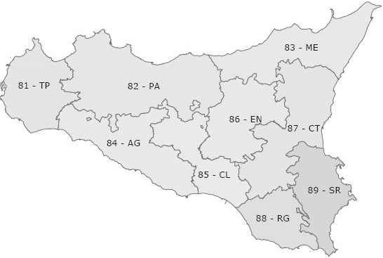

## 12.1 Autocorrelazione spaziale: gli indici di Moran e di Geary {#sec-autocorrelazione-spaziale}

Il territorio, con le sue specifiche caratteristiche, assume un ruolo essenziale per interpretare correttamente un aggregato. Spesso gli aggregati assumono valori simili in territori tra loro vicini e valori dissimili in aree tra loro lontane. Per esempio, Lombardia e Sicilia hanno livelli di PIL pro capite molto diversi, mentre Sicilia e Calabria registrano valori tra loro più simili (cosiddetta prima legge di Tobler): così come valori temporalmente più vicini sono in genere maggiormente correlati, allo stesso modo aree spazialmente più prossime tendono a essere più correlate di aree lontane.

L'esistenza di una forte correlazione spaziale, positiva o negativa, implica l'assenza di indipendenza delle osservazioni; è pertanto sempre opportuno verificare la presenza di una forte dipendenza dei dati dallo spazio.

Per il calcolo dell'autocorrelazione si può fare ricorso ai tradizionali indici di correlazione, corretti con un'opportuna matrice $W$ che segnala la vicinanza spaziale delle aree territoriali. La forma più semplice è quella di una matrice di contiguità, che assume valore 0 in assenza di confini comuni tra le aree e 1 nel caso contrario. Tuttavia, si potrebbe fare ricorso a diverse definizioni di contiguità, ovvero a pesi basati sull'inverso delle distanze geografiche tra i centri delle aree. La scelta del tipo di contiguità o del peso, e delle tecniche per misurare le distanze e costruire i centri, è relativamente arbitraria, e ciò costituisce un evidente limite di questi strumenti.

{width=65%}

Facciamo un esempio ricorrendo alle 9 province della Regione Sicilia, i cui confini sono riportati nella Figura 12.1 con sigla e relativo codice ISTAT. Ponendo 1 ove confinanti e 0 altrimenti si ottiene la seguente matrice quadrata (si pone 0 anche sulla diagonale principale), costruita a partire dalle informazioni sulla contiguità presenti nel file *confinanti.csv*, che riporta anche il valore aggiunto pro capite per gli anni 2001 e 2006

::: {.panel-tabset group="language"}
### R

```{r}
matt <- read.csv2("data/confinanti.csv")
# matt è il nome scelto per la matrice completa
matw <- matt[,2:10]
matw
vap01 <- matt[,11]
vap06 <- matt[,12]
```

### Python

```{python}
import numpy as np
import pandas as pd
import matplotlib.pyplot as plt

matt = pd.read_csv("data/confinanti.csv", sep=";", index_col="province")
matw = matt.iloc[:, 0:9]
print(matw)
W = matw.to_numpy()
vap01 = matt["vap01"].to_numpy(float)
vap06 = matt["vap06"].to_numpy(float)
```

### SAS

```sas
proc import datafile="data/confinanti.csv" out=matt dbms=dlm replace;
  delimiter=";"; getnames=yes;
run;
proc print data=matt noobs; var province TP--SR; run;
```
:::

Per ottenere l'autocorrelazione spaziale del PIL pro capite delle 9 province siciliane nel 2001 e nel 2006, facciamo ricorso all'indice I di Moran, definito come

$$
I=\left(n\Big/\sum_{i} \sum_{j} w_{ij}\right)\sum_{i} \sum_{j} (x_{i}-\bar{x})(x_{j}-\bar{x})w_{ij}\Big/\sum_{i} (x_{i}-\bar{x})^{2}
\tag{12.1}
$$

con valore centrale (autocorrelazione nulla) pari a $-1/(n-1)$, tendente a 0 per $n$ sufficientemente grande. In genere, si può dire che, se l'indice calcolato è minore del valore centrale, si ha autocorrelazione negativa, se è maggiore si ha autocorrelazione positiva.

Un altro noto indice di autocorrelazione spaziale è il c di Geary

$$
c=\left((n-1)\Big/2\sum_{i} \sum_{j} w_{ij}\right)\sum_{i} \sum_{j} (x_{i}-x_{j})^{2}w_{ij}\Big/\sum_{i} (x_{i}-\bar{x})^{2}
\tag{12.2}
$$

Quando questo indice è maggiore di 1 vi è evidenza di autocorrelazione negativa, se è inferiore a 1 diremo che vi è autocorrelazione positiva, mentre l'autocorrelazione è nulla se il valore della statistica è prossimo all'unità.

Calcoliamo l'indice di Moran per il PIL pro capite del 2001

::: {.panel-tabset group="language"}
### R

```{r}
num <- matrix(0,9,9)
for (i in 1:9) for (j in 1:9) num[i,j] <- (vap01[i]-mean(vap01))*(vap01[j]-mean(vap01))*matw[i,j]
num2 <- sum(num)
den <- 0
for (i in 1:9) den[i] <- (vap01[i]-mean(vap01))^2
den1 <- sum(den)
IMoran <- 9/sum(matw)*num2/den1
IMoran
centr <- -1/(9-1); centr
IMoran > centr
```

### Python

```{python}
def moran(x, W):
    z = x - x.mean()
    return len(x) / W.sum() * (z @ W @ z) / np.sum(z ** 2)

def geary(x, W):
    z = x - x.mean()
    diff2 = (x[:, None] - x[None, :]) ** 2
    return (len(x) - 1) / (2 * W.sum()) * np.sum(diff2 * W) / np.sum(z ** 2)

IMoran = moran(vap01, W)
centr = -1 / (9 - 1)
print(IMoran, centr, IMoran > centr)
```

### SAS

```sas
proc iml;
  use matt; read all var {TP PA ME AG CL EN CT RG SR} into W;
            read all var {vap01 vap06} into V; close matt;
  start moran(x, W);
    z = x - mean(x);
    return( nrow(x)/sum(W) * (z` * W * z) / ssq(z) );
  finish;
  start geary(x, W);
    n = nrow(x); z = x - mean(x);
    D = (repeat(x, 1, n) - repeat(x`, n, 1))##2;
    return( (n-1)/(2*sum(W)) * sum(D # W) / ssq(z) );
  finish;
  IMoran01 = moran(V[,1], W);  CGeary01 = geary(V[,1], W);
  IMoran06 = moran(V[,2], W);  CGeary06 = geary(V[,2], W);
  centr = -1/(9-1);
  print IMoran01 CGeary01 IMoran06 CGeary06 centr;
quit;
```
:::

e l'indice c di Geary, sempre per il 2001

::: {.panel-tabset group="language"}
### R

```{r}
numc <- matrix(0,9,9)
for (i in 1:9) for (j in 1:9) numc[i,j] <- ((vap01[i]-vap01[j])^2)*matw[i,j]
CGeary <- (8/(2*sum(matw)))*sum(numc)/sum(den)
CGeary
```

### Python

```{python}
print(geary(vap01, W))
```

### SAS

```sas
/* si veda il blocco precedente: CGeary01 */
```
:::

Poiché l'indice di Moran è alla destra del valore centrale, si può affermare che nel 2001 esiste una debole autocorrelazione positiva del PIL pro capite tra le province siciliane. Identica conclusione è segnalata dall'indice di Geary che, infatti, assume un valore inferiore all'unità. Allo stesso modo, per il PIL pro capite del 2006 otteniamo

::: {.panel-tabset group="language"}
### R

```{r}
num <- matrix(0,9,9)
for (i in 1:9) for (j in 1:9) num[i,j] <- (vap06[i]-mean(vap06))*(vap06[j]-mean(vap06))*matw[i,j]
num2 <- sum(num)
den <- 0
for (i in 1:9) den[i] <- (vap06[i]-mean(vap06))^2
den1 <- sum(den)
IMoran <- 9/sum(matw)*num2/den1
IMoran
centr <- -1/(9-1); centr
IMoran > centr
```

### Python

```{python}
IMoran = moran(vap06, W)
print(IMoran, centr, IMoran > centr)
```

### SAS

```sas
/* si veda il blocco precedente: IMoran06 */
```
:::

e

::: {.panel-tabset group="language"}
### R

```{r}
numc <- matrix(0,9,9)
for (i in 1:9) for (j in 1:9) numc[i,j] <- ((vap06[i]-vap06[j])^2)*matw[i,j]
CGeary <- (8/(2*sum(matw)))*sum(numc)/sum(den)
CGeary
```

### Python

```{python}
print(geary(vap06, W))
```

### SAS

```sas
/* si veda il blocco precedente: CGeary06 */
```
:::

con una più forte evidenza di autocorrelazione positiva nel 2006 rispetto al 2001.

## 12.2 Cluster analysis {#sec-cluster}

Ogni territorio possiede caratteristiche specifiche in grado di influenzare un fenomeno, economico o sociale che sia. Inoltre, molti di questi effetti specifici dipendono dalla localizzazione spaziale del territorio, poiché in genere due aree vicine mostrano comportamenti più simili di quanto non avvenga per aree distanti. È dunque legittimo ritenere che territori prossimi manifestino andamenti macroeconomici simili, costituendo di fatto macroaree sufficientemente omogenee al proprio interno; è tipicamente il caso del Centro-Nord e del Mezzogiorno d'Italia. La *cluster analysis* è dunque di grande utilità nell'individuare aree simili rispetto a certe caratteristiche.

Facciamo qui un esempio con variabili metriche con identica unità di misura. Supponiamo di esaminare le 9 province siciliane con riferimento alla produttività oraria del lavoro, espressa in euro, nell'industria tessile ($X$) e nell'industria meccanica ($Y$)

::: {.panel-tabset group="language"}
### R

```{r}
X <- c(12,25,16,81,55,70,18,48,51)
Y <- c(23,20,27,26,21,35,52,64,69)
```

### Python

```{python}
X = np.array([12, 25, 16, 81, 55, 70, 18, 48, 51])
Y = np.array([23, 20, 27, 26, 21, 35, 52, 64, 69])
```

### SAS

```sas
data prod;
  input provincia X Y @@;
  datalines;
1 12 23  2 25 20  3 16 27  4 81 26  5 55 21
6 70 35  7 18 52  8 48 64  9 51 69
;
run;
```
:::

Calcoliamo la matrice delle distanze euclidee (naturalmente sono possibili altre scelte, ma questa è tra le più semplici e adottate). Poiché la distanza euclidea tra due punti $z_{i}$ e $z_{j}$ è

$$
d(z_{i},z_{j})=\left(\sum_{k} (z_{i,k}-z_{j,k})^{2}\right)^{1/2}
\tag{12.3}
$$

la distanza tra la prima e la seconda provincia è uguale a 178 (omettendo per comodità la radice)

::: {.panel-tabset group="language"}
### R

```{r}
d12 <- (X[1]-X[2])^2+(Y[1]-Y[2])^2; d12
```

### Python

```{python}
d12 = (X[0] - X[1]) ** 2 + (Y[0] - Y[1]) ** 2
print(d12)
```

### SAS

```sas
data _null_;
  set prod(obs=2);
  retain x1 y1;
  if _n_ = 1 then do; x1 = X; y1 = Y; end;
  else do; d12 = (x1-X)**2 + (y1-Y)**2; put d12=; end;
run;
```
:::

quindi, per ottenere la matrice completa, scriveremo

::: {.panel-tabset group="language"}
### R

```{r}
d <- matrix(0,9,9)
for (i in 1:9) for (j in 1:9) d[i,j] <- (X[i]-X[j])^2+(Y[i]-Y[j])^2
```

### Python

```{python}
d = (X[:, None] - X[None, :]) ** 2 + (Y[:, None] - Y[None, :]) ** 2
```

### SAS

```sas
proc iml;
  use prod; read all var {X Y} into Z; close prod;
  d = distance(Z, "L2")##2;          /* distanze euclidee al quadrato */
  print d;
  create dist from d; append from d; close dist;
quit;
```
:::

Adesso ci serve un criterio per aggregare le aree, per esempio la distanza minima (o *single linkage*), in base al quale i due punti con il valore minimo vengono aggregati in un solo punto

::: {.panel-tabset group="language"}
### R

```{r}
d
```

### Python

```{python}
print(d)
```

### SAS

```sas
/* la matrice è stampata dal blocco precedente (print d) */
```
:::

Esistono altri criteri, quali la distanza massima, la distanza media e altri ancora, ma la distanza minima è forse la scelta più intuitiva e semplice. La distanza minima tra il raggruppamento formato dai punti $a$ e $b$ e quello formato dal punto $c$ è dunque $d(ab,c)=\min \left\{d(a,c),d(b,c)\right\}$

::: {.panel-tabset group="language"}
### R

```{r}
dn <- d; d0 <- d; ind <- dim(dn)[2]; aggr <- 0
dn[lower.tri(dn,TRUE)] <- NA
for (j in 1:(ind-2)) {
  coord <- which(dn==min(dn,na.rm=TRUE),arr.ind=TRUE)
  minimo <- min(dn,na.rm=TRUE)
  aggr[j] <- minimo; dd <- 0
  for (i in 1:ind) dd[i] <- min(d0[coord[1],i],d0[i,coord[2]])
  dn[coord[1],] <- dd
  dn[,coord[1]] <- dd
  dn <- dn[,-coord[2]]
  dn <- dn[-coord[2],]
  d0[coord[1],] <- dd
  d0[,coord[1]] <- dd
  d0 <- d0[,-coord[2]]
  d0 <- d0[-coord[2],]
  ind <- ind-1
  dn[lower.tri(dn,TRUE)] <- NA
}
aggr[j+1] <- dn[1,2]
gruppi <- matrix(0,(dim(d)[2]-1),2)
for (i in 1:(dim(d)[2]-1)) gruppi[i,1:2] <- which(d==aggr[i],arr.ind=TRUE)[1:2]
gruppi <- cbind(gruppi,aggr)
colnames(gruppi) <- c("cl1","cl2","dist")
```

### Python

```{python}
from scipy.cluster.hierarchy import linkage
from scipy.spatial.distance import squareform

# legame singolo sulla matrice delle distanze (al quadrato, come nel testo)
Z = linkage(squareform(d), method="single")
membri = {i: [i + 1] for i in range(9)}          # province numerate da 1
righe = []
for k, (a, b, dist, _) in enumerate(Z):
    membri[9 + k] = sorted(membri[int(a)] + membri[int(b)])
    righe.append({"passo": k + 1, "gruppo": membri[9 + k], "dist": dist})
gruppi = pd.DataFrame(righe).set_index("passo")
```

### SAS

```sas
/* PROC CLUSTER accetta direttamente una matrice di distanze (TYPE=DISTANCE) */
data dist(type=distance);
  set dist;
  provincia = _n_;
run;
proc cluster data=dist method=single nonorm outtree=albero;
  id provincia;
run;
```
:::

In questo modo otteniamo i gruppi soggetti a progressiva aggregazione e la distanza alla quale avviene il raggruppamento

::: {.panel-tabset group="language"}
### R

```{r}
gruppi
```

### Python

```{python}
print(gruppi)
```

### SAS

```sas
/* la tabella "Cluster History" di PROC CLUSTER riporta, passo per passo,
   i gruppi uniti e la distanza minima ("Minimum Distance") */
```
:::

Al primo passo si uniscono i punti 3 e 1 e al secondo i punti 9 e 8. Al terzo passo si uniscono il punto 3, di cui già fa parte l'1, e il punto 2; pertanto il gruppo è formato dai punti 1, 2 e 3. Al quarto passo si uniscono i punti 6 e 4 e al quinto 6 e 5, quindi il cluster del quinto passo è formato dai punti 4, 5 e 6. Così procedendo, il sesto gruppo contiene i punti 1, 2, 3 e 7, il settimo i punti 1, 2, 3, 4, 5, 6 e 7 e l'ottavo tutti i precedenti, includendo quindi tutti i nove punti.

Riprendendo l'esempio delle 9 province siciliane, potremo dire che le province 1 (Trapani) e 3 (Messina) sono le prime a manifestare una forte somiglianza con riferimento alla produttività oraria del lavoro nell'industria tessile e meccanica; seguono le province 8 (Ragusa) e 9 (Siracusa), e così via.

Se si svolge la procedura di aggregazione fino all'ultimo passo, tutte le unità si troveranno comunque riunite in un unico gruppo; sarà invece necessario arrestare la procedura al momento più opportuno per individuare un numero limitato di gruppi. A tale scopo si può ricorrere a un indice di similarità, scegliendo l'aggregazione corrispondente alla variazione, passo dopo passo, più significativa (Figura 12.2)

::: {.panel-tabset group="language"}
### R

```{r}
#| fig-cap: "Figura 12.2 – Indice di similarità"
simil <- (1-gruppi[,3]/max(d))*100; round(simil,2)
plot(round(simil,2), type="l", main="Similarità", xlab="Passi", ylab="Valori")
abline(v=4, lty=2)
```

### Python

```{python}
simil = (1 - gruppi["dist"] / d.max()) * 100
print(simil.round(2).to_numpy())
```

```{python}
#| fig-cap: "Figura 12.2 – Indice di similarità"
#| results: hide
plt.figure(figsize=(5, 5))
plt.plot(gruppi.index, simil.round(2), color="black")
plt.axvline(4, color="black", linestyle="--", linewidth=0.8)
plt.title("Similarità"); plt.xlabel("Passi"); plt.ylabel("Valori")
plt.show()
```

### SAS

```sas
/* indice di similarità dalle distanze di aggregazione di PROC CLUSTER */
proc iml;
  use dist; read all var ("COL1":"COL9") into D; close dist;
  call symputx("dmax", max(D));
quit;
data simil;
  set albero;
  where _ncl_ < 9;
  passo = 9 - _ncl_;
  simil = round((1 - _height_/&dmax)*100, 0.01);
run;
proc sort data=simil; by passo; run;
proc sgplot data=simil noautolegend;
  title "Similarità";
  series x=passo y=simil;
  refline 4 / axis=x lineattrs=(pattern=dash);
  xaxis label="Passi"; yaxis label="Valori";
run;
```
:::

La Figura 12.2 riporta l'andamento dell'indice di similarità, segnalando il passo 4 come candidato a definire i cluster; nello specifico, ciò implica la suddivisione in 5 gruppi: {1,2,3}, {8,9}, {4,6}, {5} e {7}.

## 12.3 Analisi fattoriale e componenti principali {#sec-componenti-principali}

L'*analisi fattoriale* è un'altra tecnica utilmente applicabile all'analisi di unità territoriali. Supponiamo di conoscere l'avanzo corrente ($X1$) e l'accreditamento finanziario ($X2$) di 12 amministrazioni comunali. Siamo interessati a una sintesi dei dati, in modo da poter meglio rappresentare la situazione contabile delle unità in esame. L'analisi fattoriale ci può essere di aiuto, poiché riassume l'informazione in un numero ridotto di nuove variabili (i fattori) rispetto a quelle originali. In genere, per ogni variabile $x$ definiremo

$$
x_{i}=\sum_{j} A_{ij}F_{j}+U_{i} \quad \text{con} \quad F_{j}=\sum_{i} W_{ij}x_{i}
\tag{12.4}
$$

dove $F_{j}$ è il $j$-esimo fattore comune a tutte le $x_{i}$, mentre $U_{i}$ rappresenta l'$i$-esimo fattore unico. Il principale metodo di estrazione dei fattori si basa sulle *componenti principali*, che altro non sono che combinazioni lineari delle variabili; in particolare, la prima componente raccoglie la quota maggiore della varianza, la seconda (non correlata con la prima) la quota maggiore della varianza rimanente, e così via. Per scegliere il numero di fattori al quale arrestare l'estrazione si fa riferimento proprio alla percentuale di varianza spiegata da ciascun fattore.

Ipotizziamo che lo stato contabile delle nostre 12 amministrazioni comunali sia descritto dalle seguenti due variabili

::: {.panel-tabset group="language"}
### R

```{r}
X1 <- c(16,12,13,11,10,9,8,7,5,3,2,0)
X2 <- c(8,10,6,2,8,-1,4,6,-3,-1,-3,0)
```

### Python

```{python}
X1 = np.array([16, 12, 13, 11, 10, 9, 8, 7, 5, 3, 2, 0], dtype=float)
X2 = np.array([8, 10, 6, 2, 8, -1, 4, 6, -3, -1, -3, 0], dtype=float)
```

### SAS

```sas
data comuni;
  input X1 X2 @@;
  comune = _n_;
  datalines;
16 8  12 10  13 6  11 2  10 8  9 -1
8 4  7 6  5 -3  3 -1  2 -3  0 0
;
run;
```
:::

Procediamo con l'estrazione dei fattori, notando l'assenza di differenze in alcune statistiche tra le variabili originali e quelle centrate sulla media

::: {.panel-tabset group="language"}
### R

```{r}
X1m <- X1-mean(X1)
X2m <- X2-mean(X2)
mean(X1); mean(X2); mean(X1m); mean(X2m)
var(X1); var(X2); var(X1m); var(X2m)
cov(X1,X2); cov(X1m,X2m)
cor(X1,X2); cor(X1m,X2m)
```

### Python

```{python}
X1m, X2m = X1 - X1.mean(), X2 - X2.mean()
print(X1.mean(), X2.mean(), X1m.mean(), X2m.mean())
print(X1.var(ddof=1), X2.var(ddof=1), X1m.var(ddof=1), X2m.var(ddof=1))
print(np.cov(X1, X2)[0, 1], np.cov(X1m, X2m)[0, 1])
print(np.corrcoef(X1, X2)[0, 1], np.corrcoef(X1m, X2m)[0, 1])
```

### SAS

```sas
proc standard data=comuni mean=0 out=centrate; var X1 X2; run;
data entrambe;
  merge comuni centrate(rename=(X1=X1m X2=X2m));
run;
proc corr data=entrambe cov; var X1 X2 X1m X2m; run;
```
:::

dunque

::: {.panel-tabset group="language"}
### R

```{r}
S <- matrix(c(var(X1),cov(X1,X2),cov(X2,X1),var(X2)),2,2)
S
```

### Python

```{python}
S = np.cov(X1, X2)          # matrice di varianze e covarianze
print(S)
```

### SAS

```sas
proc iml;
  use comuni; read all var {X1 X2} into X; close comuni;
  S = cov(X);
  print S;
quit;
```
:::

di cui è facile ottenere autovalori e autovettori

::: {.panel-tabset group="language"}
### R

```{r}
eigen(S)
```

### Python

```{python}
valori, vettori = np.linalg.eigh(S)            # autovalori in ordine crescente
ordine = np.argsort(valori)[::-1]
print(valori[ordine]); print(vettori[:, ordine])
```

### SAS

```sas
proc iml;
  use comuni; read all var {X1 X2} into X; close comuni;
  S = cov(X);
  call eigen(valori, vettori, S);
  print valori vettori;
quit;
```
:::

È possibile ottenere lo stesso risultato procedendo a un calcolo passo dopo passo. L'equazione generale è

$$
(S-\lambda I)w=0
\tag{12.5}
$$

dove $\lambda$ rappresenta l'autovalore e $w$ l'autovettore. Escludendo la soluzione banale $w=0$, avremo l'equazione caratteristica $|S-\lambda I|=0$, ovvero

$$
\left|\begin{matrix}23{,}09-\lambda & 16{,}45 \\ 16{,}45 & 21{,}09-\lambda \end{matrix}\right|=0
$$

il che equivale a

$$
\lambda^{2}-44{,}18\lambda +216{,}36=0
$$

da cui, per la nota formula $\lambda_{i}=(-b\pm (b^{2}-4ac)^{1/2})/2a$,

::: {.panel-tabset group="language"}
### R

```{r}
lambda1 <- -((-44.18)-(44.18^2-4*1*216.36)^0.5)/(2*1)
lambda2 <- -((-44.18)+(44.18^2-4*1*216.36)^0.5)/(2*1)
lambda <- c(lambda1,lambda2)
lambda
```

### Python

```{python}
lambda1 = -((-44.18) - (44.18 ** 2 - 4 * 1 * 216.36) ** 0.5) / (2 * 1)
lambda2 = -((-44.18) + (44.18 ** 2 - 4 * 1 * 216.36) ** 0.5) / (2 * 1)
print(lambda1, lambda2)
```

### SAS

```sas
data _null_;
  lambda1 = -((-44.18) - (44.18**2 - 4*1*216.36)**0.5)/(2*1);
  lambda2 = -((-44.18) + (44.18**2 - 4*1*216.36)**0.5)/(2*1);
  put lambda1= lambda2=;
run;
```
:::

oppure, più comodamente,

::: {.panel-tabset group="language"}
### R

```{r}
polyroot(c(216.36,-44.18,1))
```

### Python

```{python}
print(np.roots([1, -44.18, 216.36]))     # coefficienti dal grado più alto
```

### SAS

```sas
proc iml;
  radici = polyroot({1 -44.18 216.36});   /* parte reale e immaginaria */
  print radici;
quit;
```
:::

Rispetto all'esecuzione di `eigen()` i risultati sono ovviamente approssimati, poiché derivati con un numero ridotto di decimali.

Per ottenere i due autovettori $w$, sostituiamo i valori di $\lambda$ calcolati in $(S-\lambda I)$ e sviluppiamo $(S-\lambda_{1}I)w_{1}=0$

::: {.panel-tabset group="language"}
### R

```{r}
id <- diag(2)
S-lambda1*id
```

### Python

```{python}
I2 = np.eye(2)
print(S - lambda1 * I2)
```

### SAS

```sas
proc iml;
  use comuni; read all var {X1 X2} into X; close comuni;
  S = cov(X);
  lambda1 = -((-44.18) - (44.18**2 - 4*216.36)**0.5)/2;
  lambda2 = -((-44.18) + (44.18**2 - 4*216.36)**0.5)/2;
  M1 = S - lambda1*I(2);
  M2 = S - lambda2*I(2);
  w1 = (-M1[2,1]/M1[1,1]) // 1;   w1norm = w1/sqrt(ssq(w1));
  w2 = (-M2[2,1]/M2[1,1]) // 1;   w2norm = w2/sqrt(ssq(w2));
  print M1, w1 w1norm, M2, w2 w2norm;
quit;
```
:::

$$
\left[\begin{matrix}-15{,}48 & 16{,}45 \\ 16{,}45 & -17{,}48\end{matrix}\right]\left[\begin{matrix}w_{11} \\ w_{12}\end{matrix}\right]=\left[\begin{matrix}0 \\ 0\end{matrix}\right]
$$

da cui la prima condizione $-15{,}48w_{11}+16{,}45w_{12}=0$; se $w_{12}=1$, si ottiene

::: {.panel-tabset group="language"}
### R

```{r}
w11 <- -(S-lambda1*id)[2,1]/(S-lambda1*id)[1,1]
w11
```

### Python

```{python}
M1 = S - lambda1 * I2
w11 = -M1[1, 0] / M1[0, 0]
print(w11)
```

### SAS

```sas
/* si veda il blocco precedente (w1) */
```
:::

pertanto

::: {.panel-tabset group="language"}
### R

```{r}
w1 <- c(w11,1)
w1
```

### Python

```{python}
w1 = np.array([w11, 1.0])
print(w1)
```

### SAS

```sas
/* si veda il blocco precedente (w1) */
```
:::

A questo punto è necessario normalizzare $w_{1}$, poiché deve valere $w_{11}^{2}+w_{12}^{2}=1$

::: {.panel-tabset group="language"}
### R

```{r}
w1norm <- w1*(1/sqrt(sum(w1^2))); w1norm
sum(w1norm^2)
```

### Python

```{python}
w1norm = w1 / np.sqrt(np.sum(w1 ** 2))
print(w1norm, np.sum(w1norm ** 2))
```

### SAS

```sas
/* si veda il blocco precedente (w1norm) */
```
:::

Ottenuto il primo autovettore, l'equazione della prima componente è presto determinata

$$
c_{1}=0{,}728x_{1}+0{,}685x_{2}
$$

Analogamente, per $(S-\lambda_{2}I)w_{2}=0$ otteniamo

::: {.panel-tabset group="language"}
### R

```{r}
S-lambda2*id
```

### Python

```{python}
M2 = S - lambda2 * I2
print(M2)
```

### SAS

```sas
/* si veda il blocco precedente (M2) */
```
:::

con prima condizione $17{,}48w_{21}+16{,}45w_{22}=0$; se $w_{22}=1$, abbiamo

::: {.panel-tabset group="language"}
### R

```{r}
w21 <- -(S-lambda2*id)[2,1]/(S-lambda2*id)[1,1]
w21
w2 <- c(w21,1); w2
w2norm <- w2*(1/sqrt(sum(w2^2))); w2norm
sum(w2norm^2)
```

### Python

```{python}
w21 = -M2[1, 0] / M2[0, 0]
w2 = np.array([w21, 1.0])
w2norm = w2 / np.sqrt(np.sum(w2 ** 2))
print(w21, w2, w2norm, np.sum(w2norm ** 2))
```

### SAS

```sas
/* si veda il blocco precedente (w2 e w2norm) */
```
:::

e quindi la seconda componente ha equazione

$$
c_{2}=-0{,}685x_{1}+0{,}728x_{2}
$$

Pertanto, utilizzando opportunamente le variabili centrate sulla media, otteniamo

::: {.panel-tabset group="language"}
### R

```{r}
c1 <- w1norm[1]*X1m+w1norm[2]*X2m
c2 <- w2norm[1]*X1m+w2norm[2]*X2m
```

### Python

```{python}
c1 = w1norm[0] * X1m + w1norm[1] * X2m
c2 = w2norm[0] * X1m + w2norm[1] * X2m
```

### SAS

```sas
/* PROC PRINCOMP sulla matrice di covarianza (opzione COV) calcola
   autovalori, autovettori e punteggi delle componenti (Prin1, Prin2) */
proc princomp data=comuni cov out=punteggi;
  var X1 X2;
run;
```
:::

con l'ovvio risultato per le corrispondenti medie e varianze

::: {.panel-tabset group="language"}
### R

```{r}
cbind(c1,c2)
round(mean(c1),2); round(mean(c2),2)
round(var(c1),2); round(var(c2),2)
round(var(c1),2)+round(var(c2),2)
round(var(X1m),2)+round(var(X2m),2)
```

### Python

```{python}
print(np.c_[c1, c2])
print(round(c1.mean(), 2), round(c2.mean(), 2))
print(round(c1.var(ddof=1), 2), round(c2.var(ddof=1), 2))
print(round(c1.var(ddof=1), 2) + round(c2.var(ddof=1), 2))
print(round(X1m.var(ddof=1), 2) + round(X2m.var(ddof=1), 2))
```

### SAS

```sas
proc print data=punteggi noobs; var comune Prin1 Prin2; run;
proc means data=punteggi mean var maxdec=2; var Prin1 Prin2; run;
```
:::

È interessante notare che la covarianza e, naturalmente, la correlazione tra le componenti sono nulle

::: {.panel-tabset group="language"}
### R

```{r}
round(cov(c1,c2),2)
round(cor(c1,c2),2)
```

### Python

```{python}
print(round(np.cov(c1, c2)[0, 1], 2) + 0, round(np.corrcoef(c1, c2)[0, 1], 2) + 0)
```

### SAS

```sas
proc corr data=punteggi cov; var Prin1 Prin2; run;
```
:::

Il modo migliore per interpretare le componenti è capire come sono legate alle variabili di partenza

::: {.panel-tabset group="language"}
### R

```{r}
cormat <- matrix(c(cor(c1,X1),cor(c1,X2),cor(c2,X1),cor(c2,X2)),2,2)
rownames(cormat) <- c("X1","X2")
colnames(cormat) <- c("c1","c2")
cormat
```

### Python

```{python}
cormat = pd.DataFrame([[np.corrcoef(c1, X1)[0, 1], np.corrcoef(c2, X1)[0, 1]],
                       [np.corrcoef(c1, X2)[0, 1], np.corrcoef(c2, X2)[0, 1]]],
                      index=["X1", "X2"], columns=["c1", "c2"])
print(cormat)
```

### SAS

```sas
proc corr data=punteggi noprob nosimple;
  var Prin1 Prin2;
  with X1 X2;
run;
```
:::

Le componenti sono tra loro indipendenti e la prima risulta fortemente e positivamente correlata alle due variabili originarie; la seconda componente appare negativamente correlata alla prima variabile e positivamente alla seconda, ma con debole intensità. È quindi più difficile attribuire un significato a quest'ultima componente, mentre la prima può rappresentare efficacemente il grado di buona condizione contabile delle unità territoriali, con punteggi maggiori per le amministrazioni più virtuose. D'altronde, con sole due variabili di partenza, apparirebbe davvero poco utile utilizzare entrambe le componenti; infatti la varianza spiegata dalla prima è sufficientemente elevata

::: {.panel-tabset group="language"}
### R

```{r}
(var(c1)/(var(c1)+var(c2)))*100
(var(c2)/(var(c1)+var(c2)))*100
cbind(1:12,c1)[order(c1),]
```

### Python

```{python}
v1, v2 = c1.var(ddof=1), c2.var(ddof=1)
print(v1 / (v1 + v2) * 100, v2 / (v1 + v2) * 100)
graduatoria = pd.DataFrame({"comune": np.arange(1, 13), "c1": c1}).sort_values("c1")
print(graduatoria.to_string(index=False))
```

### SAS

```sas
/* la quota di varianza spiegata è nella tabella "Eigenvalues" di PROC PRINCOMP */
proc sort data=punteggi; by Prin1; run;
proc print data=punteggi noobs; var comune Prin1; run;
```
:::

In conclusione, la condizione contabile migliore è quella dell'amministrazione indicata nell'esempio con il numero 1, mentre la peggiore è quella dell'amministrazione 11.

Gli approfondimenti metodologici sugli argomenti di questo capitolo esulano dagli scopi del volume.
